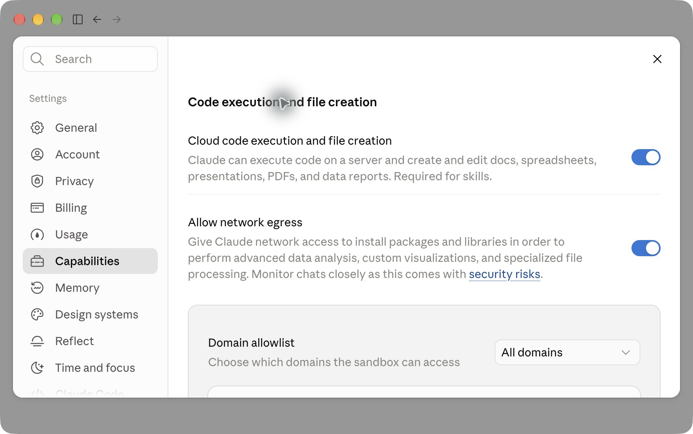
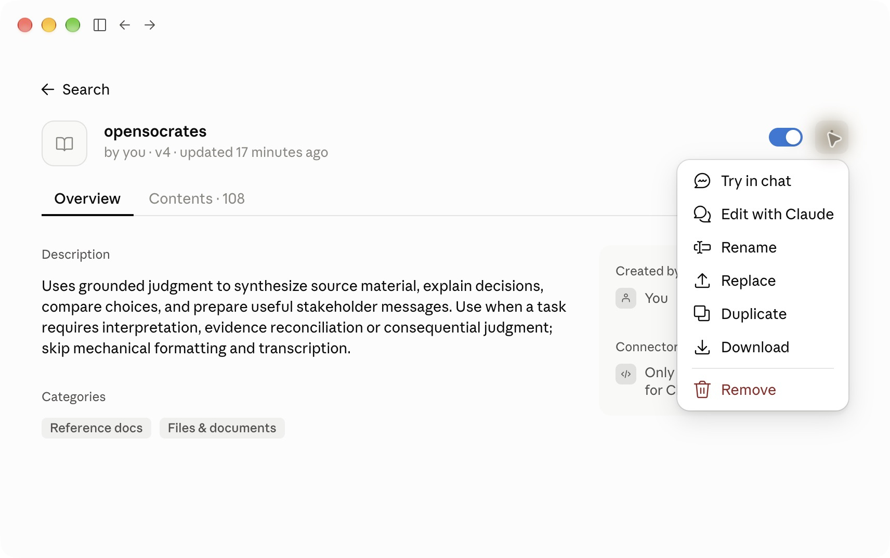
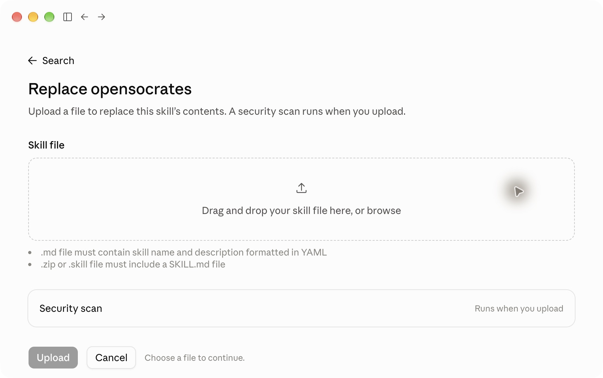
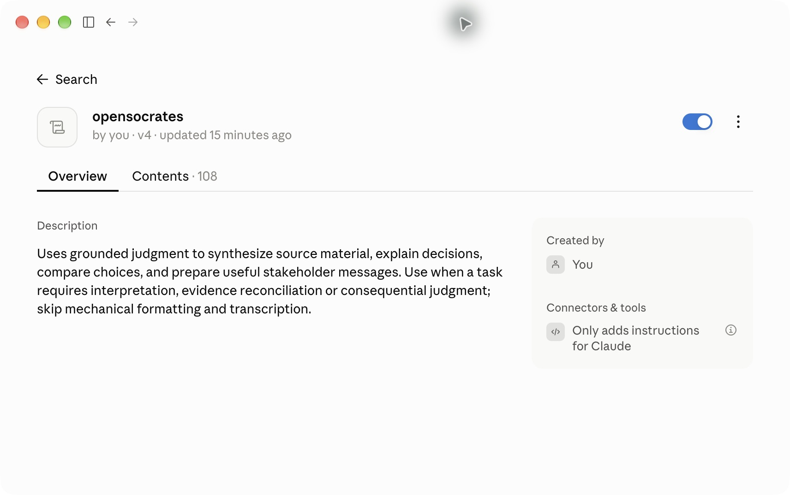
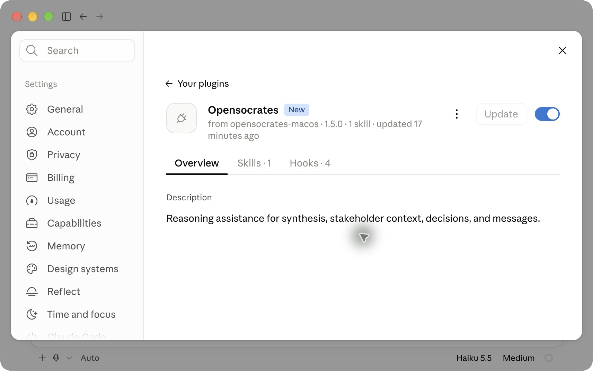
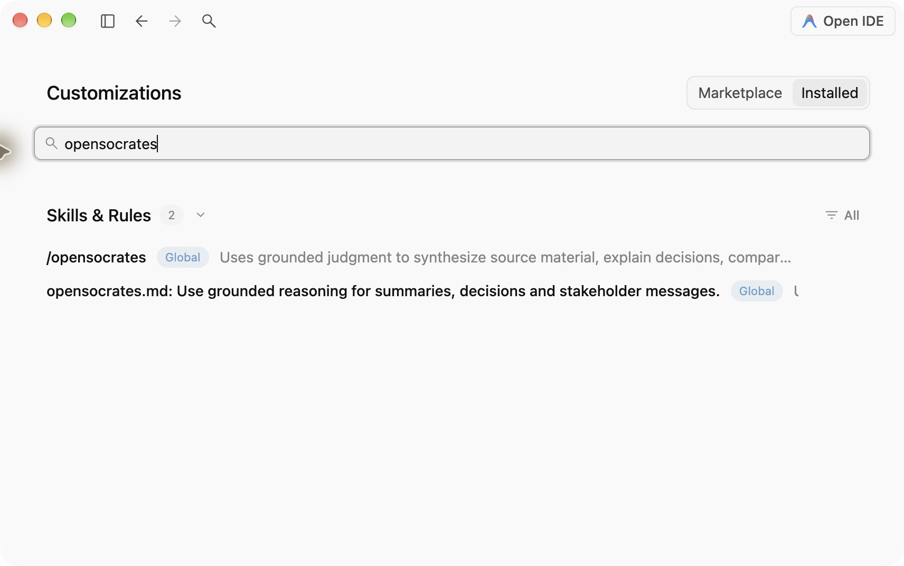

# OpenSocrates 1.6 설치 후 설정 가이드

이 문서는 네이티브 v1.6.0 후보의 설치 후 호스트 설정 안내입니다. 아직 출시하지
않았으며 현재 후보 설치·인수 명령과 릴리스 조건은 [네이티브 안내](native-v1.6.ko.md)를
따릅니다. 기존 v1.5 화면은 당시 UI 관찰이며 Go 설치 검증 증거가 아닙니다.

[English](setup-guide.md) · [설치 명령과 지원 환경](../README.ko.md) · [네이티브 후보 안내](native-v1.6.ko.md)

설치가 끝났다면 **사용하는 앱의 항목만** 확인하세요. Codex는 훅 신뢰 승인이
필요합니다. Claude 계정 스킬은 기능과 스킬을 켜고 이름을 언급하지 않고 쓸
상시 지침을 한 번 추가합니다. Claude Code는 플러그인이
켜져 있어야 합니다. Antigravity는 설치된 규칙과 스킬을 확인하면 됩니다.

지침 설정 단계는 2026년 10월 12일에 갱신했습니다. 10월 10일 캡처는 macOS의
Claude Desktop 2.31226.1과 Antigravity 2.22.0에서 가져왔습니다. Codex CLI 0.145.0의 명령과
공식 훅 안내를 확인했습니다. Windows 화면 캡처는 포함하지 않았으며, 메뉴 이름은
앱 버전·언어·계정 정책에 따라 달라질 수 있습니다.

## 어디까지 자동으로 되나요?

| 사용하는 곳 | 설치 프로그램이 처리하는 일 | 설치 뒤 확인할 일 |
| --- | --- | --- |
| Codex | 패키지 검증, 플러그인 등록·활성화 | `/hooks`에서 OpenSocrates 훅 신뢰 상태 확인, 필요한 승인, 새 대화 |
| Claude 웹·Desktop Chat·Cowork | 계정용 ZIP 검증·내보내기 | 올바른 계정에서 코드 실행·스킬 켜짐 확인; 이름 없이 사용할 상시 지침 저장 |
| Claude Code · Mac 로컬 | 네이티브 플러그인 설치·등록·활성화 | 로컬 Code 환경에서 플러그인 켜짐 확인, 새 세션 |
| Antigravity | 선택한 전역 또는 작업 공간에 규칙·스킬 배치 | 해당 범위의 규칙·스킬이 앱에 보이는지 확인, 새 대화 |

**`--host all`은 Codex만 뜻합니다.** 다른 앱은 각각 지정해야 합니다.
Windows의 Claude는 계정 스킬을 사용합니다. Windows 네이티브 Claude Code는
이번 범위에 없습니다.

## 에이전트에게 맡기기

컴퓨터와 파일에 접근할 수 있는 에이전트에 아래 요청을 붙여 넣으세요. 대상 앱은
필요에 맞게 바꾸면 됩니다. 이 요청문은 네이티브 관리 명령과 호스트 화면을
사용하며, 별도의 `setup` 명령을 설치하는 기능은 아닙니다.

```text
승인된 OpenSocrates 네이티브 릴리스의 설치 후 설정을 마무리해줘.
별도 승인 없이 미출시 후보를 설치하거나 활성 설치를 교체하지 마.
대상은 현재 설치되어 있는 Codex, Claude, Antigravity야.
공식 설치 안내:
https://github.com/ParkerHwang/OpenSocrates/blob/main/docs/setup-guide.ko.md

운영체제, 네이티브 대상, 현재 버전과 활성 상태를 먼저 확인하고,
없는 설치는 설치하고 기존 설치는 승인된 네이티브 릴리스 패키지로 업데이트해줘.
이미 올바르게 설정된 항목은 다시 바꾸지 마.

Codex, Claude 계정 스킬, Mac 로컬 Claude Code, Antigravity를 구분해줘.
--host all이 Codex만 처리한다는 점을 지켜줘.
Antigravity는 전역·작업 공간이 중복되지 않게 하고, 의도적으로 꺼둔
테스트 사본과 관련 없는 설정은 그대로 둬.
Claude 계정 스킬을 교체할 때는 기존 파일과 켜짐 상태를 먼저 백업해줘.
계정 스킬 이름을 언급하지 않고 쓰도록 2-4의 상시 지침을 Instructions for
Claude(이전 Cowork: Global instructions)에 추가해줘. 기존 지침을 보존하고
내가 사용하는 각 계정에 설정해줘.

설치, 파일 검증, 플러그인 등록, 허용된 일반 설정과 완료 확인은 진행해줘.
로그인, 조직 관리자 권한, 실제 호스트의 훅 신뢰 승인처럼 내가 해야 하는
단계가 나오면 그 화면을 열고, 무엇을 왜 눌러야 하는지만 알려줘.
승인 기록을 임의로 만들거나, 승인 우회 옵션을 쓰거나, 전체 보안을 낮추지 마.

추가 모델 답변 테스트 없이 확인해줘.
마지막에는 앱별로 설치 버전, 켜짐 상태, 훅 승인 여부(해당할 때만),
내가 해야 할 행동, 확인하지 못한 항목을 구분해서 알려줘.
실제로 보지 못한 상태는 완료라고 하지 마.
```

에이전트에게 화면 접근 기능이 없다면 CLI 설치·검증까지만 맡기고 아래 화면
단계를 직접 진행하세요. 계정 로그인이나 조직 정책은 설치 프로그램이 대신
해결할 수 있는 항목이 아닙니다.

## 1. Codex: OpenSocrates 훅을 검토하고 승인하기

훅은 세션 시작 같은 시점에 실행되는 작은 프로그램입니다. Codex는 플러그인
설치와 훅 신뢰를 별도로 관리합니다. 새 훅이나 변경된 훅은 검토·승인 전까지
실행을 건너뜁니다. [공식 OpenAI 훅 안내](https://learn.chatgpt.com/docs/hooks)

1. 먼저 설치 상태를 확인합니다.

   ```sh
   ./opensocrates status --host codex
   ```

2. 평소 작업할 폴더의 터미널에서 **대화형 Codex**를 실행합니다.

   ```sh
   codex
   ```

3. Codex의 입력칸에 `/hooks`를 입력합니다. 일반 셸에 입력하는 명령이 아닙니다.
4. 출처가 `opensocrates@opensocrates`인 항목을 찾습니다. 실행할 명령과 출처를
   검토한 뒤, 신뢰하는 OpenSocrates 항목을 호스트의 신뢰 기능으로 승인합니다.
   이미 신뢰된 항목은 다시 승인할 필요가 없습니다.
5. OpenSocrates의 7개 항목이 승인된 상태인지 확인하고 새 대화를 시작합니다.

| OpenSocrates 훅 | 확인 목적 |
| --- | --- |
| SessionStart · UserPromptSubmit | 세션 시작과 요청 제출 시 진입 |
| PreToolUse · PostToolUse | 유지되는 호스트 연동 |
| PreCompact · Stop · SessionEnd | 문맥·응답·종료 수명 주기 연동 |

**완료 기준:** 플러그인이 켜져 있고, 현재 정의의 OpenSocrates 훅이 신뢰된 상태이며,
새 대화를 시작할 수 있습니다. `status`의 “installed”만으로 켜짐이나 훅 승인이
확인되는 것은 아닙니다. `codex hooks`라는 별도 셸 명령이나
네이티브 `./opensocrates manage diagnose --host codex`는 로컬 무결성만 확인하며
대화형 훅 검토를 대신하지 않습니다. `/hooks`는 Codex 안에 입력합니다.

Codex는 공식 CLI 절차로 안내합니다. 실제 화면 캡처는 아래 Claude와
Antigravity 항목에 있으며, [캡처 범위](assets/setup-v1.5/README.md)를 별도로 기록했습니다.

## 2. Claude 계정 스킬: 켜고 계정 지침 추가하기

이 항목은 **웹 Chat, Desktop의 일반 Chat, Cowork**용입니다. 로컬 Claude Code
플러그인과는 별도입니다. 브라우저와 Desktop이 서로 다른 계정이면 각 계정의
설정을 따로 확인해야 합니다.

### 2-1. Skills에 필요한 기능 확인

개인 계정에서는 `Settings → Capabilities`를 열어
**Cloud code execution and file creation**이 켜져 있는지 확인합니다.
Team·Enterprise에서 설정이 잠겨 있으면 조직 관리자에게 Skills와 코드 실행
허용 상태를 확인해 달라고 요청하세요.
[Claude 공식 Skills 안내](https://support.claude.com/en/articles/12512180-use-skills-in-claude)



그림 1. 확인할 항목은 위쪽의 **Cloud code execution and file creation**입니다.
아래의 네트워크 접근·모든 도메인 허용은 OpenSocrates 설치를 위해 추가로 켤
필수 설정이 아닙니다. 캡처에 보이는 기존 값을 그대로 따라 바꿀 필요는 없습니다.

### 2-2. 계정용 ZIP 업로드 또는 교체

처음 설치한다면 `Customize → Skills → + → Create skill → Upload a skill`로
이동합니다. 메뉴 이름이 바뀐 버전에서는 Skills의 만들기 메뉴에서 업로드를
찾으세요. `opensocrates-account.zip` 파일을 사용합니다.
네이티브 Code용 `claude-plugin.zip`과 구분하세요.

계정용 파일은 [릴리스 페이지](https://github.com/ParkerHwang/OpenSocrates/releases)에서
받거나, 기존 폴더 안의 새 절대 경로로 내보낼 수 있습니다.

```sh
./opensocrates export --host claude-chat --package /absolute/path/to/account.zip --output /absolute/path/opensocrates-account.zip
```

이미 OpenSocrates가 있다면 해당 스킬의 `… → Download`로 먼저 백업하고
켜짐 상태를 기록한 뒤 `… → Replace`를 선택합니다. 다른 스킬은 건드리지 않습니다.



그림 2. **Download → Replace** 순서로 기존 스킬을 보관하고 교체합니다.



그림 3. 계정용 ZIP을 선택하고 **Upload**를 누릅니다. 그림은 기존 스킬을 교체하는
화면이며, 처음 추가하는 화면의 제목은 다를 수 있습니다.

### 2-3. 켜짐 확인

업로드가 끝나면 `opensocrates`의 스위치를 확인합니다. 파란색 켜짐 상태로 두고
새 대화를 시작하세요.



그림 4. 오른쪽 스위치가 켜져 있습니다. 이름 아래의 `v4`는 Claude 계정에서 이
스킬을 수정한 회차입니다. **설치된 OpenSocrates 제품 버전과 다른 번호**입니다.
제품 버전은 `Contents → SKILL.md`의 `OpenSocrates v1.6.0 후보` 표기를 확인하세요.

<a id="claude-standing-instructions"></a>

### 2-4. 이름을 언급하지 않고 사용할 상시 지침 추가

스킬을 켜도 Claude의 자동 선택에서 누락될 수 있습니다. `/opensocrates`나
이름을 매번 언급하지 않고 일반 요청에서 쓰려면 아래 지침을 한 번 추가하세요.
계정의 기존 지침은 보존합니다.

1. **Settings → General → Instructions for Claude**를 엽니다. 일부 버전은
   Settings에서 **Instructions for Claude**를 바로 보여줍니다. 이전 Cowork
   화면은 **Settings → Cowork → Global instructions → Edit**를 엽니다.
2. 아래 문구를 추가하고 저장합니다. 웹과 Desktop의 계정이 다를 수 있으므로
   각 화면에서 실제 사용하는 계정에 설정합니다. 프로젝트에만 추가한 지침은
   해당 프로젝트 안에서만 적용됩니다.
3. 새 대화에서 자료 종합·비교·판단·메시지 작성 같은 작업을 OpenSocrates
   이름 없이 평소처럼 요청합니다.

```text
자료 종합, 선택지 비교, 판단, 메시지 작성처럼 해석이나 판단이 필요한
요청에서는 내가 이름을 언급하지 않아도 활성화된 OpenSocrates 스킬을 먼저
불러와 그 지침을 따르세요. 적용할 사고 방법의 전체 절차를 읽고 조건을
확인하세요. 단순 서식 변환 같은 기계적인 작업에는 불필요한 절차를
추가하지 마세요.
```

이 지침은 모델의 스킬 선택을 안내합니다. 네이티브 훅이나 매 턴 강제 적용을
추가하지 않으며 기계적인 작업에 사고 방법을 요구하지 않습니다.
`Powered by OpenSocrates`가 없다는 사실만으로 불러오기 실패를 판정하지 마세요.
[공식 계정 지침 안내](https://support.claude.com/en/articles/10185728-understanding-claude-s-personalization-features)
· [공식 Cowork 전역 지침 안내](https://support.claude.com/en/articles/13345190-get-started-with-claude-cowork)

**설정 완료 기준:** 올바른 계정에서 필요한 기능과 계정 스킬이 켜져 있고,
이름 없이 사용하기 위한 상시 지침이 저장돼 있습니다. 계정 스킬에는 Codex와
같은 네이티브 훅 승인 절차가 없습니다. 새 판단 과제에서 자동 선택을 관찰하는
일과 이 설정을 확인하는 일은 구분하며, 설치기의 내보내기 성공으로 실제
자동 선택을 증명하지 않습니다.

## 3. Claude Code: Mac 로컬 플러그인 확인

이 경로는 Apple-silicon Mac의 터미널 Claude Code와 Desktop **로컬 Code**용입니다.
Cloud·SSH·WSL이나 Windows 네이티브 Code 설치 완료를 뜻하지 않습니다.

```sh
./opensocrates manage diagnose --host claude
```

승인한 제품 버전, `enabled: true`, `integrity: verified`, `registration: confirmed`를
확인합니다. 설치된 항목이 의도와 다르게 꺼져 있다면
`./opensocrates enable --host claude`로 켤 수 있습니다.

Desktop에서는 **Code → Local → 입력칸의 + → Plugins → Manage plugins**로
이동해 OpenSocrates를 엽니다. 표시가 바뀐 앱에서는 Settings의 Plugins에서도
설치 목록을 확인할 수 있습니다.
[Claude Code 공식 설치 안내](https://code.claude.com/docs/en/plugins/install)



그림 5. 과거 v1.5 화면입니다. 현재 승인된 제품 버전과 켜짐 스위치를 확인합니다.
`Hooks · 4`는 이 플러그인의 구성 목록입니다. 계정 스킬 화면과 구별하세요.

터미널 Claude Code에서는 `/plugin`으로 플러그인을, `/hooks`로 훅 출처와 내용을
볼 수 있습니다. **Claude Code의 `/hooks`는 읽기 전용 목록**입니다. Codex의
7개 훅 승인 절차를 여기에 그대로 적용하지 마세요.
[Claude Code 공식 훅 안내](https://code.claude.com/docs/en/hooks)

새 로컬 세션에서 실제 프로젝트 신뢰나 권한 안내가 나오면 대상 폴더·동작을
확인해 처리합니다. 조직의 훅 차단 정책이나 `disableAllHooks` 설정이 있다면
`/status`와 관리자 정책을 확인하세요. OpenSocrates 때문에 전체 권한을
무제한으로 바꿀 필요는 없습니다.

**완료 기준:** 올바른 로컬 플러그인이 켜져 있고 새 로컬 세션을 시작할 수 있습니다.
계정 스킬 업로드가 이 로컬 플러그인 설치를 대신하지는 않습니다.

## 4. Antigravity: 스킬과 규칙이 함께 있는지 확인

전역 설치라면 아래 명령을 사용합니다. 작업 공간 설치라면 설치 때 쓴 것과 같은
절대 경로의 `--workspace`를 확인 명령에도 붙입니다.

```sh
./opensocrates manage diagnose --host antigravity
```

승인한 제품 버전, `enabled: true`, `integrity: verified`와 원하는 `scope`를
확인합니다. **같은 작업에 전역·작업 공간 설치를 중복 적용하지 마세요.**

Antigravity 2.22.0에서는 **Customizations → Installed**를 열고
`opensocrates`를 검색합니다. `Skills & Rules`에 다음 두 항목이 보여야 합니다.

- `/opensocrates`: 필요한 내용을 읽는 스킬
- `opensocrates.md`: 스킬을 안내하는 상시 규칙



그림 6. 두 항목의 **Global**은 전역 설치를 뜻합니다. 작업 공간 설치는 선택한
프로젝트의 범위를 확인하세요. 다른 버전은 Customizations의 Rules·Skills 탭이나
프로젝트 설정에서 같은 항목을 보여줄 수 있습니다.
[공식 규칙 안내](https://antigravity.google/docs/rules) · [공식 스킬 안내](https://antigravity.google/docs/skills)

OpenSocrates의 Antigravity 배포는 규칙·스킬 파일 방식입니다. **별도 훅 승인
단계가 없고**, 위 화면의 Plugins 카드에 플러그인으로 보일 필요도 없습니다.
프로젝트의 일반 파일·명령 실행 권한은 해당 작업을 할 때 별도로 적용됩니다.

**완료 기준:** 선택한 범위에서 스킬과 상시 규칙이 인식되고, 새 대화를 시작할 수
있습니다. 예전 대화는 제거·업데이트 전의 내용을 계속 가지고 있을 수 있습니다.

## 자주 헷갈리는 상태

| 보이는 상태 | 다음 확인 |
| --- | --- |
| 설치됐다고 나오지만 Codex가 훅을 쓰지 않음 | 설치와 승인 구분. 대화형 `/hooks`에서 현재 정의의 신뢰 상태 확인 |
| Claude에 스킬이 있지만 회색으로 보임 | 코드 실행 기능·조직 정책·해당 스킬의 켜짐 상태 확인 |
| `/opensocrates`를 언급해야만 Claude가 사용함 | 실제 계정에 2-4의 상시 지침을 저장하고 새 판단 과제에서 이름 없이 확인 |
| Claude Chat에서는 되는데 Code에서는 안 보임 | 계정 스킬과 로컬 플러그인 설치를 각각 확인 |
| Antigravity Plugins에 OpenSocrates가 없음 | Installed의 **Skills & Rules**에서 검색 |
| 업데이트했는데 `OpenSocrates grounding: …@3`가 나옴 | 실제 설치 버전, 다른 계정·범위의 오래된 사본, 기존 대화의 남은 문맥 확인 |
| `Powered by OpenSocrates`가 안 붙음 | 단순 작업·독자 안내만 쓴 답변은 표시 대상이 아님. 표시만으로 설치 실패를 판단하지 않기 |

`Powered by OpenSocrates`는 적합한 정본 방법을 전부 읽고 실제 적용한 답변의
조건부 표기입니다. 설치 상태·훅 승인·실제 읽기·적용·답변 품질은 서로 다른
확인 항목입니다. 이 문서를 따라 설정하는 데 추가 모델 답변 시험은 필수가 아닙니다.

## 더 자세한 설치·복구 안내

- [Mac 설치·업데이트·비활성화·제거](macos-v1.5.ko.md)
- [Windows 설치와 지원 범위](windows-v1.5.ko.md)
- [사용 표기와 결정 지점 계약](decision-points.ko.md)
- [캡처 범위와 출처 기록](assets/setup-v1.5/README.md)
