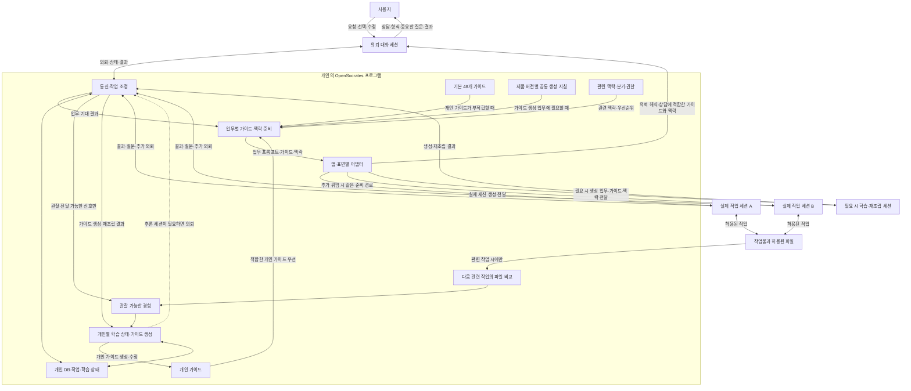
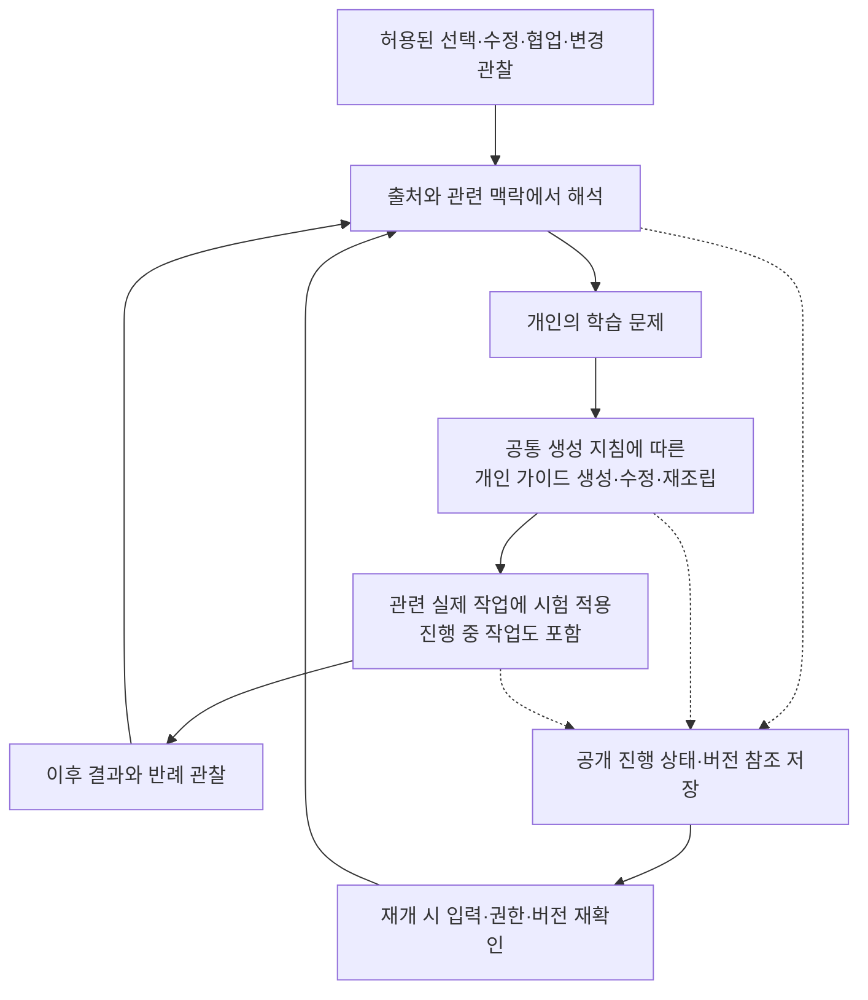

# OpenSocrates 2.0 시스템 설계와 데이터 흐름

상태: 2026-11-02 사용자 인터뷰를 반영한 개발 설계. 구현, 호스트 지원, 자동 학습의 효과를 입증한 문서가 아니다. 제품의 확정 방향은 [제품 정의](VISION_2.0.ko.md), 검증은 [검증 계획](VALIDATION_2.0.ko.md), 전체 진입점은 [시작 안내](README.ko.md)를 따른다. 이 문서의 계약과 상태 이름은 구현을 위한 제안이며, 실제 스키마를 추가하기 전에 검토한다.

## 1. 구현 경계

OpenSocrates 2.0은 한 컴퓨터에서 동작하는 프로그램과 개인별 데이터베이스를 갖는다. 기존 앱의 실제 대화 세션을 연결하고, 작업에 맞는 프롬프트·추론 가이드·맥락을 전달하며, 작업 경험을 바탕으로 개인 가이드를 발전시킨다.

초기 대상은 macOS와 Windows의 ChatGPT 데스크톱 앱과 Claude 데스크톱 앱이다. ChatGPT 앱 안의 Chat·Work·Codex를 제품 이름과 실행 표면으로 구분한다. Claude도 실제 계정의 통합 경험, Chat·Cowork·Code 표면과 로컬·클라우드 실행 위치를 기록한다. 같은 앱에 있다는 이유로 모든 표면이 같은 연결 기능을 가진다고 가정하지 않는다. Grok Bot·Cursor 등 추가 호스트와 여러 컴퓨터 사이의 동기화는 초기 범위 밖이다.

모델 제공자의 API를 직접 호출해 독립적인 에이전트 실행 환경을 만들지 않는다. 추론이 필요한 조정, 가이드 생성·재조립, 학습 판단도 지원되는 기존 앱의 대화 세션을 활용하는 방향으로 설계한다. 로컬 프로그램은 연결, 저장, 상태, 권한, 전달을 담당한다. 정확한 실행 언어, 데이터베이스 엔진, 모델 선택 기준은 아직 결정되지 않았다. SQLite 같은 내장형 트랜잭션 데이터베이스는 비교할 후보이며 확정 기술이 아니다.

기존 호스트 연결 기능을 우선 조사하고, 화면 조작이 필요하면 호스트가 제공하는 computer use 또는 검토된 오픈소스 도구를 활용한다. 특정 앱의 숨은 API, 설정 파일, 대화 데이터베이스를 임의로 수정하는 방식을 지원 계약으로 삼지 않는다. 스킬이나 연결 도구의 등록은 실제 메시지 전달·읽기·적용의 증거와 구분한다.

## 2. 세션과 프로그램의 책임

| 구성 요소 | 책임 | 구현 시 지켜야 할 경계 |
| --- | --- | --- |
| 의뢰 대화 세션 | 의도·결과물·형식 상담, 업무 프롬프트 준비, 가이드·맥락 준비 요청, 중요한 결정의 사용자 확인, 진행·결과 안내 | 실제 조사·분석·그래프·문서 작성·결과물 통합은 실행 세션에 맡긴다. |
| 실행 대화 세션 | 전달된 업무를 수행하고, 필요한 도움·질문·결과를 OpenSocrates에 전달 | 상대 세션에 직접 우회 전달하지 않는다. 추가 위임도 OpenSocrates에 요청한다. |
| 호스트 어댑터 | 앱·표면·모델·세션의 가용성 확인, 실제 세션 생성, 메시지 전달·응답 확인, 사용자 중단 반영 | 실제로 제공되는 기능만 사용한다. 화면 조작과 구조화된 연결은 동일한 증거 수준이 아니다. |
| 통신·작업 조정 | 의뢰·응답·협의·인계의 라우팅, 세션과 작업의 연결, 중복·대기 상태 관리 | 모든 관리 대상 에이전트 간 통신이 이 경로를 거치도록 한다. |
| 가이드 선택·재조립 | 적용 가능한 개인 가이드 선택, 필요시 조합·재조립 의뢰, 기본 가이드 대체 경로 | 모든 개인 가이드를 매번 주입하지 않는다. 가이드의 개수와 전달할 문맥의 크기를 구분한다. |
| 맥락 관리 | 사용자·프로젝트·업무·시점·분기·버전의 관련 정보와 우선순위 제공 | 과거 사실, 현재 사실, 가설, 사용자 선택과 권한을 혼동하지 않는다. |
| 백그라운드 학습 | 경험에서 학습할 문제를 찾고, 개인 가이드 생성·수정·시험 적용·재검토를 진행 | 공통 생성 지침을 스스로 바꾸지 않는다. 사용자 확인을 매번 요구하지 않되 중요한 결정은 기존 경계를 따른다. |
| 파일 관리 | 허용된 작업물의 조회·생성·수정·정리·버전 선택을 실행 세션에 연결 | 모든 폴더를 상시 감시하지 않는다. 메타데이터만으로 수정 의도나 작성자를 확정하지 않는다. |

고정 역할표나 역할별 `AGENTS.md`를 만들지 않는다. 에이전트에게 전달할 한 번의 업무 프롬프트는 해당 작업의 목적, 기대 결과물, 필요한 범위와 완료 판단을 명확히 한다. 아래의 통신 계약은 프로그램이 데이터를 안전하게 연결하기 위한 것으로, 사전 정의된 인격·직책·작업 절차를 강제하는 역할 Harness가 아니다.

## 3. 실제 작업의 데이터 흐름

1. 사용자가 의뢰 세션에서 대략적인 말을 한다. OpenSocrates는 이용 가능한 최소 요청·맥락으로 적합한 가이드를 준비해 의뢰 세션의 해석과 상담에도 전달한다. 완전한 의도 파악을 먼저 요구해 가이드 선택이 무한히 순환하지 않도록, 사용 가능한 초기 가이드나 범위가 좁은 정보로 시작하고 필요하면 다시 선택하는 경로를 설계한다. 현재 사용자 선택이 확인되면 이전 가이드나 과거 작업의 선택보다 우선해 보존한다. 의뢰 세션에는 실제 산출물이 아니라 해석·상담이라는 업무에 적합한 가이드를 사용한다. 실제 주입이 불가하면 그 상태를 드러낸다. 의뢰 세션은 목적·대상·결과물 형식을 살피고 필요한 선택만 상담한다. 이미 정해진 선택을 다시 유도하지 않는다.
2. 의뢰 세션은 업무와 기대 결과를 담은 프롬프트를 준비한다. 프로그램은 관련 가이드·맥락·권한을 묶어 실제 실행 세션에 전달한다. 가이드 재조립이 필요하면 그 작업도 별도 세션에 의뢰할 수 있다.
3. 실행 세션은 실제 작업을 한다. 도움이 필요하면 OpenSocrates에 요청한다. 프로그램이 적합한 앱·모델·세션을 선택하고 가이드·맥락 준비 경로를 다시 거친다. 원래 의뢰 세션이 모든 소통을 수동으로 중계할 필요는 없다.
4. 결과물 통합과 실질 검토가 필요하면 실행 세션에 맡긴다. 의뢰 세션은 실제 결과 참조와 확인 상태를 받아 사용자에게 전달한다. 완료 보고와 파일이 실제로 존재한다는 확인은 구분한다.
5. 사용자 선택과 관찰 가능한 작업 경험 중 보관이 허용된 정보만 학습 후보로 연결한다. 통신 과정의 원문을 학습 로그로 남기는 것은 허용되지 않는다.

의뢰·실행·재조립·학습 등 의미 판단을 맡은 각 세션에는 업무에 적합한 가이드와 필요한 맥락을 준비한다. 별도 학습·생성 세션에는 해당 제품 버전의 공통 생성 지침 전체 또는 제품이 완결된 단위로 정의한 모듈과 그 필수 의존·보호 조건, 필요한 입력 가이드 버전을 전달한다. 지침 일부가 누락된 채 전달됐다는 사실만으로 완결된 생성 지침이 적용됐다고 보고하지 않는다. 완결 모듈이라도 원문 대화·작업 공간 콘텐츠의 금지된 복제를 피하고 현재 사용자의 확정 선택과 유효한 권한을 보존하는 조건은 빠질 수 없다. 그 조건이나 필수 의존이 실제로 누락된 것으로 확인되면 해당 지침을 완결된 것으로 취급하지 않고, 그 불완전한 생성 결과를 개인 가이드로 저장·적용하지 않는다. 영향받지 않는 다른 업무는 계속한다. 반면 프로그램이 완결된 입력을 준비했지만 호스트가 수신·읽기 영수증을 제공하지 않는다는 사실만으로 누락을 단정하지는 않는다. 그 단계는 미확인으로 기록하며 없는 영수증을 전역 완료 관문으로 만들지 않는다. 프로그램이 완결 모듈을 조립했더라도 전송 어댑터가 실제로 넘긴 입력이 잘릴 수 있다. 지원되는 경로에서는 모듈 구성·개정과 전송 경계의 완전성을 원문 보관 없이 확인하고, 화면 입력 등 실제 전송 내용을 검증할 수 없는 경로는 그 한계를 미확인으로 둔다. 모듈 ID만으로 내용 전체가 도착했다고 주장하지 않는다. 해당 앱·표면·버전에서 실제로 확인된 유효 입력 한도를 조립한 내용이 넘는다면, 호스트가 반드시 어느 부분을 잘랐다고 추정하지 않되 전체가 전달됐다고 보지 않는다. 지원되는 재조립·분할·정본 조회 등 유효한 경로를 찾고, 필수 조건의 완전성을 확보할 수 없으면 영향받은 생성 결과만 보류한다. 한도 자체가 알려지지 않았다면 수치를 만들어내지 않는다. 모든 가이드를 일괄 주입하지 않고, 유효한 가이드가 없으면 일반 업무를 계속한다. 세션별 선택·전달·읽기·실제 사용은 관찰 가능한 수준에서 구분한다.

현재 전달 중인 메시지가 있다는 사실만으로 새 가이드가 모델에 들어갔다고 주장하지 않는다. 호스트 응답 확인, 가이드의 실제 전달, 읽기나 적용에 관한 증거, 결과물 품질은 각각 기록 가능한 수준에서 구분한다.

### 동적 분담과 통합: 사용자 중심의 한 팀

MoE는 업무별로 적합한 여러 능력을 선택하고 결과를 조합한다는 **제품 비유**다. 실제 모델의 전문가 라우터·가중치·성능이 작동한다고 주장하지 않는다. 고정 인격, 역할별 `AGENTS.md`, 항상 같은 인원 구성은 만들지 않는다.

에이전트의 이 업무에서의 특성은 고정 인격 대신 실제 앱·대화 세션, 확인된 모델과 도구 접근, 현재 맡은 일, 권한, 전달된 맥락 분기와 가이드 버전의 조합으로 기술할 수 있다. 호스트가 모델이나 내부 상태를 노출하지 않으면 그 항목은 미확인이다. 하나의 업무가 여러 세션을 쓰거나 하나의 세션이 후속 업무를 이어갈 수 있으므로, 업무·세션·모델·결과물을 하나의 정체성으로 합치지 않는다. 어떤 조합이 실제로 품질에 도움이 되는지는 평가 대상이다.

보고서 의뢰에서 분석과 문서 작성이 서로 밀접하면 한 실행 세션에서 처리할 수 있다. 그래프 제작에 다른 도구가 필요하거나 특정 부분의 독립 검토가 의미 있다면 별도 실제 세션을 동적으로 요청할 수 있다. 추가 세션은 각각 **이번 업무, 기대 결과, 필요한 자료와 범위, 적용 가능한 추론 가이드, 현재 사용자 선택·권한**을 받는다. 통신과 추가 위임은 OpenSocrates를 경유한다. 가이드 재조립이나 최종 통합도 필요하면 별도 실행 세션의 업무가 될 수 있다.

분담 판단에서는 실제 이용 가능한 앱·모델·도구·권한과 작업의 결합도, 재료 이전의 적합성, 관찰된 품질, 예상 지연·사용량과 사용자 부담을 함께 본다. 어떤 모델이 특정 작업을 잘한다고 이름만으로 가정하지 않는다. 한 작업의 발견이 다른 작업의 질문을 바꾸면 단순 병렬화가 잘못된 결과를 만들 수 있으므로 순차 작업이나 재조정을 고려한다. 병렬 실행이 빠르거나 저렴하다는 보장은 없다. 호스트의 제한, 지연과 재시도까지 실제로 측정한다.

결과 통합은 주장·출처·원본 자료 접근·현재 업무 범위를 살피며, 검토 세션의 자신감이나 모델 이름, 단순 다수결만으로 기존 결과를 바꾸지 않는다. 다른 세션이 올바른 수치를 잘못 고쳤거나 원자료 없이 반박했을 수 있다. 확인 가능한 근거가 있으면 확인하고 없으면 이견과 한계를 남긴다. 사용자가 실제로 정한 형식·방향과 유효한 권한을 지킨다. 세션 ID와 파일 ID는 다르며, 가이드 전달·결과물 존재·업무 품질의 근거도 다르다.

이 방식의 가치는 동등한 자료·도구·시간·사용량 조건의 단일 실행 세션과 호스트의 기본 기능을 대조해 평가한다. 세션 수를 늘렸는데 오류가 줄지 않고 지연·사용량·개입만 늘면 그 업무에서는 추가 분담의 근거가 부족하다. 이는 평가 가설이며 현재 구현이나 품질 개선의 증거가 아니다.

**합성 위임 예시.** 투자자 보고서의 실행 세션이 그래프를 별도로 의뢰할 가치가 있다고 판단했다고 가정한다. OpenSocrates가 새 세션에 전달할 단일 업무 요청은 “제공된 합성 코호트 자료에서 월별 잔존 추이를 그려, 축·단위·자료 출처가 표시된 수정 가능한 그래프와 이미지 파일을 돌려줘. 관측치가 없는 기간을 임의로 채우지 말고, 데이터가 부족하면 알려줘”처럼 작업과 기대 결과를 구체적으로 담는다. 여기에 **그 세션에 적합한 가이드와 허용된 자료·맥락**을 함께 전달한다. 최종 보고서가 Word라는 선택은 보존하지만 중간 그래프 파일까지 Word일 필요는 없다.

이후 그래프 세션은 산출물 참조와 확인 가능한 출처·한계, 추가 작업 요청을 계층으로 돌려준다. 통합을 맡은 실행 세션은 그래프의 단위와 원자료 일치 등을 확인하고 필요하면 이견을 다시 전달한다. 이 문장은 실험용 예시이며 정해진 직책, 특정 모델의 우월성, 자동 전달 성공 또는 실제 그래프 품질을 뜻하지 않는다.

### 위임한 결과를 이해하고 통합하기

위임할 때는 결과물이 어떤 판단에 쓰이는지, 관련 자료와 사용자의 결정, 작업 범위와 권한, 기대 형식과 확인할 근거를 해당 업무에 맞춰 전달한다. 프로그램은 적합한 가이드·맥락을 준비하되 고정된 직책 목록을 만들지 않는다. 반환된 파일의 존재, 작업자의 완료 보고, 입력과 지표 정의의 타당성, 계산, 시각화, 최종 문서 반영은 서로 다른 확인 항목이다. 다른 모델의 동의나 정확한 재계산도 **공유한 전제의 의미가 옳다는 증거가 아니다**. 통합 세션이 필요한 판단이나 도구를 갖추지 못하면, 영향과 비용을 살펴 허용된 도구나 다른 실제 세션에 해당 검사만 계층을 통해 맡길 수 있다. 모든 작업에 복수 검수를 강제하거나 추가 세션의 모델 이름을 품질 보증으로 취급하지 않는다.

**합성 사례:** 최초 집단의 인원은 A=100명·B=10명이고, 그 집단에서 1개월 관측은 A=80명·B=9명, 2개월은 A=70명·B=8명이며 3개월은 관측되지 않았다. 최초 110명 기준 비율은 각각 89/110≈80.9%, 78/110≈70.9%다. 반면 월별 합계만으로는 두 달에 모두 관측된 사람이 몇 명인지 알 수 없다. 78/89≈87.6%는 두 달 **인원수의 비율**이며, 2개월 인원이 1개월 인원의 부분집합이라는 근거가 없으면 동일인의 전월 대비 유지율이라고 확정할 수 없다. 재활성화 가능성과 원자료의 ‘관측·잔존’ 정의를 확인해야 한다. 예컨대 월별 인원은 같아도 교집합이 78명이면 동일인 유지율은 87.6%, 57명이면 64.0%다. 3개월 미관측을 0명이나 추정값으로 그리지 않는다.

이 사례의 단일 의뢰는 예를 들어 “의사결정용 Word 보고서에 넣을 수 있도록 제공된 자료의 최초 인원 기준 월별 비율을 그래프로 만들고, 분자·분모·관측 기간과 미관측 기간을 명시해 편집 가능한 원본과 이미지, 출처·한계를 돌려줘. 동일인의 전월 유지율은 정의와 교집합을 확인할 수 없으면 만들지 마”처럼 쓸 수 있다. 작업에 맞는 개인 가이드 또는 기본 가이드와 허용된 맥락을 함께 전달한다. 원자료와 정의가 제공되면 자료에 맞는 계산을 다시 확인하고, 그래프에 실제 반영된 값과 축·단위·결측 표현을 대조한다. 파일이 열리는 것과 차트 데이터가 원하는 위치에서 실제로 수정되는 것은 별개이며, 이미지 삽입만으로 Word 안의 차트 편집성을 입증하지 않는다. 최종 Word의 수치·캡션·의미가 확인된 그래프와 일치하는지도 살핀다. 필요한 경우 다른 경로의 검토를 요청하되 같은 원자료·같은 잘못된 가정을 공유할 수 있음을 드러낸다.

정의가 불명확하면 허용된 원자료의 열 설명·이전 지표 정의·해당 의사결정의 목적을 먼저 살핀다. 조건부 동일인 유지율이 중요한데 여전히 알 수 없으면 교집합 자료나 중첩 가정을 확인하는 구체적인 질문을 한다. 최초 인원 기준만으로 목적을 충족한다면 없는 값을 만들거나 불필요하게 질문하지 않는다. 원자료를 못 보면 산술과 내용의 확인 범위를 미확인으로 남기고, 검증할 수 있는 다른 부분은 진행한다. 지표 정의·데이터·사용자 선택이 바뀐 뒤 구판 결과가 도착하면 현재 업무의 최신 결과로 혼동하지 않고 관련 범위를 재검토한다. 문서가 따로 전달돼도 독자가 의미를 오해할 수 있는 중요한 미확인은 적절한 정의·설명에 반영하며, 모든 결과물에 획일적 경고문을 붙이지는 않는다. 어떤 항목을 보류·대체·제공할지는 실제 중요도와 사용자의 권한 범위에 맞게 판단한다.

### 한 업무의 데이터 계약: 합성 예시

다음 ID·내용은 가상이며 실제 전송이나 구현의 증거가 아니다. 저장 필드의 최종 형태와 현행 정책 적합성은 구현 시 확정한다.

| 흐름 | 입력과 연결할 정보 | 상태와 근거를 구분할 점 |
| --- | --- | --- |
| 의뢰 준비 | `task=t1`, 목적=투자 판단 자료, 사용자 선택=Word, 맥락 분기=`b1`, 유효 권한 참조 | 사용자가 말한 선택, 에이전트의 독자·목차 가설, 제3자 자료의 주장을 분리한다. `t1`은 대화 ID가 아니다. |
| 가이드 준비 | `t1`에 적합한 개인 가이드의 버전과 범위, 없으면 적합한 기본 48개 중 선택; 필요하면 별도 재조립 결과 참조 | 선택한 ID는 가이드 전달·읽기·활용의 증거가 아니다. 정본 절차를 그대로 적용할 때는 해당 절차의 전체 조건을 따른다. |
| 실제 세션 위임 | `message=m1`, `task=t1`, 목적지 앱·실제 세션 `s1`, 단일 업무 요청, 기대 결과, 관련 가이드·맥락·결정·권한 | 메시지 원문은 허용된 실시간 전달에만 취급한다. 프로그램 DB에 원문을 저장한다고 전제하지 않는다. 앱이 세션 생성·전달을 확인할 수 없는 단계는 미확인이다. |
| 그래프 추가 위임 | `s1`이 계층에 요청 → 자식 업무 `t2`, 메시지 `m2`, 실제 세션 `s2`; `t2`의 목적은 그래프 | Word는 최종 보고서의 결정이며 PNG 같은 중간 파일을 Word로 만들라는 뜻이 아니다. `s2`와 그래프 파일은 다른 식별자다. |
| 결과와 통합 | `t2`의 파일 참조 `a2`, 검증 가능한 출처·상태가 계층을 거쳐 `t1`의 실행 세션으로 돌아감 | 파일 존재, 가이드 수신, 숫자 정확성과 최종 결과의 유용성은 각각 다른 관찰이다. 수신할 경로가 없으면 완료를 꾸미지 않는다. |
| 수정과 학습 | 사용자가 작업 중 구조를 변경하면 유효한 선택의 새 버전을 관련 작업에 전달하고, 경험은 개인 학습 후보로도 검토 | 전달 불가면 진행 중 적용은 대기한다. 이번 업무의 확정 지시가 곧바로 전역 선호인 것은 아니며, 가이드 생성과 그 효과도 별개다. |

## 4. 가이드의 생성·선택·재조립

### 가이드의 세 종류

| 종류 | 변화 주체 | 수명과 사용 |
| --- | --- | --- |
| 기본 48개 추론 가이드 | OpenSocrates의 정식 콘텐츠·버전 관리 | 설치 직후 사용하며, 해당 작업에 적합한 개인 가이드가 없을 때 사용한다. |
| 공통 가이드 생성 지침 | OpenSocrates 버전업 | 모든 사용자의 공통 기반이다. 개인 학습이 직접 수정하지 않는다. |
| 개인별 생성 가이드 | 해당 사용자의 학습 로직 | 실제 경험에 맞게 발전한다. 고정된 가이드 개수 제한은 두지 않으며, 업무마다 관련 부분을 선택한다. |

개인 가이드의 생성 버전은 생성 지침 버전, 참조한 가이드 버전, 적용 범위와 허용된 근거 참조를 연결한다. 제품 업데이트가 기존 개인 가이드를 근거 없이 덮어쓰거나 전부 재생성하지 않도록 이행 규칙을 설계한다. 어떤 생성 지침 모듈과 보호 조건을 썼는지 식별할 수 없으면 해당 이력은 미확인으로 두고 현재 완결 지침을 따랐다고 주장하지 않는다. 그렇다고 모든 기존 가이드를 자동 삭제하거나 재생성하지 않는다. 기본 48개와 개인 가이드의 저장 위치·소유권도 구분한다. 개인 가이드는 사용자의 런타임 데이터이며 저장소의 정본 콘텐츠나 생성 지침을 덮어쓰지 않는다.

### 선택 경로

1. 현재 사용자 요청의 목적, 프로젝트, 업무, 대상, 시점, 권한에 맞는 개인 가이드를 찾는다.
2. 적용 가능한 개인 가이드가 있으면 이를 우선 사용한다. 여러 가이드가 필요하면 선택·조합·재조립한다. 단순 이어붙이기만을 요구하지 않는다.
3. 적합한 개인 가이드가 없으면 기본 48개에서 적용 가능한 가이드를 사용한다. 모든 기본 가이드가 부적합하면 방법을 억지로 적용하지 않고 일반 작업을 계속한다.
4. 개인 가이드의 일부만 맞는 경우 해당 부분만 사용할지, 기본 가이드와 조합·재조립할지, 적합성이 부족해 기본 경로로 갈지를 상황과 필수 조건에 따라 판단한다. 적합한 개인적 사고 방향이 있는데 구현 편의만으로 항상 기본 경로를 택하지 않는다. 구체적 선택 정책은 실험하며 한 경로를 이미 확정된 사용자 결정으로 가장하지 않는다.
5. 재조립 결과를 이번 작업에서만 사용할지 재사용 가능한 개인 가이드로 남길지는 학습 로직이 맥락과 경험을 보고 판단한다. 저장이 곧 효과 검증이나 영구 채택을 뜻하지 않는다.

기존 48개의 정본 절차를 그대로 적용하는 경로라면 해당 언어의 전체 절차와 필수 의존·금지 조건·중단·공개 결과를 보존해야 한다. 내용을 일부만 발췌하거나 재조립한 결과를 정본 전체를 읽고 적용한 것으로 표시하지 않는다. 새로 재조립한 개인 가이드는 그 출처와 필수 조건을 검토할 별도 결과물이며, 정본을 바꾸는 경우는 제품의 별도 검토·버전 관리 대상이다. 이는 48개를 영원히 고정하라는 뜻이 아니라 기존 절차에 관한 현재 계약을 임의로 생략하지 않는다는 뜻이다.

적합한 기본 정본 절차 전체와 필요한 의존 내용을 호스트의 입력 한도 안에서 전달·읽을 수 없다면, 지원되는 정본 조회 경로를 먼저 살핀다. 서로 독립적으로 적용 가능한 여러 절차가 함께 한도를 넘는 경우, 적합성과 의존 관계를 검토해 실제 별도 세션에 각각 전체를 전달하는 방안도 후보이다. 조건을 검토한 재조립 가이드를 활용한다면 이를 정본 절차의 전체 적용으로 표시하지 않는다. 이런 경로가 불가능하거나 맞지 않아 끝내 전체 절차를 확보하지 못한 상태를 예를 들어 `procedure_not_fully_delivered`로 남기고 정본 적용에 성공했다고 말하지 않는다. 적용을 이미 시작해 발생한 필수 중단 조건은 지키며, 방법을 강제하지 않는 일반 작업이 가능하면 그 한계를 드러낸 채 계속한다. 실행 세션 자체가 없으면 의뢰 대화가 산출을 대신하지 않는다.

가이드가 늘어나도 모두 프롬프트에 넣지 않는다. 관련성 검색, 적용 범위, 전달 예산을 구분한다. 가이드 수를 임의의 고정 상한으로 자르는 대신, 저장 용량·검색 지연·중복·폐기 상태 관리의 한계를 실제 측정해 정책으로 공개한다. 검색에 외부 임베딩 API가 필요하다고 전제하지 않는다.

**합성 선택 사례:** 다음 달 이전 계획이 있는 사용자의 “뭐가 망할지 미리 생각해줘”에서는 실패 경로를 살피는 기본 가이드나 관련 개인 가이드를 후보로 찾을 수 있다. 다만 정본의 사용 조건과 필요한 계획 맥락을 확인하기 전에는 이름이나 검색 점수만으로 적용을 확정하지 않는다. 반면 “서비스 오류가 지금 터졌어. 일단 복구하자”는 요청에 계획의 미래 실패를 상상하는 정본 절차를 무리하게 적용해 긴급 복구를 늦추지 않는다. 필요한 지원을 맥락에 맞게 고르고, 맞는 것이 없다면 일반 작업을 진행한다. “지난주 보고서처럼”이라는 요청에서는 허용된 이전 작업과 현재 프로젝트·형식을 살펴보고, 다른 프로젝트에서 유래했다는 이유만으로 적용이 허용된 범용 가이드를 전부 버리지 않는다. 형식이나 독자를 바꿀 결정적 모호성이 남을 때만 그 차이를 설명하고 묻는다. 이 사례는 특정 방법을 항상 고르라는 규칙이 아니다.

검색 결과가 없거나 제한된 후보만 보였다는 사실은 적합한 가이드가 없다는 판단과 다르다. 검색 누락을 ‘사용자가 그 가이드를 원하지 않는다’는 학습 근거로 바꾸지 않는다. 관련 후보를 놓쳤을 가능성이 있으면 상황과 지연을 고려해 질의·표현을 바꾸거나 허용된 범위에서 다시 살필 수 있다. 후보를 찾는 과정, 적용 조건·금기 판단, 정본 또는 개인 가이드 조립, 세션 전달·읽기·사용과 효과를 별도로 다룬다. 작업이 바뀌어 이전에 적합했던 가이드의 금기나 사용자 지시가 달라지면 새 상황에서 다시 판단한다. 아직 적용하지 않은 부적합 후보를 제외하는 것과 이미 적용을 시작한 정본의 중단 조건을 지키는 것은 다르다. 정본에 없는 개인 가이드는 독립적인 새 사고 방향이 될 수 있으며 정본의 하위 항목으로만 제한하지 않는다. 긴급 작업도 실제 실행 세션에서 처리한다는 요구와 유효한 권한을 지키며, 실행 세션을 열 수 없으면 시작했다고 꾸미지 않는다. 사용자가 거친 문장을 썼다는 이유로 매번 분류나 가이드 선택을 요구하지 않는다.

## 5. 개인 데이터와 통신 계약 제안

실제 정본 스키마는 `schemas/source/`, 프로그램은 `src/opensocrates/`에 구현하고 생성물은 기존 생성 절차를 따른다. 다음은 데이터를 식별하고 연결하기 위한 최소 계약의 제안이다. 모든 메시지 본문을 데이터베이스에 영구 저장하라는 뜻이 아니다.

| 계약 | 제안 필드 | 의미 |
| --- | --- | --- |
| `HostEndpoint` | endpoint ID, app/version, OS, surface, local/cloud location, available operations, model-selection capability, trust state, probe evidence | 앱 이름만으로 세션 생성·주입·응답 수신 가능성을 가정하지 않는다. |
| `TaskRecord` | task ID, project/branch IDs, intake session ref, execution session refs, goal summary, artifact refs, authorized scope ref, status, revision | 실제 작업과 대화 세션을 별개로 식별한다. 한 작업이 여러 세션을 사용할 수 있다. |
| `DispatchEnvelope` | message ID, task ID, sender/destination, parent message ID, retry identity, guide/context version refs, authority ref, expiry | 업무 프롬프트·가이드·맥락의 전달과 결과를 연결한다. 민감한 본문은 필요한 호스트 전달 시에만 취급한다. |
| `ContextRecord` | context ID, scope, branch/version/parent refs, source ref, timestamp, freshness, accepted/proposed/observed status, authority | 최신이라는 이유만으로 사용자의 의도나 권한을 바꾸지 않는다. 출처가 바뀌면 영향을 받는 사실만 재검토한다. |
| `GuideVersion` | guide ID/version, baseline/personal kind, scope, generator version, full-or-module manifest, module/safeguard revisions, pre-storage check revision/status, input guide refs, permitted evidence refs, hypothesis/active/retired status | 개인 가이드와 공통 지침의 소유권을 분리하고, 전달된 버전과 실제 사용의 확인 상태를 구분한다. |
| `LearningCheckpoint` | learning ID, question summary, input event IDs, public progress state, pending application refs, versions, revalidation need, revision | 숨은 추론이나 원문 대화를 저장하지 않고 학습 자체의 중단·재개 지점을 남긴다. |
| `ArtifactRecord` | artifact ID, allowed location ref, type, project/branch/task refs, fingerprint, observed timestamp, existing version ref | 파일 이동과 새 생성의 판별 가능성을 구분하고, 메타데이터가 수정 의도를 증명한다고 보지 않는다. |
| `AuthorityRecord` | authority ID, user/host origin, scope, allowed effects, limits, expiry/revocation, pending-confirmation state | 에이전트 출력과 과거 기록은 새로운 사용자 권한이 아니다. |

서로 다른 앱의 세션 ID는 앱/계정/표면과 함께 해석한다. 로컬 기록에는 가능한 범위에서 불필요한 계정 식별정보를 넣지 않는다. 수신자 검증 없는 전역 브로드캐스트와 모든 프로젝트를 포함하는 기본 문맥은 만들지 않는다.

## 6. 통신·동시성·복구

프로그램은 전송 요청, 실제 전송 시도, 호스트 접수, 응답 관찰, 작업물 확인을 별개 상태로 관리한다. 호스트가 접수 영수증을 제공하지 않으면 상태는 `sent_unconfirmed`처럼 미확인으로 남긴다. 화면에 버튼을 눌렀다는 사실을 접수나 완료로 승격하지 않는다.

로컬 DB의 작업·가이드·맥락 수정은 버전 전제조건과 트랜잭션을 사용하도록 설계한다. 두 세션이 같은 가이드를 갱신하면 마지막 저장으로 덮지 않고 두 제안과 근거를 보존해 충돌을 처리한다. 전송 대기 항목과 상태 변경을 연결하는 outbox는 구현 후보이다. 앱으로의 실제 효과까지 데이터베이스 트랜잭션으로 원자화할 수 있다고 가정하지 않는다.

재시도 ID는 OpenSocrates 내부 중복을 줄일 수 있지만 외부 앱에서의 정확히 한 번 실행을 보장하지 않는다. 전송 후 응답 전에 중단되면 먼저 기존 세션·결과를 확인한다. 확인할 수 없는 외부 효과는 맹목적으로 재실행하지 않고 `effect_unknown`으로 다룬다. 사용자 확인 대기와 호스트 권한 대기는 작업 실패와 구분한다.

대기 중인 가이드나 메시지를 커밋·전달하기 직전에는 현재 업무의 사용자 선택·권한, 가이드 버전과 삭제·철회 상태, 사용자가 지정한 학습 중지·사용 중지·재학습 금지의 적용 범위를 다시 판단한다. 학습만 중지한 것인지 기존 사용까지 금지한 것인지 맥락을 따른다. 설정이 바뀌면 이전에 준비한 대기 항목을 새 허가처럼 자동 전달하지 않는다. 다만 확인과 실제 호스트 전송 사이에도 사용자가 선택을 바꿀 수 있으므로 외부 앱까지 원자적 차단을 보장하지 않는다. 이미 전달됐을 수 있는 항목은 지원되는 취소·수정 경로를 시도하고 확인할 수 없으면 미확인으로 남긴다.

여러 세션이 하나의 화면을 조작하는 경우 앱·화면 자원에 대한 조정을 설계하고, 취소나 사용자 입력이 도착하면 재관찰한다. 로컬 앱 종료·기기 잠자기·오프라인·업데이트를 학습이나 전달의 영구 실패로 오인하지 않는다. 실행 불가능 상태에서는 대기와 남은 일을 기록한다. 여러 기기 간 공유나 전역 클라우드 서비스의 존재를 이 복구 설계에 전제하지 않는다.

## 7. 백그라운드 학습과 진행 중 적용

학습의 상태 예시는 `observed → interpreting → candidate → pending_application → observing_outcome → revised/retained/retired`이다. 중단과 취소는 별도 상태이며, 재개 시 마지막으로 확인한 단계와 미완료 효과를 복구한다. 이 목록은 실제 RL 알고리즘이나 검증된 채택 규칙이 아니다. 무수정, 침묵, 에이전트 간 합의만으로 성공을 확정하지 않는다.

진행 중인 관련 작업에 반영하는 기능은 목표에 포함한다. 다만 로컬 DB의 새 버전을 쓰는 것과 이미 실행 중인 모델의 문맥을 바꾸는 것은 다르다. 어댑터가 지원하는 다음 메시지·도구 호출·세션 이어가기 등 실제 진입점을 찾아 전달하고, 수신 여부를 확인할 수 있는 경우 그 버전을 추적한다. 수신이나 사용을 관찰할 수 없다면 미확인으로 둔다. 전달할 진입점이 없으면 `pending_application`으로 남기며 실시간 적용을 주장하지 않는다. 버전 고정만으로 진행 중 반영 요구를 제거하지 않는다.

가이드 생성·전달이나 모델 자신의 반복 보고를 새로운 독립 사용자 경험으로 재투입해 같은 가설을 계속 강화하는 순환을 피한다. 허용된 범위에서 입력 사건·가이드 버전과 파생 관계를 연결하고 동일 사건의 재시도는 중복으로 다룬다. 서로 다른 에이전트가 같은 근거를 반복한 것과 새 근거가 생긴 것은 다르다. 반면 에이전트가 실제 수치 오류를 발견하고 독립 자료로 확인한 경우처럼 새로운 관찰은 출처와 확실성에 맞게 다룬다. 새 신호나 관련 업무가 없는데 학습 세션이 서로 끝없이 다시 생성되지 않도록 진행 조건과 자원 예산을 설계한다.

반영 전에 해당 업무의 대상·목적·현재 사용자 선택과의 적합성을 판단한다. 일반 선호와 프로젝트 한정 수정, 외부 환경 변화, 다른 사람의 수정, 표현상의 변화, 실제 오류 교정을 구별해야 한다. 불명확한 신호는 맥락에 붙은 미확인 가설로 다룰 수 있으며, 강한 개인 선호로 승격하지 않는다. 구체적 보상, 채택·폐기, 회귀 탐지, 연산 예산은 검증 계획의 실험에서 결정할 항목이다.

사용자가 명시적 학습 지시 없이 개인화를 원한다는 제품 방향에 따라, 실제 최초 설치가 확인된 경우 학습을 자동으로 수행하는 초기 설정을 설계 후보로 둔다. 이 설정은 사용자가 중지하거나 변경할 수 있으며, 허용된 최소 설정만 보관한다. 최초 설치와 기존 설정 손상·삭제를 혼동하지 않도록 구분 경로를 시험한다. 사용자가 학습을 끄거나 일시 중지한 경우의 상태도 작업 자체와 분리한다. 그 뜻이 신규 학습만 중지하는지, 기존 개인 가이드의 사용까지 중지하는지는 사용자의 실제 지시와 맥락에 따른다. 명시적으로 중지된 학습을 재시작이나 로그인 때문에 자동으로 다시 켜지 않는다. 진행 중인 학습의 취소는 호스트가 지원하는 범위에서 시도하고, 이미 전송된 입력과 늦게 도착하는 결과가 다시 활성화되지 않도록 처리한다. 취소·전달 여부를 관찰할 수 없으면 미확인으로 둔다. 사용자가 늦게 도착한 학습 결과도 기록하지 말라고 했다면 그 결과 본문을 DB·로그·재시도 큐·색인·백업에 보관하지 않는다. 보관할 권한이나 정책상 근거가 없는 결과는 기본적으로 저장된 대기 본문이 있다고 가정하지 않는다. 그 결과의 재전송이나 호스트 대화 보관이 사용자의 금지 범위 또는 정책을 위반한다면 학습 세션에 다시 보내지 않는다. 취소·중복 방지에 필요한 상태도 허용된 최소 정보만 사용한다. 일시 처리 자체가 허용되는지와 호스트의 독립적 보관은 따로 판단한다. 중지는 자동 삭제가 아니며, 사용자가 나중에 다시 켜면 허용된 입력·현재 권한·가이드 버전을 재확인한다. 사용자 선택의 구체적 범위와 실제 호스트 동작은 구현·시험 대상이다. 학습 설정의 버전과 요청 당시 버전을 연결해, 중지 후 다시 켠 순간 이전 요청의 늦은 결과가 새 허가처럼 자동 반영되지 않도록 재검증하는 방식은 후보이다. 상태 기록과 결과 본문의 보관 허용 여부는 따로 판단한다. 사용자가 학습을 꺼 달라고 한 뜻을 유지하기 위한 최소 설정은, 기록 금지의 실제 범위가 이를 허용한다면 별도 학습 내용 없이 유지할 수 있다. 사용자가 그 설정까지 금지하거나 지우라고 했다면 그 상태를 저장했다고 가정하지 않는다. 기존 중지 또는 설정 손상이 확인된 재시작에서는 추측만으로 학습을 조용히 재활성화하지 않는다. 아무 영속 단서도 없는 경우 최초 실행과 이전 중지를 구별하는 기술적 경로는 별도 설계·검증이 필요하다. 필요한 중복 방지·재개 제어가 불가능해지면 해당 학습을 중단하고, 재시작 뒤 금지 상태를 기억할 수 있는 허용된 설정이 있는지 확인한다. 다른 사용자 업무를 전부 멈추지는 않는다.

설치·중지·복구 상태를 실제로 구분할 수 없을 때의 선택은 아직 열려 있다. 기본값으로 자동 학습을 시작하면 신규 사용자는 편하지만 이전에 학습을 끈 사용자의 뜻을 되살릴 수 없다. 학습만 대기하면 이전 중지의 침해 가능성은 줄지만 신규 사용자의 자동 학습이 지연될 수 있다. 켜면서 알리는 방식도 이미 중지한 사용자의 선택을 기술적으로 복원하는 것은 아니다. 허용된 최소 설정이나 설치 근거로 구분할 수 있는지 먼저 시험하고, 사용자가 모든 설정을 완전히 지우면서 이전 중지의 지속까지 요구하는 등 결과가 실제로 갈리는 경우에만 그 한계를 설명한다. 위 대안 중 어느 것도 이미 확정된 사용자 선택이나 검증된 기능으로 표시하지 않는다.

### 백그라운드 실행 수단의 후보

‘백그라운드’는 사용자가 별도로 학습을 지시하지 않아도 가능한 경험을 반영하고 중단 뒤 이어간다는 제품 목표다. 모든 폴더를 감시하거나 앱이 닫혀도 모델이 반드시 실행된다는 뜻은 아니다. 다음 수단은 서로 배타적인 사용자 결정이 아닌 비교 후보다.

| 후보 | 가능한 책임 | 별도로 확인할 점 |
| --- | --- | --- |
| 앱·세션이 활성일 때 작업에 연결 | 현재 업무에서 관찰 가능한 수정과 협업 신호를 해석하고 관련 작업에 반영을 시도 | 해당 앱 표면이 프로그램 호출과 진행 중 재전달을 허용하는지, 전면 업무와 자원 경합이 생기는지 |
| 사용자별 로컬 프로세스 | 허용된 작업·학습 상태의 대기, 예약, 재시작·복구와 가능한 상태 전이 | 프로세스 수명·중지·재시작, OS 권한과 소비 자원. 프로세스 자체가 모델을 갖거나 닫힌 앱에 접근한다고 가정하지 않음 |
| 다음 관련 업무에서 이어가기 | 휴면 중 변경된 파일의 허용된 지문·이력을 비교하고 미완료 학습을 재개 | 이전 근거를 다시 읽을 수 있는지, 내용과 작성자를 알 수 없는 변경을 어떻게 표시할지 |

OS의 기능을 살펴볼 출발점으로 [macOS `SMAppService`](https://developer.apple.com/documentation/servicemanagement/smappservice)와 [Windows 작업 스케줄러](https://learn.microsoft.com/en-us/windows/win32/taskschd/about-the-task-scheduler)가 있다. OS가 프로세스를 시작할 수 있다는 설명은 기존 AI 앱에서 새 세션을 열거나 추론을 실행할 수 있다는 증거가 아니다. 시작·종료 설정과 호스트의 권한, 앱이 닫힌 상태, 로그아웃·절전, 실패한 학습의 재개는 실제 OS·앱별로 시험한다. 어떤 방식도 모든 폴더의 상시 감시를 전제로 하지 않는다. 백그라운드 작업의 빈도와 전원·배터리 영향도 측정하며, 짧은 주기의 무조건 반복을 기본으로 정하지 않는다.

## 8. 맥락 분기와 파일 관리

맥락 트리는 사용자가 쉽게 이전 방향으로 돌아가거나 관점을 바꾸게 하는 개념이다. 구현 후보는 출처와 부모 관계가 있는 버전 그래프이다. 실제 Git 사용이나 문맥 전환 시 디스크 파일을 자동으로 checkout하는 기능은 확정하지 않았다.

현재 사용자 요청과 유효한 권한을 보존한 상태에서, 업무·프로젝트·대상·시점·관련성에 따라 사용할 맥락을 선택한다. 과거 관점으로 돌아갔다고 현재 권한을 복원하거나 만료된 사실을 현재 사실로 취급하지 않는다. 서로 충돌하는 가격·마감·목표는 단순한 텍스트 병합 성공으로 해결하지 않는다. 우선순위 판단의 구체적 정책과 학습 가능 범위는 정본 계약에서 다룬다.

파일 관리자는 실행 세션의 파일 작업을 프로젝트·맥락·버전 참조와 연결한다. 기존 파일 수정, 새 버전 생성, 기존 폴더 정리를 일의 맥락에 맞게 판단한다. 모든 변경을 새 파일로 만드는 고정 규칙이나 모든 덮어쓰기에 확인을 요구하는 규칙을 사용자 결정으로 추가하지 않는다. 중요한 결정은 사용자 확인 경계를 따른다.

다음 관련 작업에서 기록된 상태와 실제 파일을 대조한다. 수정 시각은 변경 신호일 뿐 내용 차이를 증명하지 않으며, 동일한 해시 방식으로 계산한 서로 다른 지문은 바이트가 다르다는 근거가 된다. 구체적인 차이를 분석하려면 읽을 수 있는 이전 버전이나 동등한 이력이 필요하다. 없으면 변경 사실만 남기고 차이·수정자·이유를 만들어내지 않는다. 파일 이동, 이름 변경, 자동 서식과 실제 내용 수정도 구분해 평가한다.

### 구체 사례: 진행 중인 파일과 이전 맥락으로 돌아가기

이 사례는 동작을 관찰한 기록이 아니라 검증할 설계다. 현재 분기에서 작업 세션 A가 보고서 파일을 쓰고 있고, 사용자가 이전 기획 방향을 다시 살핀다.

1. **열람과 전환:** 과거 맥락을 보기만 하면 현재 결정이나 파일을 자동으로 바꾸지 않는다. 사용자의 말과 행위가 과거 방향으로 실제 작업을 이어가겠다는 뜻을 충분히 명확하게 표현한다면 특정 문구를 강제하지 않고 그 방향을 선택한다. 단순 열람인지 전환인지가 결과를 크게 바꾸고 맥락만으로 해결되지 않으면 구체적으로 묻는다.
2. **선택과 권한:** 선택한 분기의 목적·결정과 현재 시점의 사실을 출처와 시점으로 구분한다. 이전 분기 선택이 만료된 권한이나 옛 파일의 자동 복원을 뜻하지 않는다. 현재 사용자가 지시한 형식과 유효한 권한을 새 의뢰에 전달한다.
3. **진행 중인 파일:** A의 쓰기가 끝났는지 확인할 수 있다면 그 상태와 실제 파일을 먼저 살핀다. 확인할 수 없다면 완료나 취소를 추측하지 않는다. 기존 경로 수정, 허용된 별도 버전 생성, 쓰기 조정·대기 중에서 현재 지시·권한·파일 상태를 고려해 고른다. 명시적으로 맡긴 일반적인 기존 파일 수정을 매번 재승인받거나, 모든 방향 전환에 새 파일을 의무화하지 않는다. 같은 경로의 경쟁 쓰기가 진행 중이거나 종료 여부가 미확인이라면 그 경로에 동시 덮어쓰기를 보내지 않고, 가능한 쓰기 조정·대기 또는 허용된 별도 버전을 검토한다. 같은 파일이 꼭 필요한데 충돌을 해소할 수 없다면 미확인을 드러내고 중요한 선택은 사용자와 판단한다. 업무 기한이 임박하거나 지나도 경쟁 쓰기의 종료가 미확인인 같은 경로에 동시 덮어쓰기를 허용하는 이유가 되지는 않는다. 대기가 업무 기한을 넘겨 조용히 멈추지 않도록 가능한 대안을 살핀다. 별도 버전을 만든 뒤에도 옛 세션이 원래 경로에 구판을 쓸 가능성이 있다면, 사용자가 원래 링크를 열었을 때 최신본을 놓치지 않도록 확인 가능한 상태와 최신본 위치를 적절히 전달한다. 이 안내도 전달·수신 확인 상태를 따로 다루며, 실패했거나 확인할 수 없으면 사용자가 위치를 이미 안다고 기록하지 않는다. 진행 중인 다른 쓰기를 프로그램이 통제할 수 있다고 가정하지 않는다.
4. **결과의 귀속:** 작업 ID, 세션 ID, 파일 ID와 해당 결정·맥락 버전을 별도로 연결한다. 이전 방향의 결과가 늦게 오면 현재 결과와 혼동하지 않고 구판 가능성을 남긴다. 실제 사용 가능한 파일인지, 새 결정이 반영됐는지는 별도 확인이다. 이미 전달된 새 선택이 확인되지 않았다면 반영됐다고 말하지 않는다.
5. **외부 변경:** 다음 관련 작업에서 허용된 이전 지문과 현재 지문을 비교한다. 같은 방식의 해시가 다르면 바이트가 다르다는 근거이며, 같으면 바이트가 같을 가능성에 관한 근거지만 충돌 가능성 때문에 절대적 증명은 아니다. 어느 경우에도 작성자·의도나 업무상 적합성은 해시만으로 알 수 없다. 이전 내용이나 허용된 이력이 없으면 구체적 차이를 만들어내지 않는다.

이 사례의 평가는 전환 전후 결과의 유용성과 사용자 부담, 기존 파일 손실 여부, 대기와 구판 표시의 정확성을 함께 본다. 파일 이름이나 새 버전 수만으로 성공을 판정하지 않는다.

## 9. 보관·권한·신뢰 경계

현재 `AGENTS.md`, `CONTRIBUTING.md`, `SECURITY.md`를 그대로 준수한다. 원문 프롬프트·대화, 스크린샷, 작업 공간 내용, 자격증명, 숨은 추론, 텔레메트리를 수집·보관하는 기능을 이 계획이 허가하지 않는다. 디버그 로그·재시도 큐·DB 백업·파생 인덱스로 우회 보관해서도 안 된다.

실시간으로 허용된 작업을 수행하기 위해 내용을 읽거나 업무 프롬프트를 호스트에 전달하는 것과, 그 원문을 OpenSocrates의 별도 영구 저장소에 복제하는 것은 구분한다. 제품 DB에는 허용된 공개 결정 요약, 출처·버전·작업물 참조와 상태를 최소한으로 보관하는 경로를 먼저 설계한다. 개인 가이드에도 비밀이나 원문을 복제하지 않도록 점검한다. 파생 정보라는 이름만으로 현 정책을 충족했다고 가정하지 않는다.

기존 파일의 전체 스냅샷 보관이나 과거 대화의 영구 복제가 기능에 필요하다고 판단되면, 정확한 데이터 종류·목적·수명·삭제·동의 범위를 제시해 별도 정책 변경을 검토한다. 그 결정 전에는 호스트나 사용자가 이미 관리하는 접근 가능한 버전 이력을 참조하거나 변경 감지만 제공한다. 조용한 학습이 사용자에게 숨겨진 제어 불가능한 학습이 되지 않도록 열람·수정·중지·삭제·되돌리기 동작의 범위를 정한다. 기본 보관 기간과 초기 활성화 경험은 미정이다.

사용자, 호스트 정책, 에이전트 요청, 외부 문서의 출처를 유지한다. 작업물과 에이전트 메시지 안의 지시문은 사용자 권한이 아니며, 학습 문제를 발견했다는 이유로 공통 생성 지침이나 보안 경계를 바꿀 수 없다. 모든 관리 대상 통신을 프로그램을 통해 연결한다는 제품 목표와, 호스트 내부의 모든 행동을 강제 제어할 수 있다는 주장은 구분한다. 통신을 통제·관찰할 수 없는 표면은 완전 지원으로 표시하지 않는다.

실행 대화에서 사용자가 직접 바꾼 지시와 그 세션의 에이전트가 “사용자가 이렇게 말했다”고 보고한 내용은 출처가 다르다. 호스트가 메시지 작성자를 신뢰할 수 있게 구별해 노출하면 실제 사용자 지시의 범위와 시점을 기록할 수 있다. 이번 업무의 명시적 형식·범위 변경이 그 경로로 확인되면 해당 업무의 현재 선택을 갱신하고, 관련 후속 위임에 전달한다. 이 갱신이 자동으로 전역 선호나 새로운 권한이 되는 것은 아니다. 세션의 모델 보고만 있고 작성자·내용을 독립적으로 확인할 수 없으면 그 보고는 미확인 단서이며 새 사용자 권한으로 자동 승격하지 않는다. 해당 실행 세션에서 사용자가 직접 한 지시는 그 세션의 업무에 유효하게 반영할 수 있지만, 다른 세션에 전달하거나 중요한 권한·결정을 갱신할 때는 확인 가능한 출처와 결과의 중요성을 함께 판단한다. 확인 가능한 경로가 없으면 대기·불확실성을 드러내고 중요한 선택에 필요한 질문을 한다. 이 구분이 불필요한 재승인을 모든 업무에 부과한다는 뜻은 아니다. 실행 세션은 이미 허용된 업무·권한 범위 안에서 하위 업무 명세를 스스로 조정할 수 있으며, 모델이 보고한 변경도 출처와 불확실성을 붙여 관련 범위의 학습 후보로 다룰 수 있다. 이를 확인된 사용자 선택이나 새로운 권한으로 바꾸지는 않는다. 기존에 확정한 결정과 충돌하거나 범위를 넘어 중요한 결과가 달라지면 확인 가능한 경로와 사용자 의사를 살핀다. 예를 들어 기존 선택이 Word 3쪽인데 실행 세션이 사용자의 4쪽 변경을 보고하고 작성자를 확인할 수 없다면, 같은 업무의 기존 권한 안에서 이 보고를 출처가 표시된 잠정 변경으로 관련 하위 작업에 전달할 수 있다. 통합 단계는 옛 3쪽만을 확정 최신 결정으로 삼아 4쪽 결과를 자동으로 되돌리거나 위반으로 확정하지 않는다. 충돌의 확인 상태를 유지하고 결과에 중대한 차이가 남을 때 확인 가능한 사용자 지시를 살핀다. 잠정 보고는 다른 업무나 새로운 권한으로 자동 확장되지 않는다. 예를 들어 작업 문서의 주입 지시나 모델 착각에서 나온 미확인 보고가 사용자가 확정한 위험 설명의 삭제처럼 중요한 변경을 요구한다면, 기존 권한 안이라는 이유만으로 확정 지시처럼 처리하지 않는다. 확인 가능한 출처를 살피고 중요한 선택을 판단할 수 없으면 그 영향받은 변경을 보류하거나 사용자에게 필요한 확인을 한다. 낮은 영향의 작업 조정까지 일률적으로 차단하지 않는다. 분량만 바뀌었다는 보고만으로 실제 영향이 낮다고 단정하지 않는다. 결과물을 확인할 수 있다면 형식·분량·포함하거나 제외하기로 확정한 내용과 대조해 중요한 누락이나 충돌도 살피고, 확인할 수 없으면 그 영향은 미확인으로 둔다. 겉모양이 일치한다는 검사만으로 의미상 준수까지 증명하지 않는다.

### 로컬 저장·검색 후보와 검증해야 할 경계

[SQLite](https://www.sqlite.org/about.html)는 별도 DB 서버 없이 프로그램에 내장되는 트랜잭션 저장소이므로 한 컴퓨터의 2.0을 위한 **비교 후보**다. 가이드 본문과 메타데이터를 한 DB에서 함께 버전 관리하는 안은 파일과 DB의 별도 커밋을 줄인다. 가이드를 별도 파일의 정본으로 두는 안은 파일 단위 열람·편집이 쉽지만 파일과 DB의 충돌·중단 복구가 필요하다. 별도 파일도 보관이므로 어느 안이든 가이드·메타데이터·참조가 현행 정책에 부합하는지 각각 검토해야 한다. 단순히 ‘개인 가이드’ 또는 ‘추상화’라고 이름 붙인 것으로 원문 재현과 개인정보 유출 가능성이 사라지지 않는다. 정본 위치와 DB 엔진은 아직 결정되지 않았다.

SQLite의 [WAL 문서](https://sqlite.org/wal.html)는 읽기와 쓰기의 병행이 가능해도 동시 writer는 하나라고 설명한다. 로컬 프로그램이 짧은 상태 변경을 조정하고 버전 전제조건으로 경쟁 업데이트를 감지하는 방법은 후보이며, 모델 응답이나 외부 앱을 기다리는 동안 DB 쓰기 트랜잭션을 붙잡지 않는 방안도 검토한다. 지연·기아·충돌·복구는 실제 부하에서 측정해야 한다. DB의 원자적 갱신이 외부 앱의 세션 생성·메시지·파일 쓰기까지 원자화하지는 않는다.

[WAL·임시 파일 안내](https://www.sqlite.org/tempfiles.html)에 따르면 비정상 종료 뒤 `-wal`이 남을 수 있다. [SQLite `secure_delete` 안내](https://www.sqlite.org/pragma.html#pragma_secure_delete)는 일반 테이블의 설정만으로 FTS5 색인의 흔적까지 지워진다고 보장하지 않는다. [FTS5의 별도 `secure-delete`](https://www.sqlite.org/fts5.html#the_secure_delete_configuration_option)는 버전 호환성 제약이 있다. 따라서 금지된 원문을 애초에 DB·오류 문자열·색인·임시 파일·백업에 쓰지 않도록 데이터 경계를 설계하고, 허용된 개인 데이터의 삭제도 DB·WAL·색인·제품 백업·OS 백업/동기화 등 서로 다른 경계를 구분해 시험한다. 설정 하나, 체크포인트 또는 단일 문자열 검사만으로 저장장치의 완전 삭제를 보장하지 않는다. 복구·삭제·호스트 자체 기억은 별개의 범위다.

삭제 설계의 예비 순서는 **논리적 삭제와 잔존 정리의 분리**다. 제품이 관리하는 항목을 삭제·비활성화하고 재개 대기에서 되살아나지 않게 하는 DB 변경을 커밋한 뒤, 필요하다면 별도 단계로 체크포인트와 색인·제품 백업의 정리를 시도한다. 같은 연결에서 트랜잭션이 열려 있으면 [체크포인트가 잠겨 시도되지 않을 수 있다](https://www3.sqlite.org/matrix/ev/src/main.html). 다른 읽기 작업, 중단 또는 실패로 정리가 끝나지 않으면 완료로 승격하지 않고 정리 대기·실패·재시도 상태를 둔다. 이는 검증 전 후보이며 OS 백업·동기화·기기 저장장치·호스트 메모리까지 제거됐다는 약속이 아니다. 2026-11-03 macOS의 Python SQLite 3.53.4와 임시 합성 DB에서는 열린 쓰기 트랜잭션 중 `wal_checkpoint(TRUNCATE)`가 `database table is locked`를 반환했고 롤백 후에는 성공 상태를 반환했다. 이는 그 환경에서 한 좁은 관찰이며 제품 삭제·복구 기능의 검증이 아니다.

오래된 읽기 스냅샷이 외부 앱 응답을 기다리는 동안 삭제된 가이드를 계속 보거나 잔존 정리를 지연할 수 있다. 외부 작업을 기다릴 때 읽기·쓰기 트랜잭션을 오래 유지하지 않는 설계를 검토하고, 결과를 커밋·전달하기 직전 현재 가이드 버전과 삭제·철회 상태를 재확인한다. 출처를 연결할 수 없는 파생 후보, 이미 호스트로 전달된 문구, 예전 백업 복원과 외부 호스트 자체 기억에는 이 확인만으로 삭제를 보장할 수 없다. 각각 관찰 가능한 취소·복구·미확인 상태를 정의하고, 예전 대기 작업이나 백업에서 삭제된 내용이 되살아나는지 시험한다. 삭제된 가이드와 나중에 독립적인 새 경험에서 생긴 유사 후보의 구별은 추가 설계가 필요하다. 같은 macOS·SQLite 3.53.4의 임시 합성 DB에서 먼저 시작한 읽기 트랜잭션은 다른 연결의 삭제 커밋 뒤에도 이전 행을 읽었고, 그동안 `TRUNCATE` 체크포인트는 busy를 반환했다. 읽기 트랜잭션 종료 뒤에는 성공 상태를 반환했다. 이는 SQLite 동작의 제한된 관찰이며 2.0의 복구 처리가 동작한다는 증거가 아니다.

사용자의 “이번 일에는 쓰지 마”, “이 가이드를 꺼”, “지워”, “앞으로 비슷한 방식도 배우거나 적용하지 마”는 같은 명령이 아니다. 의도와 범위를 현재 맥락에서 판단하고, 실질적으로 다른 결과가 생기는데 판단할 수 없는 경우에만 차이를 설명해 묻는다. 기존 가이드의 ID를 차단하는 것은 다른 문구로 다시 생성된 비슷한 생각까지 막는 것과 다르다. 반대로 의미적으로 유사한 새 후보까지 막으려면 금지 범위에 관한 어떤 표현을 보존·비교해야 할 수 있다. 그 표현 자체가 사용자가 지우려는 정보나 금지된 내용이 아닌지, 해당 기능과 권한이 허용되는지 검토한다. 해시만으로 모든 의미적 유사성을 차단하거나 외부 호스트의 기억까지 지운다고 약속하지 않는다. 완전한 망각과 유사한 방식의 미래 재학습 금지가 충돌하는 경우에는 사용자 선택을 존중하되, 해결되지 않은 경계를 숨기지 않는다.

예를 들어 사용자가 `g1`을 지우고 그 접근을 앞으로 적용하지 말라고 했는데, `g1`이 다른 가이드 둘과 재조립된 `g3`에 기여했다면 `g1`만 목록에서 지우는 것으로 충분하지 않을 수 있다. 허용된 계보가 남아 있으면 영향을 받는 `g3`와 대기 작업을 찾아 해당 지시와 관련된 부분을 제거·재조립하거나 대기시키는 방안을 검토한다. 출처가 불완전하면 정당한 다른 부분을 무조건 삭제하거나 금지한 내용이 사라졌다고 단정하지 않는다. 계보에 ID만 남고 삭제된 `g1` 본문을 확인할 수 없다면 ID만으로 `g3`의 어느 문장이 그 영향을 받았는지 확정할 수 없다. 삭제된 내용을 백업에서 몰래 복원하거나 뜻을 지어내 비교하지 않는다. 남아 있는 허용된 입력만으로 다시 구성하는 후보도 금지한 의미가 빠졌다고 자동 증명하지 못한다. 사용자가 해당 접근을 앞으로 적용하지 말라고 명시했고 알려진 파생 가이드에 영향이 있는지 판단할 수 없다면, 그 영향받은 가이드는 확인·수정 전까지 실제 적용을 보류한다. 단순 삭제와 향후 적용 금지의 범위는 사용자의 말과 맥락에 따라 구분한다. 이미 다른 세션에 전달된 내용은 호스트가 지원하는 수정·취소만 시도하고 확인 불가 상태를 보존한다. 이는 검증할 사례이지 현재 동작이나 모든 의미적 재등장을 방지한다는 보장이 아니다.

가이드 검색은 권한·명시적 범위에 의한 제외와, 그 안에서의 관련성 판단을 분리한다. 다른 프로젝트라는 이유만으로 적용이 허용된 범용 개인 가이드를 일괄 제외하지 않는다. 구조적 범위 필터, 허용된 데이터에 대한 어휘 검색, 기존 앱 세션의 의미 판단을 조합하는 방식과 소규모에서 전체 후보를 살피는 방식을 비교한다. 필요한 후보를 필터가 놓쳤을 때의 재검색 경로도 설계한다. [FTS5](https://www.sqlite.org/fts5.html)의 trigram 부분 문자열 검색은 세 글자 미만 질의에 한계가 있고 어휘 검색 자체가 동의어·한국어 형태·의미적 적합성을 보장하지 않는다. 색인이 별도의 데이터 보관이라는 점도 정책 검토 대상이다.

2026-11-03 이 작업의 macOS 환경에서 Python 내장 SQLite 3.53.4의 **메모리 DB**로 단순 합성 문구를 검색한 관찰은 다음뿐이다: trigram `MATCH`에서 `형식`은 0건, `보고서`와 `한국어`는 각각 1건이었고, unicode61 `MATCH`에서 `외부`는 `외부의`와 일치하지 않았다. 이 작은 탐색은 다른 버전·Windows·대규모 개인 가이드의 검색 정확도나 제품 동작을 증명하지 않는다. 규모별·언어별 합성 사례에서 관련 가이드의 재현율, 잘못 포함한 후보, 지연과 개인정보 보관·삭제를 함께 평가한다.

같은 환경에서 정본의 한국어 이름과 절차 전체 48개를 **메모리 DB에만** 넣고 문자열 전체를 따옴표로 감싼 FTS5 `MATCH`를 추가로 비교했다. 예를 들어 `실패`는 unicode61에서 8개 문서(사전부검 포함), trigram에서 0개였고, `근본원인`은 unicode61에서 0개, trigram에서 1개(근본원인분석 포함)였다. `뭐가 망할지`는 둘 다 0개였다. 조회 문자열과 기대 후보는 직접 고른 탐색 사례이며, 적중이 적용 적합성의 정답인지는 판단하지 않았다. 재현은 저장소 루트에서 `python3 docs/v2.0/examples/canonical_search_probe.py`로 한다. SQLite 버전·FTS5 지원과 실제 정본 파일의 버전을 함께 기록한다.

이는 단순한 정확 구절 매칭의 관찰이다. 실제 1.x의 모든 호스트가 FTS를 쓴다는 뜻이나 2.0 검색 구현·개인 가이드 검색·언어 간 성능의 증거가 아니다. 현행 1.x에는 호스트별 경로가 있으며, 예컨대 저장소의 in-turn `decision` 경로는 어휘 검색이 아니라 전달된 구조화 특성과 정본 목록을 사용한다. 이 관찰만으로 unicode61 또는 trigram 하나를 채택하거나 배제하지 않는다. 공개 정본을 메모리에서 검색한 실험의 허용 범위를 실제 사용자 요청·개인 가이드의 영구 색인에 자동 적용하지 않는다.

## 10. 호스트별 구현 전 조사

다음 항목을 앱·운영체제·표면·계정·버전마다 조사하고 증거를 남긴다. 현재 상태는 전부 2.0 구현 미검증이다.

| 조사 항목 | 확인해야 할 결과 |
| --- | --- |
| 세션 생성·찾기 | 실제 앱 목록에 새 실행 세션이 생기고, 프로그램의 작업 ID와 다시 연결되는가? |
| 모델 선택 | 원하는 모델을 선택할 수 있는가, 호스트가 자동 선택하는가, 프로그램이 결과를 관찰할 수 있는가? |
| 가이드·맥락 전달 | 내용이 실제 세션으로 들어가는가? 자동 스킬 선택, 직접 메시지, 지원 도구 중 어떤 경로인가? |
| 진행 중 변경 | 이미 일하는 세션에 새 가이드나 중요한 맥락을 실제로 전달할 수 있는가? |
| 반환 경로 | 결과·질문·추가 의뢰를 OpenSocrates가 관찰하고 원래 작업에 대응시킬 수 있는가? |
| 컴퓨터 조작 | 구조화된 기능이 없을 때 기존 computer use/오픈소스가 동작하는가? 동시 실행·사용자 중단은 어떤가? |
| 로컬 서비스 연결 | 해당 표면이 로컬 프로그램과 연결될 수 있는가? 앱이 클라우드에서 실행될 때 별도 경로가 필요한가? |
| 권한·취소·실패 | 필요한 호스트 승인, 허용 범위, 오류, 계정 만료, 재시도와 중단이 실제로 드러나는가? |

기능이 없는 표면에서 내부 앱 데이터베이스 수정, 무단 권한 확장, 모델 API 실행으로 몰래 대체하지 않는다. 가능한 준비 작업은 진행하고, 전달 불가·적용 대기·지원 미확인을 정확히 알린다. 4개 앱/OS 조합 중 한 셀의 성공으로 다른 셀을 통과 처리하지 않는다.

### 연결 경로의 후보와 제외된 대안

| 경로 | 관찰과 현재 판단 | 아직 증명되지 않은 것 |
| --- | --- | --- |
| 호스트가 지원하는 연결 도구 | [ChatGPT MCP 안내](https://learn.chatgpt.com/docs/extend/mcp)는 같은 Codex 호스트의 로컬 MCP와 호스팅된 Work를 구분하고, [Claude 연결 안내](https://support.claude.com/en/articles/11725091-when-to-use-desktop-and-web-connectors)는 로컬 확장·원격 연결과 표면별 차이를 설명한다. 실제 권한과 노출 범위를 확인한다. | 프로그램 호출이 가능해도 다른 실제 대화의 생성·메시지·결과 수신·중간 갱신이 되는지는 별개다. 계정·버전·OS별 관찰이 필요하다. |
| 기존 computer use·검토된 오픈소스 | 사용자가 허용한 후보 경로다. 작업 대상 앱과 사용자의 현재 입력을 관찰하고 충돌·중단을 처리하는 방식을 설계한다. | 각 표면의 화면 식별·실제 조작·동시성·접근성·사용자 중단·결과 귀속. 화면 조작 성공을 수신이나 품질의 증거로 격상하지 않는다. |
| 독자 앱에서 모델을 실행하는 SDK/서버 | [Codex 플랫폼 안내](https://developers.openai.com/blog/codex-as-a-platform)는 앱이 자체적으로 작업을 시작·유지할 수 있는 SDK·서버 경로를 설명한다. 이는 검토 가능한 기술 정보지만, 사용자가 현재 제외한 독자 에이전트 앱·별도 모델 실행을 조용히 대체 경로로 채택하지 않는다. | 기존 데스크톱 앱의 사용자가 볼 수 있는 실제 대화 세션과 동일한 경로라는 가정이나, 사용자가 범위 변경을 승인했다는 주장. |

[Claude의 데스크톱 딥링크 안내](https://support.claude.com/en/articles/14729294-open-claude-desktop-with-a-link)는 macOS·Windows에서 새 Chat·Cowork·Code 화면을 열고 입력창을 미리 채울 수 있다고 설명한다. 문서에서 `q`는 사용자가 검토해 보낼 수 있도록 입력창을 채우며 약 14,000자로 잘릴 수 있다. 따라서 **미리 채우기만으로 메시지 자동 전송·가이드 수신·실제 작업 세션의 완성을 주장하지 않는다**. 폴더를 지정하는 일부 경로에는 호스트의 확인이 있다. URL에 업무 원문을 넣으면 운영체제나 다른 도구의 이력·진단 경로에 노출될 가능성이 있으므로, 정책과 권한이 검토되지 않은 실제 사용자 내용을 URL 인자에 담는 설계를 전제하지 않는다. 필요한 시험에는 공개 가능한 합성 자료를 쓴다.

2026-11-03 이 회의에서는 공개 가능한 합성 문구를 담은 `claude://` 링크를 현재 대화의 인앱 브라우저로 열어 보려 했으나, 도구의 자동 승인 검토가 해당 프로토콜을 차단했다. 브라우저가 `http`·`https`만 허용하여 요청을 실행하지 않았다는 관찰이며, Claude 앱 자체가 딥링크를 지원하지 않는다는 증거는 아니다. 같은 동작을 다른 실행 경로로 우회하지 않았다. 실제 이 계정·OS에서 입력창 채움과 이후 단계는 여전히 미검증이다.

딥링크를 검토한다면 단계별 상태를 예를 들어 `link_requested → screen_opened → composer_prefilled → send_attempted → session_observed → result_returned`로 나눌 수 있다. 이는 제안된 상태 이름이며 실제 자동 조작을 전제하지 않는다. 각 단계가 관찰되지 않으면 미확인으로 두고, 입력창의 글자나 버튼 클릭만으로 실제 전송·가이드 수신·사용을 확정하지 않는다. 시간 초과 후에는 기존 화면·대화·결과를 확인 가능한 범위에서 살핀 뒤 중복 발송의 위험을 판단한다.

구체적인 비교 후보는 두 가지다. 첫째, 내용 없는 링크로 화면을 열고 허용된 computer use가 올바른 대상·입력 상태를 확인한 뒤, OpenSocrates가 제공한 업무·가이드·맥락을 일시적으로 전달하는 방식이다. 둘째, 비밀이 없는 짧은 참조만 입력창에 두고 대상 세션이 지원된 연결 도구를 통해 해당 업무의 허용된 내용을 가져오는 방식이다. 둘째 방식은 그 도구가 실제 노출되고 세션이 호출할 수 있을 때만 성립한다. 어느 쪽도 입력창을 채운 것만으로 자동 전송이나 사용자 대화 목록의 실제 세션 생성을 보장하지 않는다. 사용자가 직접 복사·전송하는 방법은 사용자가 선택할 수 있는 별도 경로일 수 있으나, 사용자를 에이전트 간 중간 전달자로 만들지 않으려는 제품 목표의 자동 경로 성공으로 세지 않는다. 클립보드·접근성·화면 조작·호스트 대화가 내용을 일시적 또는 지속적으로 보관하는 방식과 권한을 확인해야 하며, 실제 업무에서 원문이 금지된 기록 경로에 남지 않도록 설계한다. 결과의 회수와 추가 위임도 OpenSocrates를 경유해야 하며, 되지 않으면 별도로 미확인·대기다. 짧은 참조나 작업 ID는 수신자를 찾는 정보이지 그 자체가 파일·프로젝트 접근 권한이 아니다. 실제 지원되는 경로에서 사용자·업무·목적지·권한 범위를 검증할 수 있어야 하며, 검증되지 않는 수신자에게 비밀이 포함된 맥락을 전달하지 않는다. 같은 운영체제 사용자라는 사실이나 화면에 보이는 ID의 일치만으로 특정 대화 세션의 신원을 증명하지 않는다. 호스트가 필요한 바인딩을 제공하는지는 별도 검증이며, 불가능하면 그 민감한 전달 경로는 지원했다고 쓰지 않는다. 별도의 인증 방식으로 사용되는 일회성 수령표가 있다면 그것은 단순 작업 ID와 달리 노출 시 접근을 허용할 수 있는 비밀이다. 이를 URL·프로세스 인자·로그에 넣어도 안전하다고 가정하지 않고, 세션 바인딩·만료·재사용과 취소를 실제 지원 경로에서 검토한다. 호스트가 세션 신원을 증명하지 못한다면 짧은 수령표나 같은 OS 사용자만으로 신원이 증명됐다고 말하지 않는다.

MCP를 후보 경로로 검토할 때 규격 버전과 실제 호스트 지원을 구분한다. [MCP 2026-07-28 규격 안내](https://blog.modelcontextprotocol.io/posts/2026-07-28/)는 기존 `initialize` 교환과 `Mcp-Session-Id` 헤더를 제거한 무상태 코어와 별도 상태 핸들을 설명하며, [전송 규격](https://modelcontextprotocol.io/specification/2026-07-28/basic/transports)은 이전 버전과의 호환을 별도로 다룬다. 따라서 OpenSocrates의 업무·실제 앱 대화·권한 관계를 MCP 전송 세션 ID 하나에 의존해 설계하지 않는다. [MCP 보안 지침](https://modelcontextprotocol.io/docs/2026-07-28/tutorials/security/security_best_practices)은 상태 핸들의 소유만으로 인증하지 말고 요청의 권한을 검증하도록 명시한다. [MCP TypeScript SDK의 전환 안내](https://ts.sdk.modelcontextprotocol.io/v2/migration/support-2026-07-28)는 `clientInfo`와 `serverInfo`가 스스로 보고하는 정보이며 보안 판단에 쓰지 말라고 설명한다. 이전 [2025-11-25 전송 규격](https://modelcontextprotocol.io/specification/2025-11-25/basic/transports)에서 HTTP 세션 ID와 서버 전송 스트림은 선택 가능한 기능이다. 그 ID도 사용자에게 보이는 앱 대화의 신원과 같은 것으로 가정하지 않는다. 최신 코어의 요청과 선택적 구독, 이전 규격의 스트림 중 무엇을 각 호스트가 실제 제공하는지 확인해 진행 중 갱신의 push·pull·대기 경로를 설계한다. 각 앱이 어떤 MCP 버전과 호출·구독·갱신 경로를 실제로 제공하는지는 미확인이며, 규격 출판이 각 호스트의 구현이나 진행 중 가이드 주입을 증명하지 않는다.

[Claude Cowork 안내](https://support.claude.com/en/articles/13345190-get-started-with-claude-cowork)는 일부 클라우드 세션이 데스크톱 앱을 닫아도 계속되지만 로컬 파일·앱 접근에는 연결된 데스크톱 앱이 필요하다고 설명한다. [Claude 원격 MCP 안내](https://support.claude.com/en/articles/11175166-get-started-with-custom-connectors-using-remote-mcp)는 원격 연결 요청이 사용자 기기가 아닌 제공자 클라우드에서 출발한다고 밝힌다. 어느 설명도 로컬 DB에 대한 자동 연결을 보장하지 않으며, 이를 이유로 로컬 서비스를 임의로 공개하지 않는다. [ChatGPT computer use 안내](https://learn.chatgpt.com/use-cases/use-your-computer-with-codex)는 macOS의 백그라운드 화면 조작과 Windows의 전면 데스크톱 조작을 구분한다. 이는 문서상 출발점이며 이 제품·계정에서의 성공과는 별개다.

각 표면에서 허용된 경로가 없으면 그 경로의 제한과 미확인 상태를 드러낸다. 화면 조작을 원천 금지하지 않으며, 호스트의 승인·접근 제어를 우회하는 수단으로도 사용하지 않는다. 한 표면의 연결 가능성을 네 조합 전체에 일반화하지 않는다.

로컬 연결을 앱 프로세스로 한정해도 그 앱이 여러 대화에서 같은 연결을 공유할 수 있다. 연결과 핸들을 묶는 것은 접근 범위를 줄이는 후보이지 특정 대화의 신원 보증이 아니다. 앱이 파일에 접근할 수 있다는 사실도 어떤 대화에 그 파일의 존재·경로·내용을 알려도 된다는 권한이 아니다. 사용자 의뢰의 범위는 위임 판단에 필요하지만, 잘못된 수신자에게 보낸 업무 명세나 지침 자체가 노출일 수 있고 검증 전에 외부 효과가 생길 수도 있다. 수신자와 권한을 확인할 수 없는 민감한 전달·결과 귀속은 그 경로에서 보류하고, 이미 허용된 무관한 작업은 계속한다. 이 제한이 실제 사용자 업무를 얼마나 막는지는 앱별 실험으로 밝혀야 한다. 허용된 화면·호스트 중개 등 다른 경로의 가능성은 따로 평가하며 특정 MCP 구독 방식만 유일한 전달 수단이라고 단정하지 않는다.

실행 세션에 허용된 의뢰와 필요한 가이드·맥락이 이미 전달된 뒤 로컬 연결이 끊긴 경우, 그 세션은 이미 권한을 받은 독립 업무를 계속할 수 있다. 새 지침 수신이나 연결 없는 다른 세션과의 직접 협업을 레이어를 거친 성공으로 세지는 않는다. 전달 후 수신을 관찰할 수 없는 경우 수신 여부는 미확인으로 기록하되, 그 영수증 부재만으로 실행 전체를 중단하지 않는다. 처음부터 레이어를 거치지 않고 별도로 수행한 작업 역시 2.0의 자동 위임 성공은 아니다.

## 11. 설치·업데이트·이전

초기 프로그램과 어댑터는 기존 1.x 사용자 설정과 비활성화 상태를 확인하고, 소유한 파일에만 설치한다. 공통 생성 지침과 기본 가이드는 제품 버전에 연결하고, 개인 가이드·맥락의 저장 형식 버전은 별개로 둔다. 제품 업데이트는 진행 중 세션과 학습 상태를 중간 형태로 만들지 않도록 이전·실패 복구 순서를 갖춰야 한다.

언어·DB 엔진·패키지 형식·업데이트 기본값·지원 OS 최소 버전과 CPU 범위는 플랫폼 조사 및 구현 결정 기록으로 확정한다. 기존 Go 후보나 폐기된 v1.5 메모리 후보를 기본 구현으로 취급하지 않는다. 특히 저장소가 금지한 이전 후보의 코드·가이드를 복사하지 않는다. 설치·서명·재설치·롤백 주장은 실제 해당 환경의 증거로만 한다.

### 개인 가이드와 1.x 컨트롤러의 공존

현행 1.5.3 컨트롤러는 사용자 파일·도구 결과 등을 신뢰된 상위 지시가 아닌 자료로 취급하며, 기존 정본 방법을 적용할 때 전체 절차의 읽기를 요구한다. 이 경계가 2.0의 사용자별 가이드가 실제 세션에서 사용되는 방식과 어떻게 공존할지 아직 검증되지 않았다. 사용자별 가이드를 1.x의 기존 정본 방법인 것처럼 표시하거나, 반대로 단지 정본 48개가 아니라는 이유로 모두 배제하는 설계를 미리 확정하지 않는다.

현재 1.x 선택기의 정본 방법 입력은 기존 정본 계약을 유지한다. 검증되지 않은 개인 가이드를 그 선택기에 1.x 정본 방법으로 끼워 넣지 않는다. 2.0의 개인 가이드는 새 컨트롤러·연결 계약을 통해 사고 방향으로 제공하고, 향후 기존 선택기 자체를 바꾸는 경우에는 별도의 정본·신뢰 경계 검토를 거친다. 이는 개인 가이드 자체를 사용하지 못하게 하는 규칙이 아니다.

2.0 배포 설계는 제품이 관리하는 공통 생성 지침, 해당 사용자에게 속하고 허용된 범위의 개인 가이드, 제3자 자료와 사용자 권한을 구분하는 컨트롤러·호스트 연결 계약을 정의해야 한다. 개인 가이드는 상황에 맞는 사고 방향을 제공할 수 있지만, 그 안의 내용이나 원천 자료가 시스템 지시·사용자 권한·호스트 승인으로 승격되는 것은 아니다. 1.x와의 교체·공존·업그레이드 경로는 기존 설정과 비활성화 상태를 존중하며 별도 설계·시험한다. 새 신뢰 경계를 실제 호스트에서 전달하고 해석할 수 없다면 해당 기능을 미검증으로 둔다.

## 12. 공통 가이드 생성 지침의 작업 초안

아래는 회의에서 작성한 **개발용 지침 초안**이다. 배포되는 프롬프트나 정본 방법이 아니며 효과도 미검증이다. 제품 버전이 이 지침을 관리하고, 개인별 학습은 이 지침을 수정하지 않는다.

1. 이번 경험이 사용자 선택, 업무상 사실, 외부의 일회성 조건, 품질 교정, 협업 신호 중 무엇을 시사하는지 살핀다. 작성자·이유·일반성은 모르면 모른다고 둔다. 맥락 속 사실, 현재 의뢰의 제약, 사용자 권한을 개인 가이드와 혼동하지 않는다.
2. 재사용 가능한 접근이 보인다면 어떤 **상황에서 무엇을 생각하거나 어떻게 접근하면 좋을지**와 그 목적을 쓴다. 업무·과제 유형, 협업, 의사결정, 파일 관리, 설명 방식이나 상황에 맞는 선호도 다룰 수 있다. 사람을 성격 유형으로 낙인찍지 않으며 금지 목록이나 고정 역할로 축소하지 않는다.
3. 관찰 범위, 적합한 조건, 알려진 예외·불확실성, 허용된 근거 참조 및 참조 가능 상태, 생성 지침과 입력 가이드의 버전을 연결한다. 반례가 없다는 사실은 긍정 증거가 아니지만 반례를 만들어내거나 반례 작성·장기 관찰을 모든 후보의 생성 전제조건으로 만들지 않는다.
4. 관련 실제 업무에서 조용히 시험 적용하고 진행 중 업무의 반영 가능성도 살핀다. 근거가 약한 일반화는 그 불확실성을 유지하며, 비슷한 다른 프로젝트에의 적용은 관련성과 맥락을 보고 판단한다. 일정 횟수의 침묵을 성공이나 승격으로 간주하지 않는다. 부정적 경험이나 새로운 사용자 선택이 나오면 좁히고 수정·철회할 수 있어야 한다.
5. 여러 가이드를 조합·재조립할 때 현재 작업에서 사용자가 확정한 형식·목적·범위와 유효한 권한을 유지한다. 가이드는 새 권한을 만들지 않으며 관련성이 없거나 충돌하면 적용하지 않는다. 적합한 개인 가이드가 없을 때는 기본 48개 중 적합한 것을 사용하고 어느 것도 맞지 않으면 일반 작업을 계속한다.
6. 결과 가이드와 참조에 원문 대화·작업물·비밀이 복제되지 않는지 살핀다. ‘추상화’라는 이름만으로 보관이 허용된다고 판정하지 않는다. 저장 전 점검이 실패하거나 그 범위를 확인할 수 없으면 안전이 확인됐다고 표시하지 않고 영향을 받는 후보의 보관·적용 여부를 정책과 남은 근거에 따라 판단한다. 이 실패를 의뢰 상담이나 무관한 다른 업무 전체의 중단으로 넓히지 않는다. 점검기의 검증은 합성 양성 대조를 포함하고 탐지 한계를 기록한다. 허용된 상태 기록에는 사용한 점검기 개정과 결과를 연결하는 방안을 두어, 나중에 결함이 발견되면 영향을 받은 후보를 좁혀 재검토한다. 과거 점검 통과는 유출이 없다는 절대적 보증이 아니다. 입력이 사라져 해석을 뒷받침할 근거가 없다면 내용을 꾸미지 않고 해당 학습을 `input_unavailable`로 둔다. 이미 허용되고 충분한 근거가 남아 있다면 그 범위에서 할 수 있는 일은 별도로 판단한다.

**합성 예시:** 사용자가 외부 의사결정자를 위한 보고서에서 결정을 앞에 배치해 달라고 고친다. 후보는 “외부 의사결정용 보고서라면 독자가 내려야 할 결정을 먼저 파악하고 그 판단에 필요한 근거를 구성해 보라”이다. 해당 업무에서 먼저 시험하고 다른 상황에는 관련성을 판단한다. 사용자가 이 업무에 정한 Word 형식은 유지한다. 감사용 절차 검토처럼 과정 자체가 중요한 업무에는 그대로 이식하지 않는다. 이 예시는 가상의 설계 사례이며 효과의 증거가 아니다.

**또 다른 합성 예시 — 사고의 방향:** 사용자가 발주 수량을 검토하다 “평균 판매량만 보지 말고 출시가 늦어지는 경우도 생각해줘”라고 수정한다. 후보는 “불확실성이 큰 발주 판단에서는 평균 전망을 결론으로 바로 쓰기 전에, 결정을 바꿀 주요 가정과 합리적으로 가능한 다른 상황을 살펴보고 근거가 부족한 부분을 구분해 보라”이다. 이는 고정 서식이 아니라 어떤 가정과 대안을 검토할지에 관한 방향이다. 일회성 출시 지연, 업무별 위험 관리 방식, 사용자의 일반 선호 중 어느 것인지 확정하지 않고 관찰 범위와 불확실성을 남긴다. 관련 없는 확정적 업무에 억지로 시나리오를 추가하지 않는다. 가이드의 실제 효과는 동등 정보 메모와 별도로 시험한다.

### 학습 판단에 필요한 구분: 데이터 계약 초안

다음 필드는 설계를 설명하기 위한 후보이며, 실제 보관이 현재 정책에 허용된다는 판정이나 정본 스키마가 아니다. 필드·참조·가이드 본문 각각의 보관 필요성과 허용 여부를 구현 전에 검토한다.

| 단계 | 필요한 구분 | 잘못된 승격의 예 |
| --- | --- | --- |
| 관찰 | 신호 유형, 알 수 있는 출처, 업무와 시점, 현재 권한, 접근 가능한 근거, 불확실성 | 다른 사람이 파일을 바꿨을 수 있는데 사용자 개인 취향으로 기록 |
| 해석 | 이번 지시·업무 사실·외부 조건·반복 가능한 접근의 후보를 구분하고 가능한 귀속 대안을 남김 | 한 투자자의 요청을 모든 투자자와 모든 업무의 선호로 확정 |
| 생성 | 적용 상황, 생각할 방향과 목적, 알려진 예외, 초안 버전·근거와 신뢰 한계를 연결 | ‘더 좋게 해라’처럼 행동에 도움이 되지 않거나 원문을 복제한 가이드 |
| 선택·재조립 | 현재 작업과 사용자 선택·권한, 개인 가이드의 적합성, 기본 48의 대체 경로, 충돌과 전달할 범위 | 오래된 개인 가이드로 현재 사용자가 정한 결과물 형식을 변경 |
| 적용·경험 | 후보 생성·선택·전달·읽기·실제 사용·결과 평가를 각각 구분하고 관찰되지 않은 단계는 모름으로 둠 | ID 전달이나 모델 자기 칭찬을 실제 사용과 성공으로 기록 |
| 재검토 | 새로운 수정·품질 신호, 기존 해석과의 충돌, 관련·비관련 업무를 보고 유지·수정·범위 조정·철회 | 같은 자기 보고를 여러 독립 증거로 반복 집계하거나 침묵을 성공으로 계산 |

상충하는 해석은 더 최근에 기록됐거나 에이전트가 다수라는 이유만으로 확정하지 않는다. 그 업무에서 확인된 선택은 즉시 존중하면서, 개인 가이드의 장기 적용 범위는 남은 근거와 맥락에 비례해 판단한다. 사용자 확인이 필요한 중요한 결정과 조용히 시험할 수 있는 일은 상황에 맞게 구분한다. 판단에 필요한 모델 호출의 비용과 경로, 서로 다른 호스트의 해석 차이, 부정적 전이를 탐지하고 복구하는 방식은 실험할 항목이다.

### 자신의 결과가 다시 학습 근거가 되는 경우

가이드가 전달된 뒤 나온 결과나 사용자의 반응은 그 상황에 **노출된 뒤의 관찰**이다. 가이드 전달은 읽기·사용을, 결과의 유사성은 인과 효과를 증명하지 않는다. 사용자가 그대로 둔 부분은 만족이나 선택의 근거가 아니다. 반대로 사용자가 실제로 고친 부분은 새로운 신호가 될 수 있다. 그 수정이 현재 작업에 주는 지시를 존중하고, 외부 독자의 요구·이번 자료의 오류·사용자의 더 넓은 접근 방식 등 대안 해석과 노출의 영향을 함께 고려해 적합한 범위의 개인 가이드 후보를 조용히 만들 수 있다. 노출된 결과를 수정했다는 이유만으로 새 후보를 일괄 금지하거나, 수정이 곧 기존 가이드를 독립적으로 검증했다고 간주하지 않는다. 사용자의 직접 발언도 앞선 제안의 영향을 받았을 수 있다.

**합성 흐름:** 기존 가이드 G가 주문 검토 세션에 전달됐고, 사용자는 평균 전망만 제시된 결과를 보고 지연 상황도 살펴 달라고 고쳤다. 전달은 확인됐지만 G의 실제 사용과 호스트 메모리의 영향은 모른다. 이번 작업에서는 지연 상황을 검토한다. 장기 후보로는 ‘불확실성이 큰 발주 판단에서 결정을 바꿀 가정과 가능한 대안을 함께 살펴본다’를 좁은 맥락의 가설로 만들 수 있다. 이 수정은 해당 거래의 사정이나 다른 독자의 요구일 수도 있으므로 범용 사용자 선호로 확정하지 않는다. 이후 두 에이전트가 같은 수정을 전해도 별개의 사용자 선택 둘로 세지 않는다. 출처 관계가 없거나 불완전하면 중복 여부를 미확인으로 두며, 서로 다른 사건 ID만으로 독립성을 증명하지 않는다. 다음 관련 업무에서 조용히 적용할 적합성을 판단하고, 무관한 업무와 바뀐 사용자 선택도 따로 살핀다. 이는 기대 동작의 예시이며 실제 학습 결과가 아니다.

사용자의 수정 내용을 허용된 시점에 일시적으로 읽고 해석하는 것, 허용된 기존 파일 버전을 나중에 대조하는 것, 원문 복사본을 영구 보관하는 것은 서로 다르다. 마지막은 현행 정책에서 금지된다. 원본·이전 버전이 없고 지문만 있다면 수정의 의미나 작성자를 만들어내지 않는다. 가이드·출처 참조·사건 관계·상태값도 정보가 복제되거나 민감할 수 있으므로 각각 보관 필요성과 정책 허용 여부를 확인한다. 필요한 정보를 남기거나 다시 얻을 수 없다면 그 판단의 근거를 미확인 또는 `input_unavailable`로 두고, 무관한 작업이나 충분한 근거가 있는 다른 학습을 멈추지 않는다. 호스트 메모리 상태가 미확인일 때 이를 ‘영향 없음’이나 ‘중립’으로 바꾸지 않는다.

학습 신호를 비교할 때 일정한 분류어가 도움이 될 수 있지만, 그 목록만으로 개인의 새로운 사고 방향을 제한하지 않는다. 분류어·불투명 ID·시각도 다른 정보와 결합하면 민감해질 수 있으므로 정해진 값이라는 이유만으로 영구 보관을 허용했다고 보지 않는다.

## 13. 전달·재개 시 구체적인 미확인 상태

- **의미 판단의 주체:** 지역 프로그램은 상태·권한·전달을 관리하고, 의미 해석·관련성·중요도·재조립은 기존 앱 대화 세션을 활용하는 후보로 설계한다. 부트스트랩 시 어떤 기존 대화가 최소 입력을 받아 판단하며 추가 세션을 언제 여는지, 가이드가 많아질 때 검색·지연·사용량은 어떻게 감당할지는 호스트별 실험과 설계가 필요하다. 초기 순환을 피하는 후보는 이미 열린 의뢰 세션이 현재 작업을 판단하고 프로그램이 필요한 가이드의 색인을 제공하는 방식이다. 별도 세션이 유용한 경우까지 금지하는 고정 규칙은 아니다. 색인 크기·품질과 실제 세션 연결을 측정한다. 고정 역할 에이전트를 전제하지 않는다.
- **전달 전 입력 유실:** 메시지 ID와 해시만으로 전송할 본문을 복구할 수 없다. 중단 후 허용된 원천을 다시 읽어 동일한 입력을 재구성할 수 있으면 재검증하고, 그럴 수 없으면 전송할 본문의 `payload_unrecoverable`로 남긴다. 이는 학습 근거를 읽지 못하는 `input_unavailable`과 별개다. outbox가 존재한다는 이유로 원문 보관이나 전송 가능성을 가정하지 않는다.
- **전달 후 결과 미확인:** 앱에서 효과가 이미 발생했을 수 있으면 `effect_unknown`으로 두고 확인 가능한 세션·결과부터 확인한다. 내부 중복 방지와 외부 앱의 정확히 한 번 실행 보장은 다르다. 확인이 불가능할 때 맹목적인 재전송으로 중복 효과를 만들지 않는다.
- **확정 선택의 전달:** 형식·목적·범위 같은 현재 작업의 명시적 선택은 출처·적용 범위·수정 상태와 함께 추적하고 필요한 하위 의뢰와 재조립에 전달하는 `DecisionLock`을 계약 후보로 둔다. 실제 가이드와 충돌하면 사용자 선택을 우선하고, 사용자가 선택을 바꾸면 유효 범위를 갱신한다. 예컨대 최종 보고서의 Word 지정이 그래프 PNG 하위 결과까지 Word로 만들라는 뜻은 아니다. 이번 작업의 Word 지정은 자동으로 전역 선호가 아니다. 저장 형태와 현재 정책의 양립 여부는 구현 전에 검토한다.
- **진행 중 변경:** 새 버전의 DB 저장, 메시지 전달, 세션의 수신·읽기, 실제 업무에서의 사용과 결과 품질을 구분한다. 후속 메시지 또는 조회가 가능한지는 각 호스트에서 확인한다. 해당 경로가 없거나 확인되지 않으면 그 적용을 `pending_application`으로 두며, 독립적으로 가능한 다른 학습까지 중단하지 않는다. 조회했고 변화가 없는 상태와 조회하지 못한 상태를 구분한다. 조회를 강제하거나 관찰할 수 없다면 누락 여부도 미확인이다. 해시 일치만으로 의미적 충돌이 없다고 증명할 수 없다.
- **사용자 개입:** 현재 사용자가 입력하는 화면과 충돌하는 조작은 조정한다. 화면을 사용하지 않는 독립적인 작업까지 일률적으로 멈추는 규칙은 아니다. 기존에 허용된 작업과 새로 중요한 결정을 그때의 권한·맥락에 따라 구분한다.

## 14. 호스트 제약이 겹칠 때의 제품 동작

다음은 요구사항을 보존하는 설계 후보이며 네 앱·OS 셀의 실제 기능 관찰은 아니다.

1. **새 실행 세션을 열고 입력을 전달할 수 있다:** 의뢰 세션은 상담·준비를 하고 실제 산출은 새 실행 세션이 담당한다. 별도 재조립을 수행할 수 없지만 기존 가이드가 적합하면 해당 가이드를 사용하거나, 어떤 가이드도 적합하지 않다면 강제 적용 없이 그 실행 세션에서 작업을 계속할 수 있다.
2. **실행 세션은 열렸지만 중간 변경을 전달할 수 없다:** 이미 전달된 기존 업무와 새 사용자 선택의 적용 상태를 구별한다. 새 선택이 들어가지 않은 결과를 최신 선택을 반영한 결과로 보고하지 않는다. 추가 전달·위임은 대기시키고, 기존 세션이 계속 쓰고 있는지와 외부 파일 효과는 관찰한 만큼만 표시한다. 새 선택의 반영을 위해 가능한 다음 세션이나 경로가 있는지는 실제 기능과 권한에 따라 판단한다.
3. **필요한 새 실행 세션을 열 수 없다:** 의뢰 세션은 상담과 준비를 계속할 수 있지만 실제 제작이 시작됐다고 보고하지 않는다. 기존 저장소의 fail-open을 핑계로 의뢰 대화에서 몰래 산출물을 만들거나 지원되지 않는 내부 분기를 실제 앱 세션이라고 부르지 않는다. 허용된 기존 computer use나 오픈소스가 유효한 대안인지는 별도로 조사·시험한다. 사용자가 작업 방식을 나중에 바꾸면 그때의 선택과 해당 결과를 별도로 다룬다.
4. **실행 세션에서만 방향이 수정됐지만 프로그램이 그 신호를 읽지 못한다:** OpenSocrates는 수정의 내용이나 작성자를 모른다. 파일 지문의 변화나 이전 Word 선택만으로 새 선호를 만들어낼 수 없다. 비발화성 경험에서 학습한다는 요구는 삭제하지 않고, 각 호스트가 제공하는 관찰·재열람과 허용된 파일 이력에서 유효한 신호를 얻을 수 있는지 조사한다. 경로가 없는 셀은 그 학습을 미지원 또는 미확인으로 남긴다.
5. **호스트 자체 메모리와 충돌한다:** 프로그램이 특정 개인 가이드를 제외해도 앱의 자체 메모리가 별도로 사용될 수 있다. 통제나 관찰이 불가능한 경우 전체 모델 맥락에서 그 선호가 배제됐다고 보장하지 않는다. 각 앱의 메모리 설정·권한·보관을 따로 살피고, 프로그램의 저장 정책과 호스트가 독립적으로 보관하는 데이터의 차이를 설명한다. 기존 호스트 기능을 강제로 바꾼다고 가정하지 않는다.
6. **백그라운드 학습을 실행할 수 없다:** 로컬 프로그램이 재개할 일을 식별하는 것과 실제 모델을 호출해 의미를 판단하는 것은 다르다. 기존 앱 세션을 통한 해당 학습 호출이나 필요한 로컬 데이터 접근이 불가능하면 그 단계는 대기·미완료로 두고 가능한 시점에 다시 확인한다. 앱이 닫혔다는 사실만으로 모든 추론이 멈췄다고 단정하지 않는다. 일부 호스트의 클라우드 작업은 계속될 수 있지만 로컬 프로그램과의 연결은 별도로 확인해야 한다. 공급자 API를 대체 실행 경로로 도입했다고 가정하지 않으며, 어떤 실제 진입점·스케줄링이 가능한지는 표면별로 시험한다.

## 15. 이 설계의 완료 판단

계약이 문서에 존재하는 것만으로 동작을 인정하지 않는다. [검증 계획](VALIDATION_2.0.ko.md)의 실제 호스트·OS별 전달, 분리 세션 실행, 가이드 선택·재조립, 진행 중 반영, 학습 재개, 파일 비교, 권한·삭제·실패 사례를 통과해야 해당 기능을 주장할 수 있다. 작업 품질 향상은 전달 성공과 별도로 평가한다. 정책·호스트 기능·학습 신호의 미결정은 각각 해당 기능에 연결하고, 무관한 조사나 문서 작성을 막는 전역 조건으로 넓히지 않는다.
