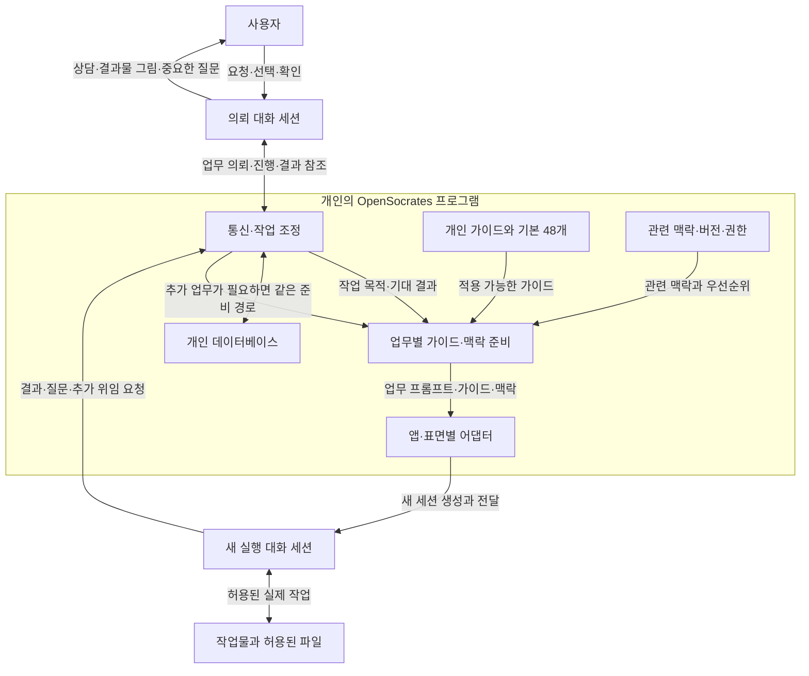
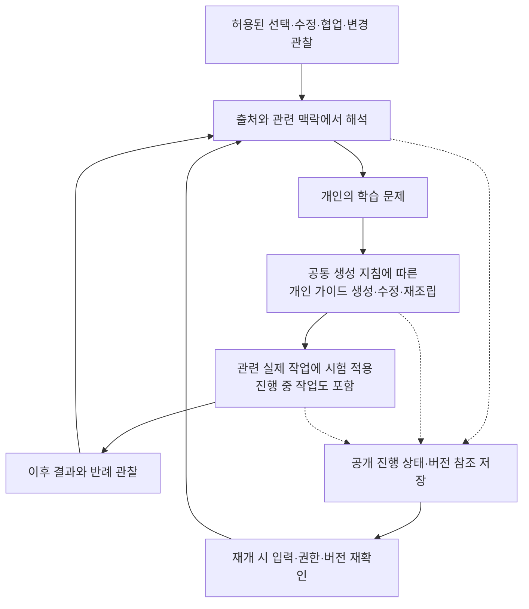

# OpenSocrates 2.0 시스템 설계와 데이터 흐름

상태: 2026-11-02 사용자 인터뷰를 반영한 개발 설계. 구현, 호스트 지원, 자동 학습의 효과를 입증한 문서가 아니다. 제품의 확정 방향은 [제품 정의](VISION_2.0.ko.md), 검증은 [검증 계획](VALIDATION_2.0.ko.md), 전체 진입점은 [시작 안내](README.ko.md)를 따른다. 이 문서의 계약과 상태 이름은 구현을 위한 제안이며, 실제 스키마를 추가하기 전에 검토한다.

## 1. 구현 경계

OpenSocrates 2.0은 한 컴퓨터에서 동작하는 프로그램과 개인별 데이터베이스를 갖는다. 기존 앱의 실제 대화 세션을 연결하고, 작업에 맞는 프롬프트·추론 가이드·맥락을 전달하며, 작업 경험을 바탕으로 개인 가이드를 발전시킨다.

초기 대상은 macOS와 Windows의 ChatGPT 데스크톱 앱과 Claude 데스크톱 앱이다. ChatGPT 앱 안의 Chat·Work·Codex를 제품 이름과 실행 표면으로 구분한다. Claude도 실제 계정의 통합 경험, Chat·Cowork·Code 표면과 로컬·클라우드 실행 위치를 기록한다. 같은 앱에 있다는 이유로 모든 표면이 같은 연결 기능을 가진다고 가정하지 않는다. Grok Bot·Cursor 등 추가 호스트와 여러 컴퓨터 사이의 동기화는 초기 범위 밖이다.

모델 제공자의 API를 직접 호출해 독립적인 에이전트 실행 환경을 만들지 않는다. 추론이 필요한 조정, 가이드 생성·재조립, 학습 판단도 지원되는 기존 앱의 대화 세션을 활용하는 방향으로 설계한다. 로컬 프로그램은 연결, 저장, 상태, 권한, 전달을 담당한다. 정확한 실행 언어, 데이터베이스 엔진, 모델 선택 기준은 아직 결정되지 않았다. SQLite 같은 내장형 트랜잭션 데이터베이스는 비교할 후보이며 확정 기술이 아니다.

기존 호스트 연결 기능을 우선 조사하고, 화면 조작이 필요하면 호스트가 제공하는 computer use 또는 검토된 오픈소스 도구를 활용한다. 특정 앱의 숨은 API, 설정 파일, 대화 데이터베이스를 임의로 수정하는 방식을 지원 계약으로 삼지 않는다. 스킬이나 연결 도구의 등록은 실제 메시지 전달·읽기·적용의 증거와 구분한다.

## 2. 세션과 프로그램의 책임

| 구성 요소 | 책임 | 구현 시 지켜야 할 경계 |
| --- | --- | --- |
| 의뢰 대화 세션 | 의도·결과물·형식 상담, 업무 프롬프트 준비, 가이드·맥락 준비 요청, 중요한 결정의 사용자 확인, 진행·결과 안내 | 실제 조사·분석·그래프·문서 작성·결과물 통합은 실행 세션에 맡긴다. |
| 실행 대화 세션 | 전달된 업무를 수행하고, 필요한 도움·질문·결과를 OpenSocrates에 전달 | 상대 세션에 직접 우회 전달하지 않는다. 추가 위임도 OpenSocrates에 요청한다. |
| 호스트 어댑터 | 앱·표면·모델·세션의 가용성 확인, 실제 세션 생성, 메시지 전달·응답 확인, 사용자 중단 반영 | 실제로 제공되는 기능만 사용한다. 화면 조작과 구조화된 연결은 동일한 증거 수준이 아니다. |
| 통신·작업 조정 | 의뢰·응답·협의·인계의 라우팅, 세션과 작업의 연결, 중복·대기 상태 관리 | 모든 관리 대상 에이전트 간 통신이 이 경로를 거치도록 한다. |
| 가이드 선택·재조립 | 적용 가능한 개인 가이드 선택, 필요시 조합·재조립 의뢰, 기본 가이드 대체 경로 | 모든 개인 가이드를 매번 주입하지 않는다. 가이드의 개수와 전달할 문맥의 크기를 구분한다. |
| 맥락 관리 | 사용자·프로젝트·업무·시점·분기·버전의 관련 정보와 우선순위 제공 | 과거 사실, 현재 사실, 가설, 사용자 선택과 권한을 혼동하지 않는다. |
| 백그라운드 학습 | 경험에서 학습할 문제를 찾고, 개인 가이드 생성·수정·시험 적용·재검토를 진행 | 공통 생성 지침을 스스로 바꾸지 않는다. 사용자 확인을 매번 요구하지 않되 중요한 결정은 기존 경계를 따른다. |
| 파일 관리 | 허용된 작업물의 조회·생성·수정·정리·버전 선택을 실행 세션에 연결 | 모든 폴더를 상시 감시하지 않는다. 메타데이터만으로 수정 의도나 작성자를 확정하지 않는다. |

고정 역할표나 역할별 `AGENTS.md`를 만들지 않는다. 에이전트에게 전달할 한 번의 업무 프롬프트는 해당 작업의 목적, 기대 결과물, 필요한 범위와 완료 판단을 명확히 한다. 아래의 통신 계약은 프로그램이 데이터를 안전하게 연결하기 위한 것으로, 사전 정의된 인격·직책·작업 절차를 강제하는 역할 Harness가 아니다.

## 3. 실제 작업의 데이터 흐름

1. 사용자가 의뢰 세션에서 대략적인 말을 한다. 의뢰 세션은 OpenSocrates와 함께 목적·대상·결과물 형식을 파악하고, 설명이 필요한 선택만 상담한다. 이미 정해진 선택을 다시 유도하지 않는다.
2. 의뢰 세션은 업무와 기대 결과를 담은 프롬프트를 준비한다. 프로그램은 관련 가이드·맥락·권한을 묶어 실제 실행 세션에 전달한다. 가이드 재조립이 필요하면 그 작업도 별도 세션에 의뢰할 수 있다.
3. 실행 세션은 실제 작업을 한다. 도움이 필요하면 OpenSocrates에 요청한다. 프로그램이 적합한 앱·모델·세션을 선택하고 가이드·맥락 준비 경로를 다시 거친다. 원래 의뢰 세션이 모든 소통을 수동으로 중계할 필요는 없다.
4. 결과물 통합과 실질 검토가 필요하면 실행 세션에 맡긴다. 의뢰 세션은 실제 결과 참조와 확인 상태를 받아 사용자에게 전달한다. 완료 보고와 파일이 실제로 존재한다는 확인은 구분한다.
5. 사용자 선택과 관찰 가능한 작업 경험 중 보관이 허용된 정보만 학습 후보로 연결한다. 통신 과정의 원문을 학습 로그로 남기는 것은 허용되지 않는다.

현재 전달 중인 메시지가 있다는 사실만으로 새 가이드가 모델에 들어갔다고 주장하지 않는다. 호스트 응답 확인, 가이드의 실제 전달, 읽기나 적용에 관한 증거, 결과물 품질은 각각 기록 가능한 수준에서 구분한다.

## 4. 가이드의 생성·선택·재조립

### 가이드의 세 종류

| 종류 | 변화 주체 | 수명과 사용 |
| --- | --- | --- |
| 기본 48개 추론 가이드 | OpenSocrates의 정식 콘텐츠·버전 관리 | 설치 직후 사용하며, 해당 작업에 적합한 개인 가이드가 없을 때 사용한다. |
| 공통 가이드 생성 지침 | OpenSocrates 버전업 | 모든 사용자의 공통 기반이다. 개인 학습이 직접 수정하지 않는다. |
| 개인별 생성 가이드 | 해당 사용자의 학습 로직 | 실제 경험에 맞게 발전한다. 고정된 가이드 개수 제한은 두지 않으며, 업무마다 관련 부분을 선택한다. |

개인 가이드의 생성 버전은 생성 지침 버전, 참조한 가이드 버전, 적용 범위와 허용된 근거 참조를 연결한다. 제품 업데이트가 기존 개인 가이드를 근거 없이 덮어쓰거나 전부 재생성하지 않도록 이행 규칙을 설계한다. 기본 48개와 개인 가이드의 저장 위치·소유권도 구분한다. 개인 가이드는 사용자의 런타임 데이터이며 저장소의 정본 콘텐츠나 생성 지침을 덮어쓰지 않는다.

### 선택 경로

1. 현재 사용자 요청의 목적, 프로젝트, 업무, 대상, 시점, 권한에 맞는 개인 가이드를 찾는다.
2. 적용 가능한 개인 가이드가 있으면 이를 우선 사용한다. 여러 가이드가 필요하면 선택·조합·재조립한다. 단순 이어붙이기만을 요구하지 않는다.
3. 적합한 개인 가이드가 없으면 기본 48개에서 적용 가능한 가이드를 사용한다. 모든 기본 가이드가 부적합하면 방법을 억지로 적용하지 않고 일반 작업을 계속한다.
4. 개인 가이드의 일부만 맞는 경우 기본 가이드의 보완 부분까지 조합할지, 적합성이 부족하다고 보고 기본 경로로 갈지는 별도 선택 정책에서 명료화한다. 지금 두 경로 중 하나를 사용자 결정으로 가장하지 않는다.
5. 재조립 결과를 이번 작업에서만 사용할지 재사용 가능한 개인 가이드로 남길지는 학습 로직이 맥락과 경험을 보고 판단한다. 저장이 곧 효과 검증이나 영구 채택을 뜻하지 않는다.

가이드가 늘어나도 모두 프롬프트에 넣지 않는다. 관련성 검색, 적용 범위, 전달 예산을 구분한다. 가이드 수를 임의의 고정 상한으로 자르는 대신, 저장 용량·검색 지연·중복·폐기 상태 관리의 한계를 실제 측정해 정책으로 공개한다. 검색에 외부 임베딩 API가 필요하다고 전제하지 않는다.

## 5. 개인 데이터와 통신 계약 제안

실제 정본 스키마는 `schemas/source/`, 프로그램은 `src/opensocrates/`에 구현하고 생성물은 기존 생성 절차를 따른다. 다음은 데이터를 식별하고 연결하기 위한 최소 계약의 제안이다. 모든 메시지 본문을 데이터베이스에 영구 저장하라는 뜻이 아니다.

| 계약 | 제안 필드 | 의미 |
| --- | --- | --- |
| `HostEndpoint` | endpoint ID, app/version, OS, surface, local/cloud location, available operations, model-selection capability, trust state, probe evidence | 앱 이름만으로 세션 생성·주입·응답 수신 가능성을 가정하지 않는다. |
| `TaskRecord` | task ID, project/branch IDs, intake session ref, execution session refs, goal summary, artifact refs, authorized scope ref, status, revision | 실제 작업과 대화 세션을 별개로 식별한다. 한 작업이 여러 세션을 사용할 수 있다. |
| `DispatchEnvelope` | message ID, task ID, sender/destination, parent message ID, retry identity, guide/context version refs, authority ref, expiry | 업무 프롬프트·가이드·맥락의 전달과 결과를 연결한다. 민감한 본문은 필요한 호스트 전달 시에만 취급한다. |
| `ContextRecord` | context ID, scope, branch/version/parent refs, source ref, timestamp, freshness, accepted/proposed/observed status, authority | 최신이라는 이유만으로 사용자의 의도나 권한을 바꾸지 않는다. 출처가 바뀌면 영향을 받는 사실만 재검토한다. |
| `GuideVersion` | guide ID/version, baseline/personal kind, scope, generator version, input guide refs, permitted evidence refs, hypothesis/active/retired status | 개인 가이드와 공통 지침의 소유권을 분리하고, 작업에 실제 적용된 버전을 추적한다. |
| `LearningCheckpoint` | learning ID, question summary, input event IDs, public progress state, pending application refs, versions, revalidation need, revision | 숨은 추론이나 원문 대화를 저장하지 않고 학습 자체의 중단·재개 지점을 남긴다. |
| `ArtifactRecord` | artifact ID, allowed location ref, type, project/branch/task refs, fingerprint, observed timestamp, existing version ref | 파일 이동과 새 생성의 판별 가능성을 구분하고, 메타데이터가 수정 의도를 증명한다고 보지 않는다. |
| `AuthorityRecord` | authority ID, user/host origin, scope, allowed effects, limits, expiry/revocation, pending-confirmation state | 에이전트 출력과 과거 기록은 새로운 사용자 권한이 아니다. |

서로 다른 앱의 세션 ID는 앱/계정/표면과 함께 해석한다. 로컬 기록에는 가능한 범위에서 불필요한 계정 식별정보를 넣지 않는다. 수신자 검증 없는 전역 브로드캐스트와 모든 프로젝트를 포함하는 기본 문맥은 만들지 않는다.

## 6. 통신·동시성·복구

프로그램은 전송 요청, 실제 전송 시도, 호스트 접수, 응답 관찰, 작업물 확인을 별개 상태로 관리한다. 호스트가 접수 영수증을 제공하지 않으면 상태는 `sent_unconfirmed`처럼 미확인으로 남긴다. 화면에 버튼을 눌렀다는 사실을 접수나 완료로 승격하지 않는다.

로컬 DB의 작업·가이드·맥락 수정은 버전 전제조건과 트랜잭션을 사용하도록 설계한다. 두 세션이 같은 가이드를 갱신하면 마지막 저장으로 덮지 않고 두 제안과 근거를 보존해 충돌을 처리한다. 전송 대기 항목과 상태 변경을 연결하는 outbox는 구현 후보이다. 앱으로의 실제 효과까지 데이터베이스 트랜잭션으로 원자화할 수 있다고 가정하지 않는다.

재시도 ID는 OpenSocrates 내부 중복을 줄일 수 있지만 외부 앱에서의 정확히 한 번 실행을 보장하지 않는다. 전송 후 응답 전에 중단되면 먼저 기존 세션·결과를 확인한다. 확인할 수 없는 외부 효과는 맹목적으로 재실행하지 않고 `effect_unknown`으로 다룬다. 사용자 확인 대기와 호스트 권한 대기는 작업 실패와 구분한다.

여러 세션이 하나의 화면을 조작하는 경우 앱·화면 자원에 대한 조정을 설계하고, 취소나 사용자 입력이 도착하면 재관찰한다. 로컬 앱 종료·기기 잠자기·오프라인·업데이트를 학습이나 전달의 영구 실패로 오인하지 않는다. 실행 불가능 상태에서는 대기와 남은 일을 기록한다. 여러 기기 간 공유나 전역 클라우드 서비스의 존재를 이 복구 설계에 전제하지 않는다.

## 7. 백그라운드 학습과 진행 중 적용

학습의 상태 예시는 `observed → interpreting → candidate → pending_application → observing_outcome → revised/retained/retired`이다. 중단과 취소는 별도 상태이며, 재개 시 마지막으로 확인한 단계와 미완료 효과를 복구한다. 이 목록은 실제 RL 알고리즘이나 검증된 채택 규칙이 아니다. 무수정, 침묵, 에이전트 간 합의만으로 성공을 확정하지 않는다.

진행 중인 관련 작업에 반영하는 기능은 목표에 포함한다. 다만 로컬 DB의 새 버전을 쓰는 것과 이미 실행 중인 모델의 문맥을 바꾸는 것은 다르다. 어댑터가 지원하는 다음 메시지·도구 호출·세션 이어가기 등 실제 진입점을 찾아 전달하고, 작업에 수신된 버전을 추적한다. 전달할 진입점이 없으면 `pending_application`으로 남기며 실시간 적용을 주장하지 않는다. 버전 고정만으로 진행 중 반영 요구를 제거하지 않는다.

반영 전에 해당 업무의 대상·목적·현재 사용자 선택과의 적합성을 판단한다. 일반 선호와 프로젝트 한정 수정, 외부 환경 변화, 다른 사람의 수정, 표현상의 변화, 실제 오류 교정을 구별해야 한다. 불명확한 신호는 맥락에 붙은 미확인 가설로 다룰 수 있으며, 강한 개인 선호로 승격하지 않는다. 구체적 보상, 채택·폐기, 회귀 탐지, 연산 예산은 검증 계획의 실험에서 결정할 항목이다.

## 8. 맥락 분기와 파일 관리

맥락 트리는 사용자가 쉽게 이전 방향으로 돌아가거나 관점을 바꾸게 하는 개념이다. 구현 후보는 출처와 부모 관계가 있는 버전 그래프이다. 실제 Git 사용이나 문맥 전환 시 디스크 파일을 자동으로 checkout하는 기능은 확정하지 않았다.

현재 사용자 요청과 유효한 권한을 보존한 상태에서, 업무·프로젝트·대상·시점·관련성에 따라 사용할 맥락을 선택한다. 과거 관점으로 돌아갔다고 현재 권한을 복원하거나 만료된 사실을 현재 사실로 취급하지 않는다. 서로 충돌하는 가격·마감·목표는 단순한 텍스트 병합 성공으로 해결하지 않는다. 우선순위 판단의 구체적 정책과 학습 가능 범위는 정본 계약에서 다룬다.

파일 관리자는 실행 세션의 파일 작업을 프로젝트·맥락·버전 참조와 연결한다. 기존 파일 수정, 새 버전 생성, 기존 폴더 정리를 일의 맥락에 맞게 판단한다. 모든 변경을 새 파일로 만드는 고정 규칙이나 모든 덮어쓰기에 확인을 요구하는 규칙을 사용자 결정으로 추가하지 않는다. 중요한 결정은 사용자 확인 경계를 따른다.

다음 관련 작업에서 기록된 상태와 실제 파일을 대조한다. 수정 시각은 변경 신호일 뿐 내용 차이를 증명하지 않으며, 동일한 해시 방식으로 계산한 서로 다른 지문은 바이트가 다르다는 근거가 된다. 구체적인 차이를 분석하려면 읽을 수 있는 이전 버전이나 동등한 이력이 필요하다. 없으면 변경 사실만 남기고 차이·수정자·이유를 만들어내지 않는다. 파일 이동, 이름 변경, 자동 서식과 실제 내용 수정도 구분해 평가한다.

## 9. 보관·권한·신뢰 경계

현재 `AGENTS.md`, `CONTRIBUTING.md`, `SECURITY.md`를 그대로 준수한다. 원문 프롬프트·대화, 스크린샷, 작업 공간 내용, 자격증명, 숨은 추론, 텔레메트리를 수집·보관하는 기능을 이 계획이 허가하지 않는다. 디버그 로그·재시도 큐·DB 백업·파생 인덱스로 우회 보관해서도 안 된다.

실시간으로 허용된 작업을 수행하기 위해 내용을 읽거나 업무 프롬프트를 호스트에 전달하는 것과, 그 원문을 OpenSocrates의 별도 영구 저장소에 복제하는 것은 구분한다. 제품 DB에는 허용된 공개 결정 요약, 출처·버전·작업물 참조와 상태를 최소한으로 보관하는 경로를 먼저 설계한다. 개인 가이드에도 비밀이나 원문을 복제하지 않도록 점검한다. 파생 정보라는 이름만으로 현 정책을 충족했다고 가정하지 않는다.

기존 파일의 전체 스냅샷 보관이나 과거 대화의 영구 복제가 기능에 필요하다고 판단되면, 정확한 데이터 종류·목적·수명·삭제·동의 범위를 제시해 별도 정책 변경을 검토한다. 그 결정 전에는 호스트나 사용자가 이미 관리하는 접근 가능한 버전 이력을 참조하거나 변경 감지만 제공한다. 조용한 학습이 사용자에게 숨겨진 제어 불가능한 학습이 되지 않도록 열람·수정·중지·삭제·되돌리기 동작의 범위를 정한다. 기본 보관 기간과 초기 활성화 경험은 미정이다.

사용자, 호스트 정책, 에이전트 요청, 외부 문서의 출처를 유지한다. 작업물과 에이전트 메시지 안의 지시문은 사용자 권한이 아니며, 학습 문제를 발견했다는 이유로 공통 생성 지침이나 보안 경계를 바꿀 수 없다. 모든 관리 대상 통신을 프로그램을 통해 연결한다는 제품 목표와, 호스트 내부의 모든 행동을 강제 제어할 수 있다는 주장은 구분한다. 통신을 통제·관찰할 수 없는 표면은 완전 지원으로 표시하지 않는다.

## 10. 호스트별 구현 전 조사

다음 항목을 앱·운영체제·표면·계정·버전마다 조사하고 증거를 남긴다. 현재 상태는 전부 2.0 구현 미검증이다.

| 조사 항목 | 확인해야 할 결과 |
| --- | --- |
| 세션 생성·찾기 | 실제 앱 목록에 새 실행 세션이 생기고, 프로그램의 작업 ID와 다시 연결되는가? |
| 모델 선택 | 원하는 모델을 선택할 수 있는가, 호스트가 자동 선택하는가, 프로그램이 결과를 관찰할 수 있는가? |
| 가이드·맥락 전달 | 내용이 실제 세션으로 들어가는가? 자동 스킬 선택, 직접 메시지, 지원 도구 중 어떤 경로인가? |
| 진행 중 변경 | 이미 일하는 세션에 새 가이드나 중요한 맥락을 실제로 전달할 수 있는가? |
| 반환 경로 | 결과·질문·추가 의뢰를 OpenSocrates가 관찰하고 원래 작업에 대응시킬 수 있는가? |
| 컴퓨터 조작 | 구조화된 기능이 없을 때 기존 computer use/오픈소스가 동작하는가? 동시 실행·사용자 중단은 어떤가? |
| 로컬 서비스 연결 | 해당 표면이 로컬 프로그램과 연결될 수 있는가? 앱이 클라우드에서 실행될 때 별도 경로가 필요한가? |
| 권한·취소·실패 | 필요한 호스트 승인, 허용 범위, 오류, 계정 만료, 재시도와 중단이 실제로 드러나는가? |

기능이 없는 표면에서 내부 앱 데이터베이스 수정, 무단 권한 확장, 모델 API 실행으로 몰래 대체하지 않는다. 가능한 준비 작업은 진행하고, 전달 불가·적용 대기·지원 미확인을 정확히 알린다. 4개 앱/OS 조합 중 한 셀의 성공으로 다른 셀을 통과 처리하지 않는다.

## 11. 설치·업데이트·이전

초기 프로그램과 어댑터는 기존 1.x 사용자 설정과 비활성화 상태를 확인하고, 소유한 파일에만 설치한다. 공통 생성 지침과 기본 가이드는 제품 버전에 연결하고, 개인 가이드·맥락의 저장 형식 버전은 별개로 둔다. 제품 업데이트는 진행 중 세션과 학습 상태를 중간 형태로 만들지 않도록 이전·실패 복구 순서를 갖춰야 한다.

언어·DB 엔진·패키지 형식·업데이트 기본값·지원 OS 최소 버전과 CPU 범위는 플랫폼 조사 및 구현 결정 기록으로 확정한다. 기존 Go 후보나 폐기된 v1.5 메모리 후보를 기본 구현으로 취급하지 않는다. 특히 저장소가 금지한 이전 후보의 코드·가이드를 복사하지 않는다. 설치·서명·재설치·롤백 주장은 실제 해당 환경의 증거로만 한다.

## 12. 공통 가이드 생성 지침의 작업 초안

아래는 회의에서 작성한 **개발용 지침 초안**이다. 배포되는 프롬프트나 정본 방법이 아니며 효과도 미검증이다. 제품 버전이 이 지침을 관리하고, 개인별 학습은 이 지침을 수정하지 않는다.

1. 이번 경험이 사용자 선택, 업무상 사실, 외부의 일회성 조건, 품질 교정, 협업 신호 중 무엇을 시사하는지 살핀다. 작성자·이유·일반성은 모르면 모른다고 둔다. 맥락 속 사실, 현재 의뢰의 제약, 사용자 권한을 개인 가이드와 혼동하지 않는다.
2. 재사용 가능한 접근이 보인다면 어떤 **상황에서 무엇을 생각하거나 어떻게 접근하면 좋을지**와 그 목적을 쓴다. 업무·과제 유형, 협업, 의사결정, 파일 관리, 설명 방식이나 상황에 맞는 선호도 다룰 수 있다. 사람을 성격 유형으로 낙인찍지 않으며 금지 목록이나 고정 역할로 축소하지 않는다.
3. 관찰 범위, 적합한 조건, 알려진 예외·불확실성, 허용된 근거 참조 및 참조 가능 상태, 생성 지침과 입력 가이드의 버전을 연결한다. 반례가 없다는 사실은 긍정 증거가 아니지만 반례를 만들어내거나 반례 작성·장기 관찰을 모든 후보의 생성 전제조건으로 만들지 않는다.
4. 관련 실제 업무에서 조용히 시험 적용하고 진행 중 업무의 반영 가능성도 살핀다. 근거가 약한 일반화는 그 불확실성을 유지하며, 비슷한 다른 프로젝트에의 적용은 관련성과 맥락을 보고 판단한다. 일정 횟수의 침묵을 성공이나 승격으로 간주하지 않는다. 부정적 경험이나 새로운 사용자 선택이 나오면 좁히고 수정·철회할 수 있어야 한다.
5. 여러 가이드를 조합·재조립할 때 현재 작업에서 사용자가 확정한 형식·목적·범위와 유효한 권한을 유지한다. 가이드는 새 권한을 만들지 않으며 관련성이 없거나 충돌하면 적용하지 않는다. 적합한 개인 가이드가 없을 때는 기본 48개 중 적합한 것을 사용하고 어느 것도 맞지 않으면 일반 작업을 계속한다.
6. 결과 가이드와 참조에 원문 대화·작업물·비밀이 복제되지 않는지 살핀다. ‘추상화’라는 이름만으로 보관이 허용된다고 판정하지 않는다. 입력이 사라져 해석을 뒷받침할 근거가 없다면 내용을 꾸미지 않고 해당 학습을 `input_unavailable`로 둔다. 이미 허용되고 충분한 근거가 남아 있다면 그 범위에서 할 수 있는 일은 별도로 판단한다.

**합성 예시:** 사용자가 외부 의사결정자를 위한 보고서에서 결정을 앞에 배치해 달라고 고친다. 후보는 “외부 의사결정용 보고서라면 독자가 내려야 할 결정을 먼저 파악하고 그 판단에 필요한 근거를 구성해 보라”이다. 해당 업무에서 먼저 시험하고 다른 상황에는 관련성을 판단한다. 사용자가 이 업무에 정한 Word 형식은 유지한다. 감사용 절차 검토처럼 과정 자체가 중요한 업무에는 그대로 이식하지 않는다. 이 예시는 가상의 설계 사례이며 효과의 증거가 아니다.

## 13. 전달·재개 시 구체적인 미확인 상태

- **의미 판단의 주체:** 지역 프로그램은 상태·권한·전달을 관리하고, 의미 해석·관련성·중요도·재조립은 기존 앱 대화 세션을 활용하는 후보로 설계한다. 부트스트랩 시 어떤 기존 대화가 최소 입력을 받아 판단하며 추가 세션을 언제 여는지, 가이드가 많아질 때 검색·지연·사용량은 어떻게 감당할지는 호스트별 실험과 설계가 필요하다. 초기 순환을 피하는 후보는 이미 열린 의뢰 세션이 현재 작업을 판단하고 프로그램이 필요한 가이드의 색인을 제공하는 방식이다. 별도 세션이 유용한 경우까지 금지하는 고정 규칙은 아니다. 색인 크기·품질과 실제 세션 연결을 측정한다. 고정 역할 에이전트를 전제하지 않는다.
- **전달 전 입력 유실:** 메시지 ID와 해시만으로 전송할 본문을 복구할 수 없다. 중단 후 허용된 원천을 다시 읽어 동일한 입력을 재구성할 수 있으면 재검증하고, 그럴 수 없으면 전송할 본문의 `payload_unrecoverable`로 남긴다. 이는 학습 근거를 읽지 못하는 `input_unavailable`과 별개다. outbox가 존재한다는 이유로 원문 보관이나 전송 가능성을 가정하지 않는다.
- **전달 후 결과 미확인:** 앱에서 효과가 이미 발생했을 수 있으면 `effect_unknown`으로 두고 확인 가능한 세션·결과부터 확인한다. 내부 중복 방지와 외부 앱의 정확히 한 번 실행 보장은 다르다. 확인이 불가능할 때 맹목적인 재전송으로 중복 효과를 만들지 않는다.
- **확정 선택의 전달:** 형식·목적·범위 같은 현재 작업의 명시적 선택은 출처·적용 범위·수정 상태와 함께 추적하고 필요한 하위 의뢰와 재조립에 전달하는 `DecisionLock`을 계약 후보로 둔다. 실제 가이드와 충돌하면 사용자 선택을 우선하고, 사용자가 선택을 바꾸면 유효 범위를 갱신한다. 예컨대 최종 보고서의 Word 지정이 그래프 PNG 하위 결과까지 Word로 만들라는 뜻은 아니다. 이번 작업의 Word 지정은 자동으로 전역 선호가 아니다. 저장 형태와 현재 정책의 양립 여부는 구현 전에 검토한다.
- **진행 중 변경:** 새 버전의 DB 저장, 메시지 전달, 세션의 수신·읽기, 실제 업무에서의 사용과 결과 품질을 구분한다. 후속 메시지 또는 조회가 가능한지는 각 호스트에서 확인한다. 해당 경로가 없거나 확인되지 않으면 그 적용을 `pending_application`으로 두며, 독립적으로 가능한 다른 학습까지 중단하지 않는다. 조회했고 변화가 없는 상태와 조회하지 못한 상태를 구분한다. 조회를 강제하거나 관찰할 수 없다면 누락 여부도 미확인이다. 해시 일치만으로 의미적 충돌이 없다고 증명할 수 없다.
- **사용자 개입:** 현재 사용자가 입력하는 화면과 충돌하는 조작은 조정한다. 화면을 사용하지 않는 독립적인 작업까지 일률적으로 멈추는 규칙은 아니다. 기존에 허용된 작업과 새로 중요한 결정을 그때의 권한·맥락에 따라 구분한다.

## 14. 이 설계의 완료 판단

계약이 문서에 존재하는 것만으로 동작을 인정하지 않는다. [검증 계획](VALIDATION_2.0.ko.md)의 실제 호스트·OS별 전달, 분리 세션 실행, 가이드 선택·재조립, 진행 중 반영, 학습 재개, 파일 비교, 권한·삭제·실패 사례를 통과해야 해당 기능을 주장할 수 있다. 작업 품질 향상은 전달 성공과 별도로 평가한다. 정책·호스트 기능·학습 신호의 미결정은 각각 해당 기능에 연결하고, 무관한 조사나 문서 작성을 막는 전역 조건으로 넓히지 않는다.
