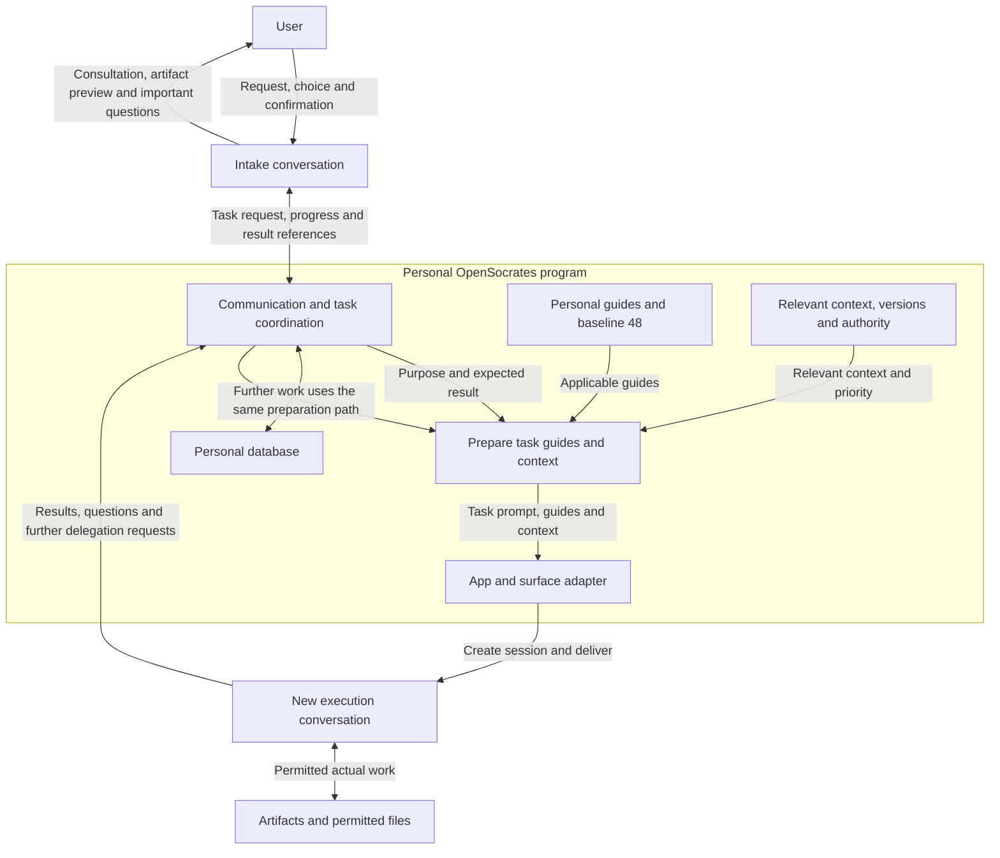
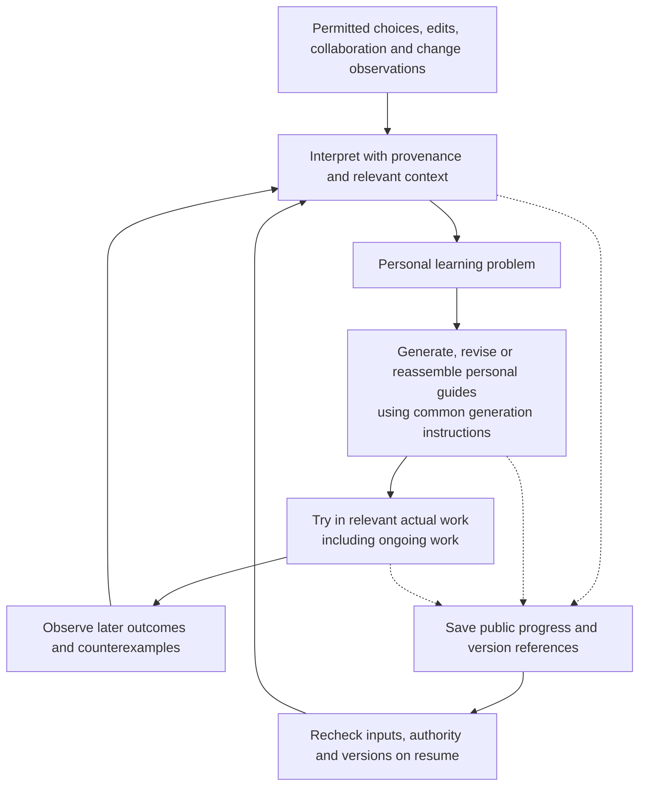

# OpenSocrates 2.0 system design and data flow

Status: development design reflecting the owner interview on 2026-11-02. This document does not establish implementation, host support, or learning effectiveness. Follow the [product definition](VISION_2.0.md), [validation plan](VALIDATION_2.0.md), and [start guide](README.md). Contract and state names below are implementation proposals to review before adding canonical schemas.

## 1. Implementation boundary

OpenSocrates 2.0 has a program and personal database running on one computer. It connects real conversations in existing apps, supplies task-specific prompts, reasoning guides and context, and develops personal guides from work experience.

The initial targets are the ChatGPT desktop app and Claude desktop app on macOS and Windows. Distinguish Chat, Work and Codex as surfaces inside the ChatGPT app rather than separate desktop products. For Claude, record the account's actual unified experience, Chat/Cowork/Code surface and local/cloud execution location. Sharing an app does not establish equal integration capabilities. Grok Bot, Cursor and other hosts, and synchronization between computers are outside the initial scope.

Do not call model-provider APIs to build a separate agent execution environment. Design reasoning-dependent coordination, guide generation/reassembly and learning judgments to use supported conversations in existing apps too. The local program owns connections, storage, state, authority and delivery. The implementation language, database engine and model-selection policy remain undecided. An embedded transactional database such as SQLite is a candidate to compare, not a selected technology.

Investigate existing host integrations first. When screen interaction is needed, use host-provided computer use or reviewed open-source tools. Do not make arbitrary modification of private app APIs, configuration or conversation databases a supported integration contract. Registering a skill or connector is distinct from evidence of message delivery, reading and application.

## 2. Session and program responsibilities

| Component | Responsibility | Implementation boundary |
| --- | --- | --- |
| Intake conversation | Clarify intent, artifact and format; prepare the task prompt; request guides/context; obtain user confirmation for important decisions; report progress and results | Delegate actual research, analysis, charts, writing and artifact integration to execution conversations. |
| Execution conversation | Perform the assigned work and return requests for help, questions and results to OpenSocrates | Do not bypass the layer to contact another session. Request additional delegation through OpenSocrates. |
| Host adapter | Check app/surface/model/session availability; create real conversations; deliver messages and observe responses; honor interruption | Use only capabilities actually exposed. Screen interaction and structured integration have different evidence boundaries. |
| Communication and task coordination | Route requests, responses, collaboration and handoffs; associate sessions and tasks; manage duplicates and pending states | All managed inter-agent communication travels through this path. |
| Guide selection and reassembly | Select applicable personal guides; request composition/reassembly when useful; provide baseline fallback | Do not inject every personal guide. Guide count and context-delivery size are separate concerns. |
| Context management | Supply relevant user/project/task/time/branch/version information and priority | Separate past/current facts, hypotheses, user choices and authority. |
| Background learning | Identify learning problems; generate, revise, try and reconsider personal guides | Do not rewrite common generator instructions. Routine changes are quiet; important decisions retain the user-confirmation boundary. |
| File management | Connect execution sessions to permitted artifact reads, creation, editing, organization and version choices | Do not monitor every folder continuously. Metadata does not establish an author's identity or intent. |

Do not create a fixed role inventory or role-specific `AGENTS.md` files. Each task prompt makes that job's purpose, expected result, relevant boundaries and completion judgment clear. The communication contracts below connect program data; they are not a role Harness prescribing personas, job titles or fixed work procedures.

## 3. Work data flow

1. The user makes an ordinary, potentially incomplete request in the intake conversation. That conversation works with OpenSocrates to establish purpose, audience and format and discusses choices only when needed. It does not redirect a settled user choice.
2. The intake conversation prepares the task and expected result. The program supplies relevant guides, context and authority to a real execution conversation. If guide reassembly is needed, that work may also be delegated to a separate conversation.
3. The execution conversation performs the work. It requests assistance through OpenSocrates, which selects a suitable app/model/session and repeats the guide/context preparation path. The intake conversation need not manually relay every exchange.
4. Artifact integration and substantive checking are performed in execution conversations. The intake conversation receives result references and confirmation status for the user. A completion report and confirmation that the file actually exists are distinct observations.
5. Only permitted information from user choices and observable work experience becomes learning input. Do not retain the communication transcript as a learning log.

A message in transit does not prove a new guide entered the model context. Distinguish host receipt, actual guide delivery, evidence of reading/application and artifact quality to the extent each can be observed.

## 4. Guide generation, selection and reassembly

### Three guide-related assets

| Kind | Who changes it | Lifetime and use |
| --- | --- | --- |
| Baseline 48 reasoning guides | OpenSocrates canonical content and release management | Used at initial installation and when no appropriate personal guide exists for the task. |
| Common guide-generation instructions | OpenSocrates version updates | Shared foundation for all users; personal learning does not rewrite it. |
| Personal generated guides | That user's learning logic | Develop from actual experience. No fixed guide-count limit; relevant portions are selected per job. |

A personal guide version links the generator version, input guide versions, scope and permitted evidence references. Design migration so a product update does not overwrite or regenerate every personal guide without grounds. Separate ownership and storage for baseline and personal guides. Personal guides are user runtime data; they do not overwrite canonical repository content or generator instructions.

### Selection path

1. Find personal guides applicable to the current request's purpose, project, work type, audience, time and authority.
2. Prefer applicable personal guides. Select, combine or reassemble several when useful; mere concatenation is not required.
3. When no appropriate personal guide exists, use applicable guides from the baseline 48. If none fits, continue ordinary work without forcing an inapplicable method.
4. Whether partially applicable personal guides may be supplemented with baseline content, or should trigger baseline fallback, remains a selection-policy decision. Do not present either option as an owner decision already made.
5. Learning logic judges whether a reconstructed guide is task-local or worth retaining as a reusable personal guide. Storage does not establish effectiveness or permanent adoption.

Growing the guide collection does not mean injecting the whole collection. Separate relevance retrieval, scope and delivery budgets. Instead of imposing an arbitrary fixed guide-count ceiling, measure and disclose storage, retrieval latency, duplication and retirement constraints. Do not assume retrieval requires an external embedding API.

## 5. Proposed personal-data and communication contracts

Implement canonical schemas under `schemas/source/`, runtime code under `src/opensocrates/`, and generated outputs through the existing generation process. The following are minimum identity/linkage proposals, not an instruction to persist every message body.

| Contract | Proposed fields | Meaning |
| --- | --- | --- |
| `HostEndpoint` | endpoint ID, app/version, OS, surface, local/cloud location, available operations, model-selection capability, trust state, probe evidence | App identity alone does not establish session creation, injection or response retrieval. |
| `TaskRecord` | task ID, project/branch IDs, intake session ref, execution session refs, goal summary, artifact refs, authorized scope ref, status, revision | Identify work separately from conversations; a task may span several sessions. |
| `DispatchEnvelope` | message ID, task ID, sender/destination, parent message ID, retry identity, guide/context version refs, authority ref, expiry | Associate task prompts, guides, context and results. Handle sensitive payload only as needed for permitted host delivery. |
| `ContextRecord` | context ID, scope, branch/version/parent refs, source ref, timestamp, freshness, accepted/proposed/observed status, authority | Recency alone does not change user intent or authority. Changed sources reopen affected facts only. |
| `GuideVersion` | guide ID/version, baseline/personal kind, scope, generator version, input guide refs, permitted evidence refs, hypothesis/active/retired status | Separate ownership of personal guides and common instructions; track the version actually applied to work. |
| `LearningCheckpoint` | learning ID, question summary, input event IDs, public progress state, pending application refs, versions, revalidation need, revision | Track learning interruption/resumption without retaining private reasoning or raw conversation. |
| `ArtifactRecord` | artifact ID, permitted location ref, type, project/branch/task refs, fingerprint, observed timestamp, existing version ref | Distinguish what is known about moves/new files; metadata does not prove intent. |
| `AuthorityRecord` | authority ID, user/host origin, scope, allowed effects, limits, expiry/revocation, pending-confirmation state | Agent outputs and prior records do not create new user authority. |

Interpret host session IDs with their app/account/surface scope. Avoid unnecessary account identifiers in local records. Do not create an unvalidated global recipient broadcast or a default context containing every project.

## 6. Communication, concurrency and recovery

Track requested delivery, attempted transmission, host receipt, observed response and artifact confirmation separately. If a host provides no receipt, retain an unconfirmed state such as `sent_unconfirmed`. Clicking a screen control is not evidence of acceptance or completion.

Design task/guide/context writes around database transactions and version preconditions. Concurrent guide updates preserve both proposals and their grounds instead of silently using the last write. An outbox coupling pending delivery and state updates is an implementation candidate. Do not assume the database can atomically commit effects in external apps.

Retry identities can reduce duplicates inside OpenSocrates but cannot guarantee exactly-once external execution. After interruption between transmission and response, inspect the existing conversation/result first. Treat an unverifiable external effect as `effect_unknown` rather than blindly repeating it. Waiting for a user decision or host permission differs from work failure.

When sessions share screen-control resources, design app/screen coordination and re-observe after cancellation or user input. Local app exit, sleep, offline state and updates are not permanent learning/delivery failures. Record pending work while execution is unavailable. Recovery does not assume cross-device sharing or a global cloud service.

## 7. Background learning and in-flight application

Example learning states are `observed → interpreting → candidate → pending_application → observing_outcome → revised/retained/retired`. Interruption and cancellation are separate states; resume restores the last confirmed stage and unresolved effects. This is not a selected RL algorithm or a validated adoption rule. Absence of edits, silence, or agreement among agents does not by itself establish success.

Applying learning to related ongoing work remains a product goal. Writing a new local database version is different from changing an already running model's context. Use actual adapter-supported entry points such as a subsequent message, tool call or session continuation, and track the version received by that work. If no entry point is available, retain `pending_application` and do not claim live application. Do not remove the in-flight requirement merely by freezing versions.

Judge compatibility with the work's audience, purpose and current user choices before applying a change. Distinguish general preferences from project-specific edits, external changes, another author's changes, expression changes and actual error corrections. An ambiguous signal may remain a scoped, unverified hypothesis rather than a strong personal preference. Reward, adoption/retirement, regression detection and compute budgets are decisions to investigate through the validation experiments.

## 8. Context branches and file management

The context tree is a concept for returning to an earlier direction or switching perspectives. A version graph with provenance and parent relationships is an implementation candidate. Actual Git use or automatic disk checkout on a context switch has not been selected.

Preserve the current request and valid authority while selecting context by work/project/audience/time/relevance. Returning to a past perspective does not restore revoked authority or make stale facts current. Conflicting prices, dates and goals are not resolved by successful text merging. Specify priority policy and its learnable scope in the canonical contracts.

Associate execution-session file work with project/context/version references. Judge in-place edits, new versions and existing-folder organization in the work's context. Do not add an owner decision that every change requires a new file or every overwrite requires confirmation. Important decisions retain the user-confirmation boundary.

Compare recorded state with actual files at the next related task. Modification time is a signal, not proof of content change; different fingerprints computed with the same hash method establish byte differences. Exact comparison needs a readable prior version or equivalent history. Without one, retain the observed change and do not invent the difference, author or reason. Evaluate moves, renames, automated formatting and substantive edits separately.

## 9. Retention, authority and trust boundaries

Follow current `AGENTS.md`, `CONTRIBUTING.md` and `SECURITY.md`. This plan does not authorize collection/retention of raw prompts/conversations, screenshots, workspace content, credentials, private reasoning or telemetry. Debug logs, retry queues, database backups and derived indexes must not become retention workarounds.

Separate reading content for permitted real-time work or delivering a task prompt to a host from duplicating that raw content into OpenSocrates permanent storage. First design a path retaining only permitted public decision summaries, source/version/artifact references and necessary state. Inspect personal guides for copied secrets or source text too. Calling information derived does not establish compliance.

If full file snapshots or permanent conversation copies are needed, propose a separate policy decision describing exact data, purpose, lifetime, deletion and consent. Until then, refer to accessible version history already managed by the user/host or provide change detection only. Define inspection, correction, pause, deletion and rollback so quiet learning is not inaccessible or uncontrollable learning. Retention defaults and initial enrollment remain undecided.

Preserve the provenance of user instructions, host policy, agent requests and external documents. Instructions in files or peer messages are not user authority. Discovering a learning problem does not authorize changing common generator instructions or security boundaries. Distinguish the goal of routing all managed communication through the program from a claim of controlling every host-internal action. Do not label an unobservable or uncontrollable surface fully supported.

## 10. Required host investigation before implementation

Investigate and record each item by app, OS, surface, account and version. All remain unverified as 2.0 implementation capabilities.

| Probe | Required observation |
| --- | --- |
| Create/find conversation | Does a real execution conversation appear in the app and reconnect to the program's task ID? |
| Select model | Can the desired model be selected, does the host choose, and can the program observe that result? |
| Deliver guides/context | Does content actually enter the conversation? Is the route host-selected skill, direct message or supported tool? |
| Update ongoing work | Can new guides or important context actually reach a working conversation? |
| Return path | Can OpenSocrates observe results, questions and additional requests and correlate them to the task? |
| Computer interaction | When structured capabilities are absent, does existing computer use/open source work? What happens with concurrency and user interruption? |
| Local service connection | Can this surface connect to the local program? Does cloud execution require a separate path? |
| Authority/cancellation/failure | Are host approvals, limits, errors, account expiry, retries and interruption observable? |

Do not silently substitute private app database modification, unauthorized access expansion or model-API execution when a surface lacks a capability. Continue possible preparation and accurately report unavailable delivery, pending application or unknown support. A successful app/OS cell does not pass the other cells.

## 11. Installation, updates and migration

The initial program and adapters inspect existing 1.x settings and disabled state and install only into owned locations. Bind common generation instructions and baseline guides to product versions; version the personal-guide/context storage format separately. Product updates need migration and recovery ordering that avoids leaving ongoing sessions and learning in a partial state.

Decide language, database engine, package format, update defaults, minimum OS versions and CPU coverage through platform investigation and implementation decision records. Do not treat the old Go draft or withdrawn v1.5 memory candidate as the implementation baseline. In particular, do not copy code/guides from the candidate prohibited by repository governance. Installation, signing, reinstall and rollback claims require evidence from their actual environment.

## 12. Working draft of the common guide-generation instructions

This is a **development draft** from the meeting, not a shipped prompt or canonical method; its effectiveness is unverified. Product versions own the common instructions; personal learning does not rewrite them.

1. Examine whether the experience suggests a user choice, work fact, one-off external condition, quality correction or collaboration signal. Leave author, reason and generality unknown when unsupported. Do not confuse facts, current-task constraints or authority with a personal guide.
2. When there is a reusable approach, express **what to consider or how to approach the situation**, and why. Work and task type, collaboration, decisions, file management, explanation and context-dependent preferences are eligible. Do not label the person with a personality type or reduce the guide to a prohibition list or fixed role.
3. Associate observed scope, applicable conditions, known exceptions and uncertainty, permitted evidence references and their availability, generator revision and input-guide versions. Missing counterexamples are not positive evidence; do not invent them or make counterexamples and long observation universal prerequisites for candidate creation.
4. Try relevant candidates quietly in real work, including ongoing work where applicable. Preserve uncertainty in weak generalizations and assess relevance and context before applying across projects. Silence for a fixed number of uses is not success or promotion. Negative experience or new user choices may narrow, revise or retire a guide.
5. Combining or reassembling guides preserves the user's settled format, purpose, scope and valid authority for the current work. Guidance creates no new authority; do not apply it when irrelevant or conflicting. When no personal guide fits, use an applicable guide from the baseline 48; continue ordinary work if none fits.
6. Inspect guide text and references for copied raw conversations, workspace content and secrets. The label “abstract” does not establish retention permission. If input disappears and no sufficient permitted evidence remains, do not invent it; mark the dependent learning `input_unavailable`. Separately assess work still supported by remaining permitted evidence.

**Synthetic illustration:** A user asks that a report for an external decision-maker lead with the decision. A candidate might say: “For an external decision report, first identify the reader's decision, then organize the evidence needed for it.” Try it in the relevant work and assess relevance elsewhere. Preserve the user's Word choice for this task. Do not transfer it unchanged to an audit procedure where process itself matters. This is a design illustration, not evidence of benefit.

## 13. Explicit unknowns in delivery and resumption

- **Who makes semantic judgments:** A design candidate has the local program manage state, authority and delivery, while existing app conversations interpret meaning, relevance, importance and reassembly. The bootstrap conversation, minimum inputs, when to open another session, and retrieval latency and usage with many guides require host-specific experiments and design. One bootstrap candidate has the already-open intake conversation judge the task while the program supplies an index of possible guides. This does not ban a separate session when it is useful. Measure index size and quality and actual session connectivity. No fixed-role agents are assumed.
- **Input lost before delivery:** A message ID and hash cannot reconstruct an unsent payload. On resumption, revalidate a reconstruction only if an authorized source remains readable; otherwise mark the unsent payload `payload_unrecoverable`, distinct from unavailable learning evidence (`input_unavailable`). An outbox does not authorize raw retention or prove a payload remains deliverable.
- **Unknown effect after delivery:** If an effect may already have happened in the app, mark `effect_unknown` and inspect available sessions/results first. Internal deduplication is not exactly-once execution in an external app. Do not blindly retry an unobservable effect.
- **Delivering settled choices:** A candidate `DecisionLock` contract tracks explicit current-task choices such as format, purpose and scope with provenance, applicability and revision, and supplies relevant choices to delegated and reassembly work. A conflicting guide yields to the user's choice; a later user change updates its valid scope. For example, Word for the final report does not require an intermediate chart PNG to be a Word document. A Word choice for this task is not automatically a global preference. Review the stored representation against current policy before implementation.
- **In-flight changes:** Separate DB version creation, message delivery, session receipt/read, actual use in work and output quality. Verify follow-up message or pull capabilities per host. If a path is unavailable or unconfirmed, leave that application `pending_application` without stopping independent learning. Distinguish checking with no change from not checking. If a pull cannot be required or observed, whether it was skipped is unknown too. A matching hash alone does not prove semantic compatibility.
- **User intervention:** Coordinate screen actions that conflict with the user's current input. This is not a blanket rule to pause independent work that does not use that screen. Distinguish already-authorized actions from new important decisions in their actual context and authority.

## 14. Completion criteria for this design

Documented contracts alone do not establish working behavior. Claim a feature only after the [validation plan](VALIDATION_2.0.md) supplies actual host/OS evidence for delivery, separate execution conversations, guide selection/reassembly, in-flight application, learning resume, file comparison, authority, deletion and failure cases. Evaluate work-quality improvement separately from delivery. Attach unresolved policy, host and learning-signal questions to their dependent features rather than turning them into global conditions blocking unrelated research or documentation.
