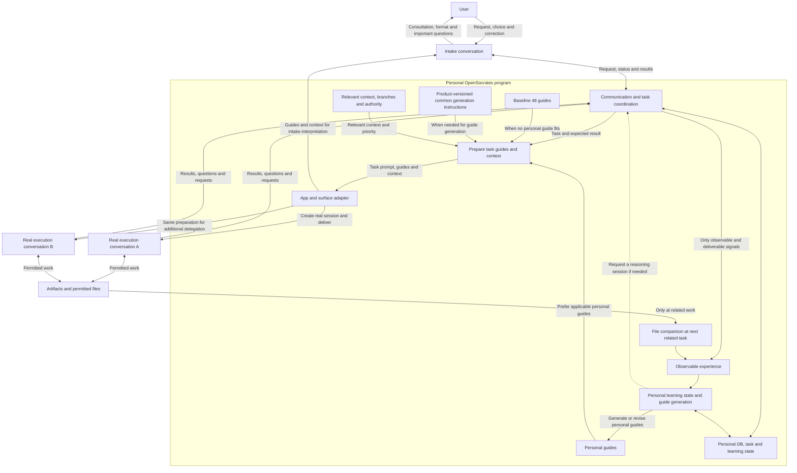
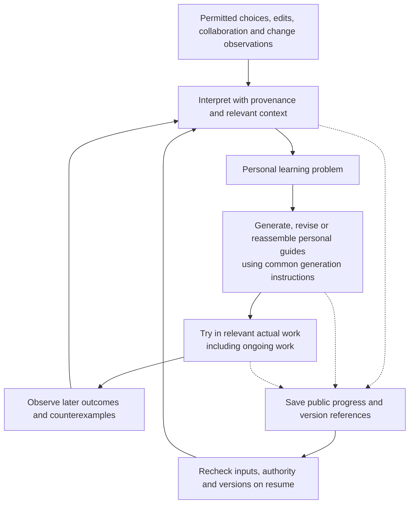

# OpenSocrates 2.0 system design and data flow

Status: development design reflecting the owner interview on 2026-11-02. This document does not establish implementation, host support, or learning effectiveness. Follow the [product definition](VISION_2.0.md), [validation plan](VALIDATION_2.0.md), and [start guide](README.md). Contract and state names below are implementation proposals to review before adding canonical schemas.

## 1. Implementation boundary

OpenSocrates 2.0 has a program and personal database running on one computer. It connects real conversations in existing apps, supplies task-specific prompts, reasoning guides and context, and develops personal guides from work experience.

The initial targets are the ChatGPT desktop app and Claude desktop app on macOS and Windows. Distinguish Chat, Work and Codex as surfaces inside the ChatGPT app rather than separate desktop products. For Claude, record the account's actual unified experience, Chat/Cowork/Code surface and local/cloud execution location. Sharing an app does not establish equal integration capabilities. Grok Bot, Cursor and other hosts, and synchronization between computers are outside the initial scope.

Do not call model-provider APIs to build a separate agent execution environment. Design reasoning-dependent coordination, guide generation/reassembly and learning judgments to use supported conversations in existing apps too. The local program owns connections, storage, state, authority and delivery. The implementation language, database engine and model-selection policy remain undecided. An embedded transactional database such as SQLite is a candidate to compare, not a selected technology.

Investigate existing host integrations first. When screen interaction is needed, use host-provided computer use or reviewed open-source tools. Do not make arbitrary modification of private app APIs, configuration or conversation databases a supported integration contract. Registering a skill or connector is distinct from evidence of message delivery, reading and application.

## 2. Session and program responsibilities

| Component | Responsibility | Implementation boundary |
| --- | --- | --- |
| Intake conversation | Clarify intent, artifact and format; prepare the task prompt; request guides/context; obtain user confirmation for important decisions; report progress and results | Delegate actual research, analysis, charts, writing and artifact integration to execution conversations. |
| Execution conversation | Perform the assigned work and return requests for help, questions and results to OpenSocrates | Do not bypass the layer to contact another session. Request additional delegation through OpenSocrates. |
| Host adapter | Check app/surface/model/session availability; create real conversations; deliver messages and observe responses; honor interruption | Use only capabilities actually exposed. Screen interaction and structured integration have different evidence boundaries. |
| Communication and task coordination | Route requests, responses, collaboration and handoffs; associate sessions and tasks; manage duplicates and pending states | All managed inter-agent communication travels through this path. |
| Guide selection and reassembly | Select applicable personal guides; request composition/reassembly when useful; provide baseline fallback | Do not inject every personal guide. Guide count and context-delivery size are separate concerns. |
| Context management | Supply relevant user/project/task/time/branch/version information and priority | Separate past/current facts, hypotheses, user choices and authority. |
| Background learning | Identify learning problems; generate, revise, try and reconsider personal guides | Do not rewrite common generator instructions. Routine changes are quiet; important decisions retain the user-confirmation boundary. |
| File management | Connect execution sessions to permitted artifact reads, creation, editing, organization and version choices | Do not monitor every folder continuously. Metadata does not establish an author's identity or intent. |

Do not create a fixed role inventory or role-specific `AGENTS.md` files. Each task prompt makes that job's purpose, expected result, relevant boundaries and completion judgment clear. The communication contracts below connect program data; they are not a role Harness prescribing personas, job titles or fixed work procedures.

## 3. Work data flow

1. The user makes an ordinary, potentially incomplete request in the intake conversation. OpenSocrates uses the minimum available request/context to prepare and deliver applicable guidance to intake for interpretation and consultation too. To avoid a bootstrap loop requiring complete intent before choosing guidance, design a path starting from available initial guides or narrow context and reselecting when needed. When a current user choice is confirmed, preserve it over earlier guidance or past-task choices. Choose guidance appropriate to intake interpretation and consultation rather than artifact production. If actual injection is unavailable, disclose that state. Intake establishes purpose, audience and format and discusses choices only when needed; it does not redirect a settled choice.
2. The intake conversation prepares the task and expected result. The program supplies relevant guides, context and authority to a real execution conversation. If guide reassembly is needed, that work may also be delegated to a separate conversation.
3. The execution conversation performs the work. It requests assistance through OpenSocrates, which selects a suitable app/model/session and repeats the guide/context preparation path. The intake conversation need not manually relay every exchange.
4. Artifact integration and substantive checking are performed in execution conversations. The intake conversation receives result references and confirmation status for the user. A completion report and confirmation that the file actually exists are distinct observations.
5. Only permitted information from user choices and observable work experience becomes learning input. Do not retain the communication transcript as a learning log.

Prepare applicable guides and needed context for every conversation making judgments, including intake, execution, reassembly and learning. A separate learning/generation conversation receives the full product-versioned common generation instructions, or a product-defined complete module with required dependencies and safeguards, plus necessary input-guide versions. Do not treat a partially delivered instruction as complete merely because some text arrived. Even a complete module must retain the conditions against prohibited copying of raw conversations/workspace content and for preserving current settled user choices and valid authority. If those safeguards or required dependencies are not delivered, do not treat the instruction as complete; continue unaffected independent work. Do not inject every guide or force one when none applies. Distinguish selection, delivery, reading and actual use per conversation to the extent observable.

A message in transit does not prove a new guide entered the model context. Distinguish host receipt, actual guide delivery, evidence of reading/application and artifact quality to the extent each can be observed.

### Dynamic delegation and integration: one user-centered team

MoE is a **product analogy** for selecting and composing useful capabilities for a task. It does not assert that a model's expert router or weights are involved, or that quality is established. Do not create fixed personas, role-specific `AGENTS.md` files or the same standing team for every job.

An agent's characteristics for this work can be described as a composition of its actual app and conversation, verified model and tool access, present assignment, authority, delivered context branch and guide versions, rather than a fixed persona. If a host does not expose model or internal state, mark that item unknown. One task can span sessions and one session can continue later work, so do not collapse task, session, model and artifact into one identity. Whether a composition improves quality is an evaluation question.

For a report, analysis and writing may be tightly coupled enough for one execution conversation. If chart creation requires different tools or independent review of a particular part is useful, another real conversation may be requested dynamically. Each additional session receives **this assignment, the expected result, necessary material and scope, applicable reasoning guides, and current user choices and authority**. Communication and further delegation flow through OpenSocrates. Guide reassembly or final integration may also become a separate execution task when useful.

Assess available apps, models, tools and authority together with task coupling, suitability of transferring materials, observed quality, expected latency and usage, and user burden. Do not infer that a model is good at a task from its name alone. If discovery in one task changes the question in another, naive parallelization can produce the wrong result; consider sequencing or re-coordination. Parallel execution is not guaranteed to be faster or cheaper. Measure host limits, latency and retries.

Integration examines claims, sources, access to original evidence and current task scope; a reviewer session's confidence, model name or simple majority alone does not justify changing a result. Another session may incorrectly “correct” a valid number or object without access to source data. Check accessible evidence and otherwise preserve disagreement and limits. Respect the user's settled format/direction and valid authority. Session IDs and file IDs differ, as do evidence of guide delivery, artifact existence and work quality.

Evaluate value against one execution conversation and native host features under comparable material, tools, time and usage budgets. If adding sessions does not reduce errors and increases delay, usage or intervention, that task lacks evidence for extra delegation. This is an evaluation hypothesis, not evidence of implementation or quality improvement.

**Synthetic delegation example.** Suppose the report's execution conversation judges a separate chart assignment worthwhile. The single task request OpenSocrates sends to a new session might say: “Plot monthly retention from the supplied synthetic cohort data. Return an editable chart and an image with axes, units and source marked. Do not invent missing periods; report insufficient data.” It concretely states the work and expected result. Deliver **guidance appropriate to that session and permitted material/context** alongside it. Preserve Word as the final report format without requiring an intermediate chart image to be a Word file.

The chart session then returns artifact references, observable sources/limits and any further requests through the layer. The execution session responsible for integration checks items such as units and consistency with source data and routes disagreements back when needed. This is an experimental illustration, not a fixed job title, evidence that a particular model is superior, successful automatic delivery or actual chart quality.

### Data contract for one job: synthetic illustration

These IDs and contents are fictional, not evidence of actual delivery or implementation. Decide final storage fields and current-policy compatibility during implementation.

| Flow | Inputs and associations | State and evidence distinctions |
| --- | --- | --- |
| Intake preparation | `task=t1`, purpose=investment decision material, user choice=Word, context branch=`b1`, valid authority reference | Separate explicit user choices, agent hypotheses about audience/outline and third-party claims. `t1` is not a conversation ID. |
| Guide preparation | Applicable personal-guide versions and scope for `t1`, or an applicable choice from the baseline 48; optional separate reassembly reference | A selected ID does not establish guide delivery, reading or use. Applying a canonical procedure unchanged retains its complete conditions. |
| Delegate to a real session | `message=m1`, `task=t1`, target app and real session `s1`, one task request, expected result, relevant guides/context/decisions/authority | Handle raw message text only for permitted real-time delivery. Do not assume the program stores it in the DB. Keep host creation/delivery stages unknown if unobservable. |
| Delegate a chart | `s1` requests via the layer → child task `t2`, message `m2`, real session `s2`; `t2` is chart work | Word is the final report choice, not a requirement that an intermediate chart image be Word. `s2` and the chart file have different identifiers. |
| Result and integration | File reference `a2` for `t2` and verifiable source/status return via the layer to the `t1` execution conversation | File existence, guide receipt, numerical accuracy and final usefulness are separate observations. Do not invent completion if there is no return path. |
| Correction and learning | If the user changes structure during work, deliver the updated valid decision where applicable and consider the experience as a personal-learning candidate | Leave in-flight application pending when delivery is unavailable. A settled instruction for this job is not automatically a global preference; guide generation and effect also differ. |

## 4. Guide generation, selection and reassembly

### Three guide-related assets

| Kind | Who changes it | Lifetime and use |
| --- | --- | --- |
| Baseline 48 reasoning guides | OpenSocrates canonical content and release management | Used at initial installation and when no appropriate personal guide exists for the task. |
| Common guide-generation instructions | OpenSocrates version updates | Shared foundation for all users; personal learning does not rewrite it. |
| Personal generated guides | That user's learning logic | Develop from actual experience. No fixed guide-count limit; relevant portions are selected per job. |

A personal guide version links the generator version, input guide versions, scope and permitted evidence references. Design migration so a product update does not overwrite or regenerate every personal guide without grounds. If the generation module and safeguards used cannot be identified, retain unknown lineage rather than claiming current complete instructions were followed. Do not automatically delete or regenerate all existing guides. Separate ownership and storage for baseline and personal guides. Personal guides are user runtime data; they do not overwrite canonical repository content or generator instructions.

### Selection path

1. Find personal guides applicable to the current request's purpose, project, work type, audience, time and authority.
2. Prefer applicable personal guides. Select, combine or reassemble several when useful; mere concatenation is not required.
3. When no appropriate personal guide exists, use applicable guides from the baseline 48. If none fits, continue ordinary work without forcing an inapplicable method.
4. When a personal guide fits only partly, judge whether to use its applicable part, combine/reassemble it with baseline guidance, or use baseline fallback because suitability is insufficient, according to context and required conditions. Do not always choose the baseline for implementation convenience when a personal thinking direction actually fits. Evaluate the selection policy without presenting one route as an already-settled owner decision.
5. Learning logic judges whether a reconstructed guide is task-local or worth retaining as a reusable personal guide. Storage does not establish effectiveness or permanent adoption.

When applying an existing canonical procedure from the baseline 48 unchanged, preserve its full procedure in the task locale, required dependencies, contraindications, stops and public outputs. Do not represent an excerpt or a reassembled result as a complete read and application of the canonical procedure. A newly reassembled personal guide is a distinct artifact whose provenance and required conditions need review; changes to canonical methods require separate product review and versioning. This preserves the current contract for existing procedures, not a commitment to freeze the 48 forever.

If an applicable baseline canonical procedure and its required dependencies cannot be delivered/read in full within the host's input limits, first investigate a supported canonical retrieval path. If multiple independently applicable procedures together exceed the limit, a candidate is to check their suitability and dependencies and deliver each complete procedure to an appropriate separate real session. If a reviewed reassembled guide is used, do not label it as full application of the canonical procedure. If these routes are unavailable or unsuitable and the complete procedure remains unavailable, record a state such as `procedure_not_fully_delivered` and do not claim canonical application succeeded. Preserve any required stop condition from a method already applied, and continue ordinary work without forcing a method when possible while disclosing the limit. If there is no execution conversation, intake does not produce the artifact instead.

Growing the guide collection does not mean injecting the whole collection. Separate relevance retrieval, scope and delivery budgets. Instead of imposing an arbitrary fixed guide-count ceiling, measure and disclose storage, retrieval latency, duplication and retirement constraints. Do not assume retrieval requires an external embedding API.

## 5. Proposed personal-data and communication contracts

Implement canonical schemas under `schemas/source/`, runtime code under `src/opensocrates/`, and generated outputs through the existing generation process. The following are minimum identity/linkage proposals, not an instruction to persist every message body.

| Contract | Proposed fields | Meaning |
| --- | --- | --- |
| `HostEndpoint` | endpoint ID, app/version, OS, surface, local/cloud location, available operations, model-selection capability, trust state, probe evidence | App identity alone does not establish session creation, injection or response retrieval. |
| `TaskRecord` | task ID, project/branch IDs, intake session ref, execution session refs, goal summary, artifact refs, authorized scope ref, status, revision | Identify work separately from conversations; a task may span several sessions. |
| `DispatchEnvelope` | message ID, task ID, sender/destination, parent message ID, retry identity, guide/context version refs, authority ref, expiry | Associate task prompts, guides, context and results. Handle sensitive payload only as needed for permitted host delivery. |
| `ContextRecord` | context ID, scope, branch/version/parent refs, source ref, timestamp, freshness, accepted/proposed/observed status, authority | Recency alone does not change user intent or authority. Changed sources reopen affected facts only. |
| `GuideVersion` | guide ID/version, baseline/personal kind, scope, generator version, full-or-module manifest, module/safeguard revisions, input guide refs, permitted evidence refs, hypothesis/active/retired status | Separate ownership of personal guides and common instructions; distinguish the version delivered from the observed status of actual use. |
| `LearningCheckpoint` | learning ID, question summary, input event IDs, public progress state, pending application refs, versions, revalidation need, revision | Track learning interruption/resumption without retaining private reasoning or raw conversation. |
| `ArtifactRecord` | artifact ID, permitted location ref, type, project/branch/task refs, fingerprint, observed timestamp, existing version ref | Distinguish what is known about moves/new files; metadata does not prove intent. |
| `AuthorityRecord` | authority ID, user/host origin, scope, allowed effects, limits, expiry/revocation, pending-confirmation state | Agent outputs and prior records do not create new user authority. |

Interpret host session IDs with their app/account/surface scope. Avoid unnecessary account identifiers in local records. Do not create an unvalidated global recipient broadcast or a default context containing every project.

## 6. Communication, concurrency and recovery

Track requested delivery, attempted transmission, host receipt, observed response and artifact confirmation separately. If a host provides no receipt, retain an unconfirmed state such as `sent_unconfirmed`. Clicking a screen control is not evidence of acceptance or completion.

Design task/guide/context writes around database transactions and version preconditions. Concurrent guide updates preserve both proposals and their grounds instead of silently using the last write. An outbox coupling pending delivery and state updates is an implementation candidate. Do not assume the database can atomically commit effects in external apps.

Retry identities can reduce duplicates inside OpenSocrates but cannot guarantee exactly-once external execution. After interruption between transmission and response, inspect the existing conversation/result first. Treat an unverifiable external effect as `effect_unknown` rather than blindly repeating it. Waiting for a user decision or host permission differs from work failure.

Immediately before committing or delivering pending guidance or messages, reconsider the current task's user choices and authority, guide version and deletion/withdrawal state, and the scope of any user-directed pause of learning, pause of use or prohibition on relearning. Interpret whether the user paused learning alone or also existing use in context. Do not automatically deliver a previously prepared pending item as newly authorized after settings change. The user may still change a choice between this check and external delivery, so do not promise atomic blocking inside another app. Attempt supported cancellation/revision for an item that may already have been sent and retain unknown status when unobservable.

When sessions share screen-control resources, design app/screen coordination and re-observe after cancellation or user input. Local app exit, sleep, offline state and updates are not permanent learning/delivery failures. Record pending work while execution is unavailable. Recovery does not assume cross-device sharing or a global cloud service.

## 7. Background learning and in-flight application

Example learning states are `observed → interpreting → candidate → pending_application → observing_outcome → revised/retained/retired`. Interruption and cancellation are separate states; resume restores the last confirmed stage and unresolved effects. This is not a selected RL algorithm or a validated adoption rule. Absence of edits, silence, or agreement among agents does not by itself establish success.

Applying learning to related ongoing work remains a product goal. Writing a new local database version is different from changing an already running model's context. Use actual adapter-supported entry points such as a subsequent message, tool call or session continuation, and track the version received when receipt can be observed. Leave receipt or use unknown when it cannot be observed. If no entry point is available, retain `pending_application` and do not claim live application. Do not remove the in-flight requirement merely by freezing versions.

Avoid a feedback loop that treats guide generation, delivery or repeated model self-report as new independent user experience and repeatedly reinforces the same hypothesis. Link permitted input-event and guide-version lineage and deduplicate retries of the same event. Several agents repeating one source are different from new evidence. Conversely, genuinely new observations, such as a numerical correction checked against an independent source, are handled according to their provenance and certainty. Design progress conditions and resource budgets so learning sessions do not continually create one another without a new signal or relevant work.

Judge compatibility with the work's audience, purpose and current user choices before applying a change. Distinguish general preferences from project-specific edits, external changes, another author's changes, expression changes and actual error corrections. An ambiguous signal may remain a scoped, unverified hypothesis rather than a strong personal preference. Reward, adoption/retirement, regression detection and compute budgets are decisions to investigate through the validation experiments.

Consistent with the product direction of personalization without an explicit learning command, consider an initial configuration that runs learning automatically when a genuine first install is established. The user can pause or change it; retain only permitted minimal settings. Test how first install is distinguished from loss or corruption of an existing setting. Separate the state of user-disabled or paused learning from the work itself. Whether the user's instruction pauses only new learning or also use of existing personal guides depends on the actual words and context. Do not automatically re-enable explicitly paused learning on restart or login. Attempt to cancel in-flight learning where the host supports it and prevent already-sent inputs or late results from silently reactivating it; leave cancellation and delivery unknown when unobservable. If the user has said not to retain late learning results, do not store the result body in the DB, logs, retry queue, index or backups. When authority or policy does not permit retention, do not assume a pending body is stored by default. Do not send that result again to a learning conversation if resending it or host-side retention would violate the user's prohibition or policy. Use only permitted minimal state for cancellation and deduplication. Separately assess whether transient processing is allowed and what the host retains independently. Pausing is not automatic deletion. If the user later enables learning, recheck permitted input, current authority and guide versions. The precise scope of the user's choice and actual host behavior require implementation and testing. One candidate is to associate the learning-setting revision with each request and revalidate late results, so re-enabling learning does not automatically treat an earlier paused request as newly authorized. Permission to retain state records and result bodies is assessed separately. A minimal setting needed to honor the user's instruction to turn learning off may be retained without learning content if the actual scope of the prohibition permits it. If the user forbids or deletes even that setting, do not assume the state is retained. Do not silently reactivate learning based only on a guess when a prior pause or corrupt settings are established on restart. A technical path to distinguish first launch from prior disabling when no persistent cue exists still requires separate design and validation. Stop affected learning when necessary deduplication/resumption control becomes impossible, and check whether any permitted setting can preserve the prohibition across restart. Do not stop all unrelated user work.

The choice when install, prior pause and recovery state genuinely cannot be distinguished remains open. Automatically starting learning by default helps a new user but cannot recover an earlier user's choice to stop. Holding only learning reduces the chance of violating a prior pause but may delay a new user's automatic learning. Starting and displaying a notice still does not technically restore a previous stop. First test whether permitted minimal settings or installation evidence can distinguish the cases; explain the limitation only when outcomes materially differ, such as a user requesting complete removal of every setting while also expecting the old pause to persist. Do not present any of these alternatives as an already-settled user decision or verified behavior.

### Candidates for background execution

“Background” is the product goal of learning from available experience without a separate learning instruction and resuming after interruption. It does not require watching every folder or imply that a model always runs when the host app is closed. These are alternatives to compare, not mutually exclusive user decisions.

| Candidate | Possible responsibility | What still needs verification |
| --- | --- | --- |
| Attach to an active app conversation | Interpret observable corrections and collaboration signals from current work and attempt application to relevant work | Whether that surface allows program calls and in-flight redelivery; contention with foreground work |
| Per-user local process | Queue, schedule, restart and recover permitted work/learning state and possible state transitions | Process lifetime, stop/restart, OS authority and resource use. Do not assume the process itself contains a model or can access a closed app |
| Resume on the next related task | Compare permitted fingerprints/history of related files and resume incomplete learning | Whether previous grounds can be reread and how to report changes whose contents and author are unknown |

Starting points for OS investigation include [macOS `SMAppService`](https://developer.apple.com/documentation/servicemanagement/smappservice) and [Windows Task Scheduler](https://learn.microsoft.com/en-us/windows/win32/taskschd/about-the-task-scheduler). Documentation that an OS can launch a process is not evidence that an existing AI app can create a new conversation or run inference. Test startup/shutdown settings, host authority, closed app, logout/sleep and resumption of interrupted learning on each actual OS/app. None assumes continuous monitoring of every folder. Measure scheduling frequency and power/battery impact; do not default to unconditional short-interval polling.

## 8. Context branches and file management

The context tree is a concept for returning to an earlier direction or switching perspectives. A version graph with provenance and parent relationships is an implementation candidate. Actual Git use or automatic disk checkout on a context switch has not been selected.

Preserve the current request and valid authority while selecting context by work/project/audience/time/relevance. Returning to a past perspective does not restore revoked authority or make stale facts current. Conflicting prices, dates and goals are not resolved by successful text merging. Specify priority policy and its learnable scope in the canonical contracts.

Associate execution-session file work with project/context/version references. Judge in-place edits, new versions and existing-folder organization in the work's context. Do not add an owner decision that every change requires a new file or every overwrite requires confirmation. Important decisions retain the user-confirmation boundary.

Compare recorded state with actual files at the next related task. Modification time is a signal, not proof of content change; different fingerprints computed with the same hash method establish byte differences. Exact comparison needs a readable prior version or equivalent history. Without one, retain the observed change and do not invent the difference, author or reason. Evaluate moves, renames, automated formatting and substantive edits separately.

### Worked scenario: an in-flight file and a return to earlier context

This is a design to test, not a record of observed behavior. On the current branch, execution conversation A is writing a report while the user revisits an earlier direction.

1. **Inspect versus switch:** Merely viewing an old context does not automatically change current decisions or files. If the user's words and actions sufficiently express an intent to continue work in that direction, select it without requiring a magic phrase. Ask concretely only if inspection versus switching materially changes the result and context does not resolve it.
2. **Choices and authority:** Distinguish the selected branch's goals and decisions from current facts by provenance and time. Selecting an old branch does not restore expired authority or automatically restore an old file. Carry the user's current format choice and valid authority into new work.
3. **A file in flight:** If A's write completion is observable, inspect that state and the actual file first. Otherwise do not guess completion or cancellation. Choose among editing the existing path, creating an authorized separate version, coordinating the write or waiting, according to current instructions, authority and file state. Do not repeatedly seek approval for an ordinary explicitly assigned edit, or require a new file for every direction change. If a competing write to the same path is ongoing or its completion is unknown, do not issue a concurrent overwrite there; consider available coordination, waiting or an authorized separate version. If that exact file is essential and the conflict cannot be resolved, expose the uncertainty and consult the user on important choices. An approaching or elapsed deadline does not itself justify issuing a concurrent overwrite at the same path while the competing write remains unknown. Consider possible alternatives so a wait does not silently exceed the task deadline. If the old session may later write an older version at the original path even after a separate version is created, appropriately communicate the observable state and latest-file location so a user opening the old link is not misled. Track delivery and receipt of that notice separately; do not record that the user knows the location if the notice failed or is unconfirmed. Do not assume the program can control a concurrent host write.
4. **Result attribution:** Link task ID, session ID, file ID and the relevant decision/context versions separately. If an earlier-direction result arrives late, do not confuse it with the current result; retain its potentially stale status. Whether a usable file exists and whether it reflects the new decision are separate checks. Do not say a new choice was applied when that is unconfirmed.
5. **External changes:** At the next related task, compare permitted previous and current fingerprints. Different hashes from the same method establish different bytes; equal hashes are evidence consistent with equal bytes but cannot absolutely prove it due to possible collisions. Neither establishes author, intention or fitness for the task. Without previous content or permitted history, do not invent the actual change.

Evaluate usefulness and burden after switching, preservation of existing files, and accuracy of pending/stale indications together. File names or the number of new versions do not alone establish success.

## 9. Retention, authority and trust boundaries

Follow current `AGENTS.md`, `CONTRIBUTING.md` and `SECURITY.md`. This plan does not authorize collection/retention of raw prompts/conversations, screenshots, workspace content, credentials, private reasoning or telemetry. Debug logs, retry queues, database backups and derived indexes must not become retention workarounds.

Separate reading content for permitted real-time work or delivering a task prompt to a host from duplicating that raw content into OpenSocrates permanent storage. First design a path retaining only permitted public decision summaries, source/version/artifact references and necessary state. Inspect personal guides for copied secrets or source text too. Calling information derived does not establish compliance.

If full file snapshots or permanent conversation copies are needed, propose a separate policy decision describing exact data, purpose, lifetime, deletion and consent. Until then, refer to accessible version history already managed by the user/host or provide change detection only. Define inspection, correction, pause, deletion and rollback so quiet learning is not inaccessible or uncontrollable learning. Retention defaults and initial enrollment remain undecided.

Preserve the provenance of user instructions, host policy, agent requests and external documents. Instructions in files or peer messages are not user authority. Discovering a learning problem does not authorize changing common generator instructions or security boundaries. Distinguish the goal of routing all managed communication through the program from a claim of controlling every host-internal action. Do not label an unobservable or uncontrollable surface fully supported.

A user's direct change in an execution conversation differs in provenance from an agent in that session reporting “the user said this.” If the host reliably exposes message authorship, the scope and time of the actual user instruction can be recorded. When an explicit format or scope change for this task is confirmed through that path, update the current task choice and carry it into relevant subsequent delegation. This update does not automatically become a global preference or new authority. If only the model's report is available and authorship/content cannot be independently checked, treat it as an unconfirmed signal, not new user authority automatically. An instruction the user gave directly in that worker can validly guide that worker, but forwarding it to other sessions or revising important authority/decisions requires judging observable provenance and consequence. If no verification path exists, expose pending/uncertainty and ask only when the important choice requires it. This does not impose repeated approvals on every task. Within its already-authorized work and scope, a worker may adjust a subtask specification, and a model-reported change may be considered as a scoped learning candidate with its provenance and uncertainty. Neither becomes a confirmed user choice or new authority. When it conflicts with an already settled decision or materially changes outcomes outside the scope, check available provenance and the user's intent. For example, if the settled choice was a three-page Word document and a worker reports a user change to four pages without verifiable authorship, the report may be forwarded to related subtasks as a provenance-labeled provisional change within existing authority. Integration must not automatically revert the four-page output or declare a violation by treating the old three-page choice as the confirmed latest decision. Preserve the unresolved conflict and check observable user instructions when the outcome materially differs. A provisional report does not automatically extend to other tasks or create new authority.

### Local storage and retrieval candidates, and boundaries to verify

[SQLite](https://www.sqlite.org/about.html) is an embedded transactional store that does not require a separate database server, making it a **candidate for comparison** on one computer. Versioning guide bodies and metadata together in one database reduces separate file/DB commits. Making separate guide files canonical can support direct inspection and editing, but requires recovery from file/DB conflicts and interruptions. Separate files are retention too: review each guide, metadata item and reference against current policy in either option. Calling text a “personal guide” or “abstraction” does not eliminate raw-source reproduction or sensitive-data risk. The canonical location and database engine are not decided.

SQLite's [WAL documentation](https://sqlite.org/wal.html) explains that reads and writes can overlap but there is only one writer at a time. Candidates include coordinating short state writes in the local program and detecting concurrent updates with version preconditions, without holding a write transaction while waiting for a model or external app. Measure latency, starvation, conflicts and recovery under actual load. Atomic database updates do not make external session creation, message delivery or file writes atomic.

The [WAL and temporary-file documentation](https://www.sqlite.org/tempfiles.html) says `-wal` can remain after an unclean shutdown. The [SQLite `secure_delete` documentation](https://www.sqlite.org/pragma.html#pragma_secure_delete) does not guarantee that the ordinary-table setting removes FTS5 index traces. [FTS5's separate `secure-delete`](https://www.sqlite.org/fts5.html#the_secure_delete_configuration_option) has version-compatibility implications. Design the data boundary so prohibited raw material is never written to the DB, error strings, indexes, temporary files or backups. Separately test deletion of permitted personal data across DB, WAL, indexes, product backups and OS backup/sync boundaries. A setting, checkpoint or single-string scan does not guarantee complete physical-media erasure. Recovery, deletion and native host memory are separate boundaries.

A provisional deletion sequence **separates logical removal from residual cleanup**. Commit DB changes that remove or deactivate product-managed entries and prevent pending work from reviving them; if needed, subsequently attempt checkpointing and cleanup of indexes and product backups as separate stages. With an open transaction on the same connection, [checkpointing may return locked without being attempted](https://www3.sqlite.org/matrix/ev/src/main.html). If other readers, interruption or failure prevent cleanup, do not promote it to completed; keep pending, failed and retry states. This is a candidate before validation, not a promise that OS backups, synchronization, storage media or native host memory were erased. In a temporary synthetic DB using Python SQLite 3.53.4 on macOS on 2026-11-03, `wal_checkpoint(TRUNCATE)` returned `database table is locked` during an open write transaction and a successful status after rollback. This narrow local observation does not validate product deletion or recovery.

An old read snapshot can continue to see a deleted guide or delay residual cleanup while waiting for an external app. Consider avoiding long read and write transactions across external waits, and recheck current guide versions and deletion/withdrawal status immediately before committing or delivering results. That recheck alone cannot guarantee deletion for derived candidates without traceable provenance, content already sent to a host, restoration from an old backup, or independent native host memory. Define observable cancellation, recovery and unknown states separately and test whether older pending work or backups revive deleted content. Distinguishing a deleted guide from a similar candidate produced later by independent new experience needs further design. In a temporary synthetic DB on the same macOS/SQLite 3.53.4 environment, a read transaction begun before a deletion continued to see the old row after another connection committed it; `TRUNCATE` checkpoint returned busy until the reader ended, then returned success. This is a limited SQLite observation, not evidence that 2.0 recovery works.

“Do not use this in this task,” “disable this guide,” “delete it,” and “never learn or apply similar approaches again” are not the same request. Interpret intention and scope in context, explaining the distinction and asking only when materially different outcomes remain unresolved. Blocking an existing guide ID differs from preventing a similar idea from being generated in different words. Preventing semantically similar future candidates may require retaining and comparing some representation of the prohibited scope; review whether that representation is itself information the user wanted deleted or otherwise forbidden, and whether the function and authority permit it. Do not promise a hash blocks all semantic equivalents or deletes native host memory. If complete forgetting conflicts with preventing similar future relearning, respect the user's choice without concealing the unresolved boundary.

For example, if a user deletes `g1` and asks that its approach not be applied again, but `g1` contributed to `g3` reassembled with two other guides, removing only `g1` from a list may not suffice. If permitted lineage remains, consider finding affected `g3` and pending work, then removing/reassembling the relevant portion or holding it. If provenance is incomplete, do not automatically delete legitimate unrelated portions or assert that prohibited content is gone. If lineage contains only IDs and the deleted `g1` body is unavailable, the ID alone cannot identify which `g3` text it influenced. Do not secretly restore deleted material from backups or invent its meaning for comparison. A candidate reassembled only from remaining permitted inputs does not automatically prove the prohibited meaning is absent. If the user explicitly prohibited future use of the approach and its influence on a known derived guide cannot be judged, hold actual application of that affected guide until it can be checked or revised. Interpret plain deletion and future-use prohibition according to the user's words and context. Attempt to revise or cancel already-delivered content only where the host supports it, preserving unknown states. This is a case to validate, not current behavior or a guarantee against every semantic reappearance.

Separate exclusions imposed by authority and explicit scope from relevance judgment inside that boundary. Do not categorically exclude an allowed general-purpose personal guide just because it came from another project. Compare structured scope filters, lexical retrieval over permitted data and semantic judgment in existing app conversations with inspecting all candidates at small scale. Design a re-query path when filtering misses relevant candidates. [FTS5](https://www.sqlite.org/fts5.html) trigram substring matching has limitations for queries shorter than three characters, and lexical search alone does not guarantee synonym, Korean morphology or semantic relevance. An index is another data-retention surface requiring policy review.

On 2026-11-03, a small local **in-memory DB** probe using Python's SQLite 3.53.4 on macOS found trigram `MATCH` returned 0 for `형식` and 1 each for `보고서` and `한국어`; unicode61 `MATCH` did not match `외부` to `외부의`. This small investigation does not establish retrieval accuracy on other versions, Windows or a large personal-guide collection, or product behavior. Evaluate recall of relevant guides, false candidates, latency and retention/deletion together on synthetic cases by scale and language.

## 10. Required host investigation before implementation

Investigate and record each item by app, OS, surface, account and version. All remain unverified as 2.0 implementation capabilities.

| Probe | Required observation |
| --- | --- |
| Create/find conversation | Does a real execution conversation appear in the app and reconnect to the program's task ID? |
| Select model | Can the desired model be selected, does the host choose, and can the program observe that result? |
| Deliver guides/context | Does content actually enter the conversation? Is the route host-selected skill, direct message or supported tool? |
| Update ongoing work | Can new guides or important context actually reach a working conversation? |
| Return path | Can OpenSocrates observe results, questions and additional requests and correlate them to the task? |
| Computer interaction | When structured capabilities are absent, does existing computer use/open source work? What happens with concurrency and user interruption? |
| Local service connection | Can this surface connect to the local program? Does cloud execution require a separate path? |
| Authority/cancellation/failure | Are host approvals, limits, errors, account expiry, retries and interruption observable? |

Do not silently substitute private app database modification, unauthorized access expansion or model-API execution when a surface lacks a capability. Continue possible preparation and accurately report unavailable delivery, pending application or unknown support. A successful app/OS cell does not pass the other cells.

### Connection candidates and the excluded alternative

| Route | Observation and current judgment | What remains unproven |
| --- | --- | --- |
| Tools exposed by a host | [ChatGPT MCP guidance](https://learn.chatgpt.com/docs/extend/mcp) distinguishes local MCP on the same Codex host from hosted Work, and [Claude connector guidance](https://support.claude.com/en/articles/11725091-when-to-use-desktop-and-web-connectors) distinguishes local extensions, remote connections and surfaces. Check actual authority and exposure. | A program call alone does not establish creation of another real conversation, messaging, result receipt or in-flight update. Observe each account/version/OS. |
| Existing computer use and reviewed open source | The user has identified this as a candidate. Design observation of the target app and current user input, with conflict and interruption handling. | Screen identification, actual interaction, concurrency, accessibility, user interruption and result attribution by surface. A click is not a receipt or quality proof. |
| SDK/server executing a model in a separate app | The [Codex platform guide](https://developers.openai.com/blog/codex-as-a-platform) describes SDK/server paths by which an application can start and maintain its own tasks. This is relevant technical information, but do not silently adopt a separate agent application or model execution that the user has excluded from current scope. | The assumption that it is identical to a real user-visible conversation in an existing desktop app, or that the user has approved a scope change. |

Where an authorized path is unavailable, surface that path's limits and unknown status. Do not categorically prohibit computer use or use it to bypass host approval/access controls. Do not generalize one surface's connectivity to all four combinations.

## 11. Installation, updates and migration

The initial program and adapters inspect existing 1.x settings and disabled state and install only into owned locations. Bind common generation instructions and baseline guides to product versions; version the personal-guide/context storage format separately. Product updates need migration and recovery ordering that avoids leaving ongoing sessions and learning in a partial state.

Decide language, database engine, package format, update defaults, minimum OS versions and CPU coverage through platform investigation and implementation decision records. Do not treat the old Go draft or withdrawn v1.5 memory candidate as the implementation baseline. In particular, do not copy code/guides from the candidate prohibited by repository governance. Installation, signing, reinstall and rollback claims require evidence from their actual environment.

### Coexistence of personal guides and the 1.x controller

The current 1.5.3 controller treats user files and tool outputs as data rather than trusted higher-level instructions, and requires a complete canonical read when applying an existing method. How that boundary coexists with actual use of 2.0 user-specific guidance in sessions is not yet verified. Do not label a personal guide as an existing 1.x canonical method, or predetermine that it must all be excluded merely because it is not one of the 48.

Maintain the existing canonical-method input contract of the 1.x selector. Do not insert unverified personal guides into that selector disguised as 1.x canonical methods. Supply 2.0 personal guidance as thinking direction through a new controller/connection contract; any later change to the existing selector requires separate canonical and trust-boundary review. This is not a rule forbidding personal-guide use.

The 2.0 distribution design must define controller/host contracts distinguishing product-managed common generation instructions, personal guides belonging to the user and their permitted scope, third-party data and user authority. A personal guide can offer context-appropriate thinking direction, but its content and source material do not become system instructions, user authority or host approval. Design and test replacement/coexistence/upgrade with 1.x separately while respecting existing settings and disabled state. If a host cannot deliver and interpret the new trust boundary, leave that capability unverified.

## 12. Working draft of the common guide-generation instructions

This is a **development draft** from the meeting, not a shipped prompt or canonical method; its effectiveness is unverified. Product versions own the common instructions; personal learning does not rewrite them.

1. Examine whether the experience suggests a user choice, work fact, one-off external condition, quality correction or collaboration signal. Leave author, reason and generality unknown when unsupported. Do not confuse facts, current-task constraints or authority with a personal guide.
2. When there is a reusable approach, express **what to consider or how to approach the situation**, and why. Work and task type, collaboration, decisions, file management, explanation and context-dependent preferences are eligible. Do not label the person with a personality type or reduce the guide to a prohibition list or fixed role.
3. Associate observed scope, applicable conditions, known exceptions and uncertainty, permitted evidence references and their availability, generator revision and input-guide versions. Missing counterexamples are not positive evidence; do not invent them or make counterexamples and long observation universal prerequisites for candidate creation.
4. Try relevant candidates quietly in real work, including ongoing work where applicable. Preserve uncertainty in weak generalizations and assess relevance and context before applying across projects. Silence for a fixed number of uses is not success or promotion. Negative experience or new user choices may narrow, revise or retire a guide.
5. Combining or reassembling guides preserves the user's settled format, purpose, scope and valid authority for the current work. Guidance creates no new authority; do not apply it when irrelevant or conflicting. When no personal guide fits, use an applicable guide from the baseline 48; continue ordinary work if none fits.
6. Inspect guide text and references for copied raw conversations, workspace content and secrets. The label “abstract” does not establish retention permission. If a pre-storage check fails or its scope cannot be confirmed, do not label the candidate as verified safe; judge retention and application of the affected candidate under policy and remaining evidence. Do not expand that failure into a halt of intake consultation or all unrelated work. Validate the checker using synthetic positive controls and record detection limits. If input disappears and no sufficient permitted evidence remains, do not invent it; mark the dependent learning `input_unavailable`. Separately assess work still supported by remaining permitted evidence.

**Synthetic illustration:** A user asks that a report for an external decision-maker lead with the decision. A candidate might say: “For an external decision report, first identify the reader's decision, then organize the evidence needed for it.” Try it in the relevant work and assess relevance elsewhere. Preserve the user's Word choice for this task. Do not transfer it unchanged to an audit procedure where process itself matters. This is a design illustration, not evidence of benefit.

**Another synthetic illustration — direction of thought:** While reviewing an order quantity, a user corrects the work: “Do not just use average sales; consider a delayed launch too.” A candidate might say: “For an ordering decision with substantial uncertainty, before treating the average forecast as the answer, examine key assumptions that could change the decision, plausible alternative situations and gaps in the evidence.” This concerns which assumptions and alternatives to examine, not a fixed output format. Preserve observed scope and uncertainty rather than deciding whether this is a one-off delay, a work-specific risk practice or a general user preference. Do not force scenarios into unrelated determinate work. Test its actual effect separately from a same-information fact note.

### Distinctions needed for learning: draft data contract

These candidate fields explain the design; they are not a canonical schema or a determination that actual storage is permitted under current policy. Review the need and permission to retain each field, reference and guide body before implementation.

| Stage | Distinction needed | Example of an invalid promotion |
| --- | --- | --- |
| Observation | Signal type, known origin, task and time, current authority, accessible grounds and uncertainty | Record a change potentially made by another person as the user's personal preference |
| Interpretation | Distinguish this task's instruction, work fact, external condition and candidate reusable approach; retain plausible attribution alternatives | Treat one investor's request as an established preference of all investors and all work |
| Generation | Associate applicable situation, thinking direction and purpose, known exceptions, draft version, grounds and confidence limits | A non-actionable “do better” instruction or a guide reproducing raw source text |
| Selection and reassembly | Current work and user choices/authority, personal-guide relevance, baseline-48 fallback, conflicts and delivery scope | An old personal guide changes the output format the user has just chosen |
| Application and experience | Separate candidate creation, selection, delivery, reading, actual use and result evaluation; mark unobserved stages unknown | Treat ID delivery or model self-praise as actual use and success |
| Reconsideration | Examine later corrections, quality signals, conflicting interpretations and related/unrelated work; retain, revise, rescope or retire | Count the same self-report repeatedly as independent evidence or silence as success |

Do not establish one of several conflicting interpretations solely because it is newer or more agents agree. Honor choices confirmed for the current work immediately, while judging longer-term personal-guide scope in proportion to remaining evidence and context. Distinguish important decisions requiring user confirmation from quiet trials in the actual situation. Cost and routes for model judgments, cross-host interpretation differences, and detection and recovery of negative transfer remain experiments.

## 13. Explicit unknowns in delivery and resumption

- **Who makes semantic judgments:** A design candidate has the local program manage state, authority and delivery, while existing app conversations interpret meaning, relevance, importance and reassembly. The bootstrap conversation, minimum inputs, when to open another session, and retrieval latency and usage with many guides require host-specific experiments and design. One bootstrap candidate has the already-open intake conversation judge the task while the program supplies an index of possible guides. This does not ban a separate session when it is useful. Measure index size and quality and actual session connectivity. No fixed-role agents are assumed.
- **Input lost before delivery:** A message ID and hash cannot reconstruct an unsent payload. On resumption, revalidate a reconstruction only if an authorized source remains readable; otherwise mark the unsent payload `payload_unrecoverable`, distinct from unavailable learning evidence (`input_unavailable`). An outbox does not authorize raw retention or prove a payload remains deliverable.
- **Unknown effect after delivery:** If an effect may already have happened in the app, mark `effect_unknown` and inspect available sessions/results first. Internal deduplication is not exactly-once execution in an external app. Do not blindly retry an unobservable effect.
- **Delivering settled choices:** A candidate `DecisionLock` contract tracks explicit current-task choices such as format, purpose and scope with provenance, applicability and revision, and supplies relevant choices to delegated and reassembly work. A conflicting guide yields to the user's choice; a later user change updates its valid scope. For example, Word for the final report does not require an intermediate chart PNG to be a Word document. A Word choice for this task is not automatically a global preference. Review the stored representation against current policy before implementation.
- **In-flight changes:** Separate DB version creation, message delivery, session receipt/read, actual use in work and output quality. Verify follow-up message or pull capabilities per host. If a path is unavailable or unconfirmed, leave that application `pending_application` without stopping independent learning. Distinguish checking with no change from not checking. If a pull cannot be required or observed, whether it was skipped is unknown too. A matching hash alone does not prove semantic compatibility.
- **User intervention:** Coordinate screen actions that conflict with the user's current input. This is not a blanket rule to pause independent work that does not use that screen. Distinguish already-authorized actions from new important decisions in their actual context and authority.

## 14. Product behavior when host constraints combine

These are design candidates preserving the requirements, not observations of the four app/OS cells.

1. **A new execution conversation can be created and given input:** The intake conversation consults and prepares; the new execution conversation produces the deliverable. If separate reassembly is unavailable but an existing guide fits, use it; if none fits, the execution conversation can continue ordinary work without forcing a method.
2. **A conversation exists but cannot receive an in-flight change:** Distinguish the old assignment already delivered from application of a new user choice. Do not report an output as reflecting a new choice that did not reach the worker. Keep additional delivery/delegation pending and report ongoing work and file effects only to the extent observed. Whether a subsequent session or route can carry the new choice depends on actual capability and authority.
3. **A required new execution conversation cannot be created:** The intake conversation can continue consultation and preparation but must not report that production started. Do not use repository fail-open as a pretext to silently create the deliverable in intake or call an unsupported internal branch a real app conversation. Investigate and test permitted existing computer-use or open-source options separately. If the user later changes the work mode, distinguish that choice and its result.
4. **A direction change occurs only in a worker conversation and the program cannot read the signal:** OpenSocrates does not know the change or author. A changed fingerprint or an earlier Word choice cannot establish a new preference. Do not erase the requirement to learn from nonverbal experience: investigate each host's observable events, reread paths and permitted file history for useful signals. Mark learning unsupported or unknown where there is no path.
5. **Native host memory conflicts:** Even if the program excludes a particular personal guide, the app may independently use its own memory. When it cannot be controlled or observed, do not guarantee that the preference was absent from the model's entire context. Investigate each app's memory settings, authority and retention separately, and distinguish program storage policy from data independently retained by the host. Do not assume host features can be forcibly changed.
6. **Background learning cannot execute:** Identifying pending work in the local program is different from invoking a model to make semantic judgments. When learning through an existing app conversation is unavailable or the app is closed, keep that stage pending/incomplete and recheck when possible. Do not assume a provider API is substituted; test actual entry points and scheduling by surface.

## 15. Completion criteria for this design

Documented contracts alone do not establish working behavior. Claim a feature only after the [validation plan](VALIDATION_2.0.md) supplies actual host/OS evidence for delivery, separate execution conversations, guide selection/reassembly, in-flight application, learning resume, file comparison, authority, deletion and failure cases. Evaluate work-quality improvement separately from delivery. Attach unresolved policy, host and learning-signal questions to their dependent features rather than turning them into global conditions blocking unrelated research or documentation.
